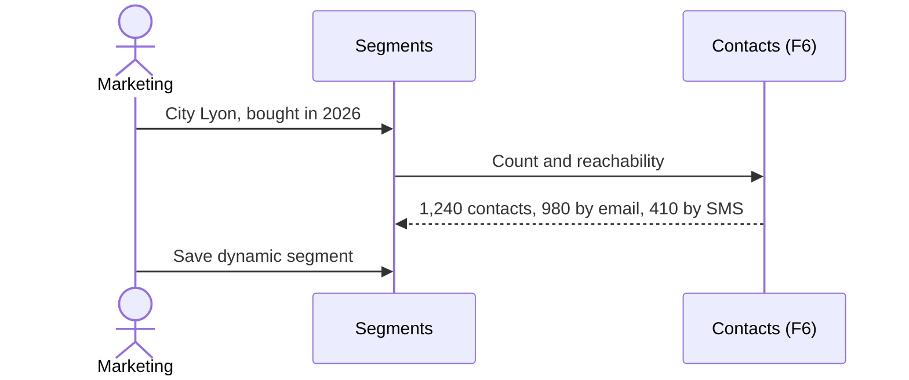

🏠 [Specs](../../../../README.md) › 🧩 [Functional capabilities](../../../README.md) ›
📣 [F5 Social media and marketing](../../README.md) › 📝 [Use cases](../README.md) ›
📝 [Use cases: FL-F5-06 Audiences, consent and journeys](README.md) › 📝 UC-F5-14 Build a segment of contacts

# 📝 UC-F5-14 Build a segment of contacts

**Status:** ✅ specified

## Summary

Marketing builds a segment of contacts from conditions on their records (customers who bought in the last year, members
of a city, attendees of an event) and sees how many can be reached per channel.

## Personas

- [U12 Marketing and communication](../../../../01-users/personas/u12-marketing.md)
- [U13 Owner](../../../../01-users/personas/u13-owner.md)

## Goal

Send each message to the people it concerns, and only those who agreed.

## Trigger

A campaign, a journey or an event invitation to prepare.

## Frequency

Weekly.

## Preconditions

- Contacts in F6 or in a sector record type.

## Postconditions

- **Succeeded:** the segment is saved, counted per channel, and evaluated again at each send
  ([BR-F5-09](../../business-rules/br-f05-09-segments-are-evaluated-at-send-time.md)).
- **Failed:** no segment is saved.

## Main flow

1. The marketing person opens Segments ([S-F5-14](../../screens/06-audiences-consent-and-journeys/s-f05-14-segments.md))
   and adds conditions: city, purchases, tags, events attended, lead score.
2. SimpleERP counts the contacts, and per channel those who can be reached (consent, not suppressed).
3. They preview 20 contacts to check the conditions.
4. They save the segment, static or dynamic, and use it in a campaign, a journey or an event invitation.

## Alternative flows

- 1a. The AI assistant writes the conditions from a sentence ("customers in Lyon who bought this year").
- 4a. Static: frozen at save; dynamic: evaluated at each send.

## Error flows

- 2e. No contact can be reached on the channel: the segment saves but the campaign warns.
- 1e. A condition on a field the user may not see: not offered,
  [BR-F2-25](../../../f02-no-code-configuration/business-rules/br-f02-25-field-rights-apply-on-every-channel.md).

## Business rules

- [BR-F5-09 Segments are evaluated at send time](../../business-rules/br-f05-09-segments-are-evaluated-at-send-time.md)
- [BR-F5-08 Marketing messages need consent](../../business-rules/br-f05-08-marketing-needs-consent.md)

## Entities

- [E-F5-09 Contact segment](../../data/e-f05-09-contact-segment.md)
- [E-F5-10 Consent and suppression record](../../data/e-f05-10-consent-and-suppression-record.md)
- [E-F5-18 Contact](../../data/e-f05-18-contact.md)

## Permissions

Marketing and communication; the owner reads; record rules on contacts apply.

## Notifications

None.

## Audit events

Segment created, changed, used.

## AI involvement

The AI assistant drafts texts and segments in the company style
([BR-F3-11](../../../f03-assistant/business-rules/br-f03-11-drafts-follow-the-company-style.md)); a person sends.

## API, MCP and A2A exposure

T5 operations of F5 with the caller's rights; the MCP tool of F5; no A2A skill.

## Screens

- [S-F5-14 Segments](../../screens/06-audiences-consent-and-journeys/s-f05-14-segments.md)

## Flowchart

See [FL-F5-06 Audiences, consent and journeys](../../flows/fl-f05-06-audiences-consent-and-journeys.md#flowchart).

## Sequence diagram

## Acceptance criteria

1. **Given** the example shop chain with 1,240 customers in Lyon who bought in 2026 **when** the segment is built
   **then** it shows 1,240 contacts, 980 reachable by email and 410 by SMS.
2. **Given** a dynamic segment **when** a new customer buys in Lyon on the day of the send **then** she receives the
   campaign.
3. **Given** a static segment saved on 2026-11-01 **when** a contact moves to Paris **then** she stays in it.

## Non-functional notes

Counting 100,000 contacts within 3 seconds.

## Regulatory references

Consent for email and SMS marketing
([CR-FR-063](../../../../10-country-packs/france/consumer/cr-fr-063-electronic-marketing-consent.md)).

## Related use cases

- [UC-F5-08 Run email campaigns](../05-benchmark-additions/uc-f05-08-run-email-campaigns.md)
- [UC-F5-10 Automate marketing journeys](uc-f05-10-automate-marketing-journeys.md)

## Open questions

None.

---

⬅️ [UC-F5-13](../05-benchmark-additions/uc-f05-13-turn-social-interactions-into-leads.md) · ⬆️ [Up](README.md) ·
➡️ [UC-F5-15 Record and prove consent](uc-f05-15-record-and-prove-consent.md)
