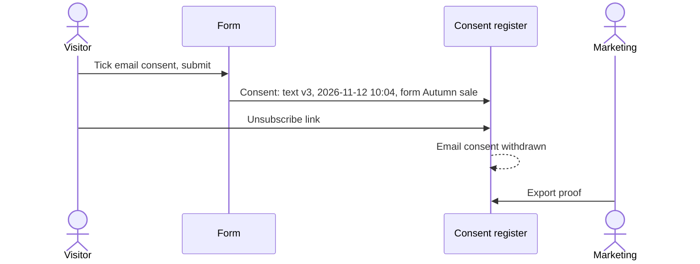

🏠 [Specs](../../../../README.md) › 🧩 [Functional capabilities](../../../README.md) ›
📣 [F5 Social media and marketing](../../README.md) › 📝 [Use cases](../README.md) ›
📝 [Use cases: FL-F5-06 Audiences, consent and journeys](README.md) › 📝 UC-F5-15 Record and prove consent

# 📝 UC-F5-15 Record and prove consent

**Status:** 🔄 waiting for the owner

## Summary

Each contact's consent per channel (email, SMS, WhatsApp) is recorded with its source, text and date, withdrawn in one
click, and shown as proof when asked.

## Personas

- [U12 Marketing and communication](../../../../01-users/personas/u12-marketing.md)
- [U09 Customer](../../../../01-users/personas/u09-customer.md)

## Goal

Prove why every marketing message was allowed.

## Trigger

A form, an import, a purchase, an unsubscribe or a request for proof.

## Frequency

Continuous.

## Preconditions

- None.

## Postconditions

- **Succeeded:** the consent register holds the contact's current consent per channel with its proof.
- **Failed:** nothing is recorded; the contact is not reachable for marketing.

## Main flow

1. A visitor ticks the consent box on a form
   ([UC-F5-19](../08-pages-forms-surveys-and-whatsapp/uc-f05-19-publish-a-landing-page-with-a-form.md)); the consent is
   recorded with the text shown, the date and the source
   ([BR-F5-10](../../business-rules/br-f05-10-consent-is-proven-and-withdrawn-at-once.md)).
2. Marketing opens the consent register
   ([S-F5-15](../../screens/06-audiences-consent-and-journeys/s-f05-15-consent-register.md)) to see each contact's
   consent per channel.
3. A contact unsubscribes from a link or replies STOP: the channel's consent is withdrawn at once.
4. On request, marketing exports the proof of a contact's consent.

## Alternative flows

- 1a. An imported list: each line must carry its source and date, or it imports without consent.
- 1b. An existing customer for similar products: the soft opt-in of
  [CR-FR-063](../../../../10-country-packs/france/consumer/cr-fr-063-electronic-marketing-consent.md) applies to email,
  with an unsubscribe in every message.

## Error flows

- 1e. A form without a consent text: it cannot be published
  ([BR-F5-14](../../business-rules/br-f05-14-forms-collect-only-what-they-declare-with-consent.md)).
- 3e. An unsubscribe that cannot be matched: the address is suppressed anyway.

## Business rules

- [BR-F5-10 Consent is proven and withdrawn at once](../../business-rules/br-f05-10-consent-is-proven-and-withdrawn-at-once.md)
- [BR-F5-08 Marketing messages need consent](../../business-rules/br-f05-08-marketing-needs-consent.md)

## Entities

- [E-F5-10 Consent and suppression record](../../data/e-f05-10-consent-and-suppression-record.md)
- [E-F5-18 Contact](../../data/e-f05-18-contact.md)

## Permissions

Marketing and communication; the owner reads; record rules on contacts apply. Contacts manage their own consent from the
links.

## Notifications

None.

## Audit events

Consent given, withdrawn, exported, with source.

## AI involvement

None: consent is never inferred.

## API, MCP and A2A exposure

T5 consent operations; imports must carry the proof.

## Screens

- [S-F5-15 Consent register](../../screens/06-audiences-consent-and-journeys/s-f05-15-consent-register.md)

## Flowchart

See [FL-F5-06 Audiences, consent and journeys](../../flows/fl-f05-06-audiences-consent-and-journeys.md#flowchart).

## Sequence diagram

## Acceptance criteria

1. **Given** a visitor ticks email consent on the form "Autumn sale" **when** she submits **then** the register holds
   the consent with the text version, date and form.
2. **Given** the same contact **when** she clicks Unsubscribe **then** she receives no further marketing email.
3. **Given** a contact who replies STOP to an SMS **when** it arrives **then** SMS consent is withdrawn.
4. **Given** a request for proof **when** marketing exports it **then** the file shows the text, date and source.

## Non-functional notes

Withdrawal applies to sends starting after it, within a minute (Proposed).

## Regulatory references

[CR-FR-063](../../../../10-country-packs/france/consumer/cr-fr-063-electronic-marketing-consent.md);
[CR-FR-196](../../../../10-country-packs/france/data-protection/cr-fr-196-legitimate-interest-balancing.md).

## Related use cases

- [UC-F5-14 Build a segment of contacts](uc-f05-14-build-a-segment-of-contacts.md)
- [UC-F5-19 Publish a landing page with a form](../08-pages-forms-surveys-and-whatsapp/uc-f05-19-publish-a-landing-page-with-a-form.md)

## Open questions

None.

---

⬅️ [UC-F5-14 Build a segment of contacts](uc-f05-14-build-a-segment-of-contacts.md) · ⬆️ [Up](README.md) ·
➡️ [UC-F5-16 Keep emails delivered](uc-f05-16-keep-emails-delivered.md)
