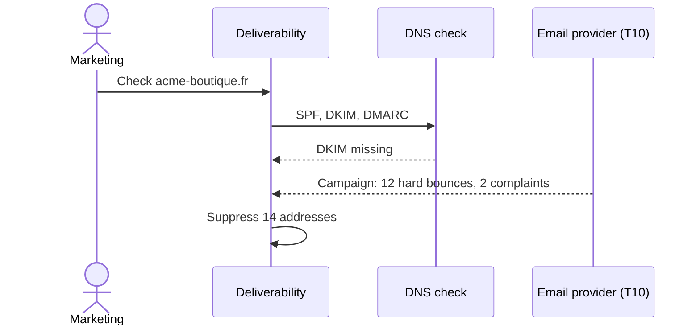

🏠 [Specs](../../../../README.md) › 🧩 [Functional capabilities](../../../README.md) ›
📣 [F5 Social media and marketing](../../README.md) › 📝 [Use cases](../README.md) ›
📝 [Use cases: FL-F5-06 Audiences, consent and journeys](README.md) › 📝 UC-F5-16 Keep emails delivered

# 📝 UC-F5-16 Keep emails delivered

**Status:** 🔄 waiting for the owner

## Summary

Marketing checks the sending domain (SPF, DKIM, DMARC), and SimpleERP suppresses hard bounces and complaints and warns
when the complaint rate rises.

## Personas

- [U12 Marketing and communication](../../../../01-users/personas/u12-marketing.md)
- [U07 Administrator](../../../../01-users/personas/u07-administrator.md)

## Goal

Emails that reach inboxes, not spam folders.

## Trigger

Setting up email sending, each campaign, a rising complaint rate.

## Frequency

At setup; then continuous.

## Preconditions

- An email sending provider set up (T10).

## Postconditions

- **Succeeded:** the domain passes its checks; bounces and complaints are suppressed
  ([BR-F5-11](../../business-rules/br-f05-11-bounces-and-complaints-are-suppressed.md)).
- **Failed:** campaigns are paused until the domain passes.

## Main flow

1. The marketing person opens Deliverability
   ([S-F5-16](../../screens/06-audiences-consent-and-journeys/s-f05-16-deliverability.md)) and checks the sending
   domain: SPF, DKIM and DMARC records, with the records to add if missing.
2. Each campaign's hard bounces and complaints are added to the suppression list.
3. Soft bounces are retried, then suppressed after 3 in a row (Proposed).
4. The screen shows the bounce and complaint rates per campaign; above 0.3 % complaints (Proposed), sending pauses and
   marketing is warned.

## Alternative flows

- 1a. In the hosted edition, F18 checks the domain it hosts.

## Error flows

- 1e. A record missing: the domain shows failing and campaigns cannot be sent.
- 4e. The provider suspends the account: campaigns pause and the administrator is told.

## Business rules

- [BR-F5-11 Bounces and complaints are suppressed](../../business-rules/br-f05-11-bounces-and-complaints-are-suppressed.md)

## Entities

- [E-F5-10 Consent and suppression record](../../data/e-f05-10-consent-and-suppression-record.md)
- [E-F5-05 Email or SMS campaign](../../data/e-f05-05-email-or-sms-campaign.md)

## Permissions

Marketing and communication; the owner reads; record rules on contacts apply. The administrator for the domain.

## Notifications

Marketing: rates above the threshold, a failing domain.

## Audit events

Domain checks, suppressions, pauses.

## AI involvement

The AI assistant explains a failing record in plain words.

## API, MCP and A2A exposure

T5 operations of F5 with the caller's rights; the MCP tool of F5; no A2A skill.

## Screens

- [S-F5-16 Deliverability](../../screens/06-audiences-consent-and-journeys/s-f05-16-deliverability.md)

## Flowchart

See [FL-F5-06 Audiences, consent and journeys](../../flows/fl-f05-06-audiences-consent-and-journeys.md#flowchart).

## Sequence diagram

## Acceptance criteria

1. **Given** the domain without a DKIM record **when** it is checked **then** it shows failing with the record to add.
2. **Given** a campaign with 12 hard bounces **when** it ends **then** the 12 addresses are suppressed.
3. **Given** a complaint rate of 0.5 % **when** it is computed **then** sending pauses and marketing is warned.

## Non-functional notes

None.

## Regulatory references

(Proposed) to read: the large mailbox providers' sender rules.

## Related use cases

- [UC-F5-08 Run email campaigns](../05-benchmark-additions/uc-f05-08-run-email-campaigns.md)
- [UC-F18-01 Build the site with the guide](../../../f18-hosted-websites-and-domains/use-cases/01-build-the-site/uc-f18-01-build-the-site-with-the-guide.md)

## Open questions

None.

---

⬅️ [UC-F5-15 Record and prove consent](uc-f05-15-record-and-prove-consent.md) · ⬆️ [Up](README.md) ·
➡️ [UC-F5-17 Set up ticketing for an event](../07-events-and-ticketing/uc-f05-17-set-up-ticketing-for-an-event.md)
