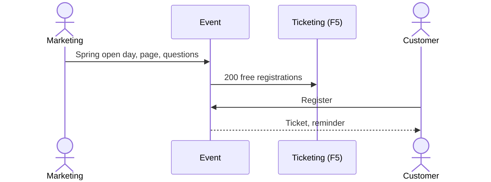

🏠 [Specs](../../../../README.md) › 🧩 [Functional capabilities](../../../README.md) ›
📣 [F5 Social media and marketing](../../README.md) › 📝 [Use cases](../README.md) ›
📝 [Use cases: FL-F5-07 Events and ticketing](README.md) › 📝 UC-F5-11 Organise events and sell tickets

# 📝 UC-F5-11 Organise events and sell tickets

**Status:** ✅ specified

## Summary

Marketing or an event producer creates an event with its page and registrations; tickets are sold through the shared
ticketing model, and attendees get reminders and a satisfaction survey.

## Personas

- [U12 Marketing](../../../../01-users/personas/u12-marketing.md)
- [U09 Customer](../../../../01-users/personas/u09-customer.md)

## Goal

Fill the event and know who comes.

## Trigger

An event to organise.

## Frequency

Per event.

## Preconditions

F5 set up for the company.

## Postconditions

- **Succeeded:** the event page is live; registrations and tickets are recorded.
- **Failed:** the event stays draft.

## Main flow

1. Marketing creates the event ([S-F5-11](../../screens/07-events-and-ticketing/s-f05-11-event.md)) with its page,
   sessions and registration questions.
2. Ticketing is set with the shared model ([UC-F5-17](uc-f05-17-set-up-ticketing-for-an-event.md)); free events use
   registrations only.
3. Customers register and pay online; they get their ticket and a reminder the day before.
4. On the day, tickets are scanned
   ([UC-F5-18](uc-f05-18-sell-at-the-box-office-and-scan-tickets.md)); after, a satisfaction
   survey is sent ([UC-F5-12](../08-pages-forms-surveys-and-whatsapp/uc-f05-12-run-surveys-and-live-polls.md)).

## Alternative flows

- 1a. Talks and speakers are proposed and selected.
- 3a. Invitations to a segment
  ([UC-F5-14](../06-audiences-consent-and-journeys/uc-f05-14-build-a-segment-of-contacts.md)).

## Error flows

- 3e. Sold out: the waiting list opens.
- 3e. Payment refused: the seat is released.

## Business rules

- [BR-F5-08 Marketing messages need consent](../../business-rules/br-f05-08-marketing-needs-consent.md)

## Entities

- [E-F5-07 Registration event](../../data/e-f05-07-registration-event.md)

## Permissions

Marketing and event producers.

## Notifications

Attendees: confirmation, reminder, survey.

## Audit events

Event published; registrations; tickets.

## AI involvement

The AI assistant drafts texts and segments in the company style
([BR-F3-11](../../../f03-assistant/business-rules/br-f03-11-drafts-follow-the-company-style.md)); a person sends.

## API, MCP and A2A exposure

T5 operations of F5 with the caller's rights; the MCP tool of F5; no A2A skill.

## Screens

- [S-F5-11](../../screens/07-events-and-ticketing/s-f05-11-event.md)

## Flowchart

See [FL-F5-07 Events and ticketing](../../flows/fl-f05-07-events-and-ticketing.md#flowchart).

## Sequence diagram

## Acceptance criteria

1. **Given** an open day with 200 places **when** the 200th person registers **then** the waiting list opens for the
   next.
2. **Given** a paid concert **when** a customer pays 32 EUR **then** she gets her ticket by email.
3. **Given** the day after the event **when** the survey is sent **then** attendees with a scanned ticket receive it.

## Non-functional notes

None.

## Regulatory references

[CR-FR-181](../../../../10-country-packs/france/tax-and-vat/cr-fr-181-ticket-vat-rates.md) for paid tickets.

## Related use cases

See [FL-F5-07](../../flows/fl-f05-07-events-and-ticketing.md).

- [UC-F5-17 Set up ticketing for an event](uc-f05-17-set-up-ticketing-for-an-event.md)

## Open questions

None.

---

⬅️ [UC-F5-10](../06-audiences-consent-and-journeys/uc-f05-10-automate-marketing-journeys.md) · ⬆️ [Up](README.md) ·
➡️ [UC-F5-12](../08-pages-forms-surveys-and-whatsapp/uc-f05-12-run-surveys-and-live-polls.md)
