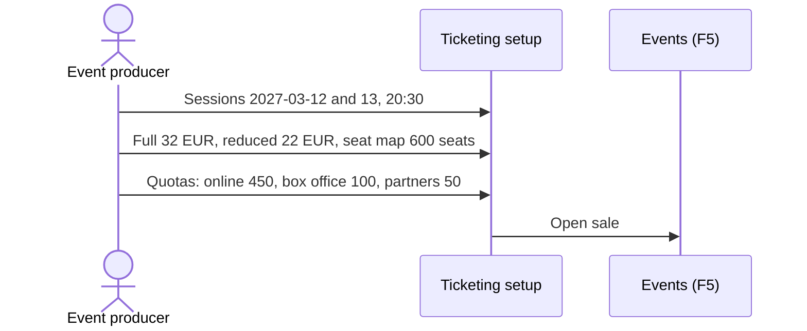

🏠 [Specs](../../../../README.md) › 🧩 [Functional capabilities](../../../README.md) ›
📣 [F5 Social media and marketing](../../README.md) › 📝 [Use cases](../README.md) ›
📝 [Use cases: FL-F5-07 Events and ticketing](README.md) › 📝 UC-F5-17 Set up ticketing for an event

# 📝 UC-F5-17 Set up ticketing for an event

**Status:** 🔄 waiting for the owner

## Summary

An event producer sets the one ticketing model of D457 on an event: sessions, ticket types and prices, quotas per
channel, a seat map with categories, and the channels that sell (online, box office, partners).

## Personas

- [U43 Event producer](../../../../01-users/personas/u43-event-producer.md)
- [U12 Marketing and communication](../../../../01-users/personas/u12-marketing.md)

## Goal

Sell every seat once, across every channel.

## Trigger

An event opens for sale.

## Frequency

Per event or season.

## Preconditions

- The event exists ([UC-F5-11](uc-f05-11-organise-events-and-sell-tickets.md)).

## Postconditions

- **Succeeded:** tickets are on sale on the chosen channels
  ([BR-F5-12](../../business-rules/br-f05-12-one-seat-one-ticket-across-every-channel.md)).
- **Failed:** the event is not on sale.

## Main flow

1. The producer opens the event's Ticketing
   ([S-F5-17](../../screens/07-events-and-ticketing/s-f05-17-ticketing-setup.md)) and adds its sessions (dates and
   times).
2. They add ticket types with prices and VAT
   ([CR-FR-181](../../../../10-country-packs/france/tax-and-vat/cr-fr-181-ticket-vat-rates.md)): full, reduced, free,
   season pass.
3. For a seated venue, they load or draw the seat map and give each seat its category.
4. They set quotas per channel: online, box office ([UC-F5-18](uc-f05-18-sell-at-the-box-office-and-scan-tickets.md)),
   partners; seats not sold by a channel's deadline go back to the common pool.
5. They open the sale; the event page shows the tickets.

## Alternative flows

- 3a. Free placement: a capacity per session instead of a seat map.
- 2a. A season pass: one ticket type gives access to several sessions.

## Error flows

- 4e. Quotas above the capacity: refused with the difference.
- 5e. No price for a ticket type: the sale cannot open.

## Business rules

- [BR-F5-12 One seat, one ticket, across every channel](../../business-rules/br-f05-12-one-seat-one-ticket-across-every-channel.md)

## Entities

- [E-F5-11 Ticket type and seat map](../../data/e-f05-11-ticket-type-and-seat-map.md)
- [E-F5-07 Registration event](../../data/e-f05-07-registration-event.md)
- [E-F5-20 Waiting list](../../data/e-f05-20-waiting-list.md)

## Permissions

Event producers and marketing; the owner reads the sales.

## Notifications

Marketing: sale opened.

## Audit events

Ticket types, prices, quotas and seat map changed; sale opened and closed.

## AI involvement

The AI assistant drafts texts and segments in the company style
([BR-F3-11](../../../f03-assistant/business-rules/br-f03-11-drafts-follow-the-company-style.md)); a person sends.

## API, MCP and A2A exposure

T5 operations of F5 with the caller's rights; the MCP tool of F5; no A2A skill.

## Screens

- [S-F5-17 Ticketing setup](../../screens/07-events-and-ticketing/s-f05-17-ticketing-setup.md)
- [S-F5-11 Event](../../screens/07-events-and-ticketing/s-f05-11-event.md)

## Flowchart

See [FL-F5-07 Events and ticketing](../../flows/fl-f05-07-events-and-ticketing.md#flowchart).

## Sequence diagram

## Acceptance criteria

1. **Given** Scènes du Fleuve's 600-seat theatre for 2027-03-12 **when** the producer sets quotas online 450, box office
   100, partners 50 **then** the sale opens with 600 seats.
2. **Given** quotas totalling 650 **when** they are saved **then** they are refused with 50 over capacity.
3. **Given** seat F12 sold online **when** the box office opens the map **then** F12 shows sold.
4. **Given** 30 partner seats unsold at the partner deadline **when** the deadline passes **then** they go back to the
   common pool.

## Non-functional notes

Seat map of 2,000 seats usable on a tablet (Proposed).

## Regulatory references

[CR-FR-181](../../../../10-country-packs/france/tax-and-vat/cr-fr-181-ticket-vat-rates.md);
[CR-FR-177](../../../../10-country-packs/france/events/cr-fr-177-show-ticket-tax.md);
[CR-FR-176](../../../../10-country-packs/france/events/cr-fr-176-performing-arts-declaration.md).

## Related use cases

- [UC-F5-11 Organise events and sell tickets](uc-f05-11-organise-events-and-sell-tickets.md)
- [UC-F5-18 Sell at the box office and scan tickets](uc-f05-18-sell-at-the-box-office-and-scan-tickets.md)
- [UC-SC16-05 Sell tickets with seat maps and price categories](../../../../08-sectors/sc16-events-and-culture/use-cases/02-ticketing/uc-sc16-05-sell-tickets-with-seat-maps-and-price-categories.md)

## Open questions

None.

---

⬅️ [UC-F5-16 Keep emails delivered](../06-audiences-consent-and-journeys/uc-f05-16-keep-emails-delivered.md) ·
⬆️ [Up](README.md) ·
➡️ [UC-F5-18 Sell at the box office and scan tickets](uc-f05-18-sell-at-the-box-office-and-scan-tickets.md)
