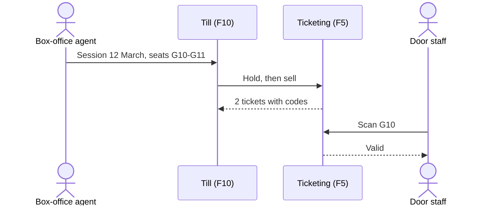

🏠 [Specs](../../../../README.md) › 🧩 [Functional capabilities](../../../README.md) ›
📣 [F5 Social media and marketing](../../README.md) › 📝 [Use cases](../README.md) ›
📝 [Use cases: FL-F5-07 Events and ticketing](README.md) › 📝 UC-F5-18 Sell at the box office and scan tickets

# 📝 UC-F5-18 Sell at the box office and scan tickets

**Status:** ✅ specified

## Summary

A box-office agent sells tickets from the shared model on the F10 till, and staff scan tickets at the door; a ticket is
valid once.

## Personas

- [U44 Box-office agent](../../../../01-users/personas/u44-box-office-agent.md)
- [U43 Event producer](../../../../01-users/personas/u43-event-producer.md)

## Goal

Fast sales on the day and nobody entering twice.

## Trigger

The box office opens; the doors open.

## Frequency

Every event day.

## Preconditions

- Ticketing is set ([UC-F5-17](uc-f05-17-set-up-ticketing-for-an-event.md)); a till session is open,
  [UC-F10-01](../../../f10-point-of-sale/use-cases/01-till-session/uc-f10-01-open-and-close-a-till-session.md).

## Postconditions

- **Succeeded:** tickets sold and scanned; the counts are live across channels.
- **Failed:** a refused ticket keeps its holder out with the reason.

## Main flow

1. The box-office agent searches the session on the till,
   [UC-F10-02](../../../f10-point-of-sale/use-cases/02-sell-at-the-counter/uc-f10-02-sell-at-the-counter.md), and picks
   seats on the map or ticket types.
2. The customer pays at the till
   ([UC-F10-03](../../../f10-point-of-sale/use-cases/02-sell-at-the-counter/uc-f10-03-take-payment.md)); tickets print
   or go by email.
3. At the doors, staff scan tickets on a phone
   ([S-F5-18](../../screens/07-events-and-ticketing/s-f05-18-ticket-scan.md)): valid, already used, wrong session.
4. Counts of sold and scanned tickets update for the producer.

## Alternative flows

- 3a. A season pass: scanned once per session.
- 1a. A booking held for collection: the agent finds it by name and prints it.

## Error flows

- 3e. A ticket already scanned: refused with the time of the first scan
  ([BR-F5-13](../../business-rules/br-f05-13-a-ticket-opens-the-door-once.md)).
- 3e. No network at the door: scans are checked against the list loaded before the doors opened, and synced after.

## Business rules

- [BR-F5-13 A ticket opens the door once](../../business-rules/br-f05-13-a-ticket-opens-the-door-once.md)
- [BR-F5-12 One seat, one ticket, across every channel](../../business-rules/br-f05-12-one-seat-one-ticket-across-every-channel.md)
- [BR-F10-06 Offline, the till keeps selling](../../../f10-point-of-sale/business-rules/br-f10-06-offline-keeps-selling.md)

## Entities

- [E-F5-12 Event ticket](../../data/e-f05-12-event-ticket.md)
- [E-F5-11 Ticket type and seat map](../../data/e-f05-11-ticket-type-and-seat-map.md)

## Permissions

Box-office agents sell; door staff scan; producers read counts.

## Notifications

None.

## Audit events

Ticket sold (as the till's sale), scanned, refused.

## AI involvement

None at the door.

## API, MCP and A2A exposure

T5 ticket validation for partner scanners.

## Screens

- [S-F5-18 Ticket scan](../../screens/07-events-and-ticketing/s-f05-18-ticket-scan.md)
- [S-F10-02 Till](../../../f10-point-of-sale/screens/02-sell-at-the-counter/s-f10-02-till.md)

## Flowchart

See [FL-F5-07 Events and ticketing](../../flows/fl-f05-07-events-and-ticketing.md#flowchart).

## Sequence diagram

## Acceptance criteria

1. **Given** seats G10 and G11 free for 2027-03-12 **when** the agent sells them at the till **then** 2 tickets are
   issued and the seats show sold online too.
2. **Given** ticket G10 scanned at 20:05 **when** it is scanned again at 20:12 **then** it is refused with "scanned at
   20:05".
3. **Given** a ticket for 2027-03-13 **when** it is scanned on 2027-03-12 **then** it is refused as wrong session.

## Non-functional notes

A scan answers within 300 ms.

## Regulatory references

Till rules of the country pack
([CR-FR-025](../../../../10-country-packs/france/point-of-sale/cr-fr-025-sale-data-recorded.md)).

## Related use cases

- [UC-F5-17 Set up ticketing for an event](uc-f05-17-set-up-ticketing-for-an-event.md)
- [UC-F10-02 Sell at the counter](../../../f10-point-of-sale/use-cases/02-sell-at-the-counter/uc-f10-02-sell-at-the-counter.md)
- [UC-SC16-07 Run the box office on the day](../../../../08-sectors/sc16-events-and-culture/use-cases/02-ticketing/uc-sc16-07-run-the-box-office-on-the-day.md)

## Open questions

None.

---

⬅️ [UC-F5-17 Set up ticketing for an event](uc-f05-17-set-up-ticketing-for-an-event.md) · ⬆️ [Up](README.md) ·
➡️ [UC-F5-19](../08-pages-forms-surveys-and-whatsapp/uc-f05-19-publish-a-landing-page-with-a-form.md)
