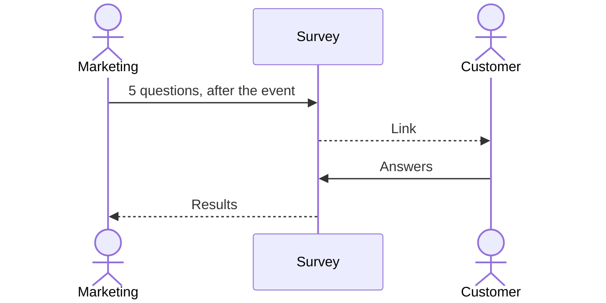

🏠 [Specs](../../../../README.md) › 🧩 [Functional capabilities](../../../README.md) ›
📣 [F5 Social media and marketing](../../README.md) › 📝 [Use cases](../README.md) ›
📝 [Use cases: FL-F5-08 Pages, forms, surveys and WhatsApp](README.md) › 📝 UC-F5-12 Run surveys and live polls

# 📝 UC-F5-12 Run surveys and live polls

**Status:** ✅ specified

## Summary

Marketing or HR writes a survey with conditions, sends it by link or campaign, or runs a live poll, and reads the
results.

## Personas

- [U12 Marketing](../../../../01-users/personas/u12-marketing.md)
- [U06 HR](../../../../01-users/personas/u06-hr.md)
- [U09 Customer](../../../../01-users/personas/u09-customer.md)

## Goal

Hear customers and employees.

## Trigger

A question to ask.

## Frequency

Monthly.

## Preconditions

F5 set up for the company.

## Postconditions

- **Succeeded:** answers are collected and shown.
- **Failed:** the survey stays draft.

## Main flow

1. The marketing person writes the questions
   ([S-F5-12](../../screens/08-pages-forms-surveys-and-whatsapp/s-f05-12-survey.md)) with conditions (skip if not a
   customer).
2. They send it by link, campaign or after an event, or run it live with results on screen.
3. Answers arrive, anonymous or linked to contacts as chosen.
4. They read the results and export them.

## Alternative flows

- 1a. HR uses it for appraisal or engagement surveys (F9).

## Error flows

- 3e. The survey is closed: late answers are refused with a message.

## Business rules

- See F5's rules.

## Entities

- [E-F5-08 Survey](../../data/e-f05-08-survey.md)

## Permissions

Marketing and HR.

## Notifications

The author: answers threshold reached.

## Audit events

Survey sent, closed.

## AI involvement

The AI assistant summarises open answers.

## API, MCP and A2A exposure

T5 operations of F5 with the caller's rights; the MCP tool of F5; no A2A skill.

## Screens

- [S-F5-12](../../screens/08-pages-forms-surveys-and-whatsapp/s-f05-12-survey.md)

## Flowchart

See [FL-F5-08 Pages, forms, surveys and WhatsApp](../../flows/fl-f05-08-pages-forms-surveys-and-whatsapp.md#flowchart).

## Sequence diagram

## Acceptance criteria

1. **Given** a survey sent to 180 attendees **when** 62 answer **then** results show 62 answers.
2. **Given** an anonymous survey **when** results are read **then** no answer shows a name.
3. **Given** a survey closed on 11-30 **when** an answer comes on 12-01 **then** it is refused with a message.

## Non-functional notes

None.

## Regulatory references

GDPR: anonymous unless stated
([CR-FR-050](../../../../10-country-packs/france/data-protection/cr-fr-050-privacy-by-design.md)).

## Related use cases

See [FL-F5-08](../../flows/fl-f05-08-pages-forms-surveys-and-whatsapp.md).

- [UC-F9-28 Run engagement surveys and exit interviews](../../../f09-hr-and-projects/use-cases/10-listen-to-employees/uc-f09-28-run-engagement-surveys-and-exit-interviews.md)

## Open questions

None.

---

⬅️ [UC-F5-11](../07-events-and-ticketing/uc-f05-11-organise-events-and-sell-tickets.md) · ⬆️ [Up](README.md) ·
➡️ [UC-F5-13](../05-benchmark-additions/uc-f05-13-turn-social-interactions-into-leads.md)
