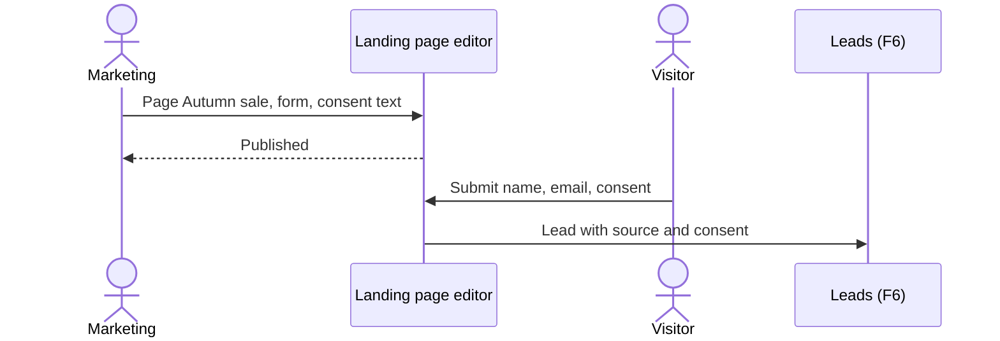

🏠 [Specs](../../../../README.md) › 🧩 [Functional capabilities](../../../README.md) ›
📣 [F5 Social media and marketing](../../README.md) › 📝 [Use cases](../README.md) ›
📝 [Use cases: FL-F5-08 Pages, forms, surveys and WhatsApp](README.md) › 📝 UC-F5-19 Publish a landing page with a form

# 📝 UC-F5-19 Publish a landing page with a form

**Status:** 🔄 waiting for the owner

## Summary

Marketing publishes a landing page with a form whose answers create leads or contacts, with their consent and the
campaign they came from.

## Personas

- [U12 Marketing and communication](../../../../01-users/personas/u12-marketing.md)
- [U09 Customer](../../../../01-users/personas/u09-customer.md)

## Goal

Turn a campaign's visitors into leads, traced to their source.

## Trigger

A campaign or an event needs a page.

## Frequency

A few per month.

## Preconditions

- A domain or the company website (F11 or F18).

## Postconditions

- **Succeeded:** the page is live; each submission creates a lead with its consent and source.
- **Failed:** the page stays draft.

## Main flow

1. The marketing person opens Landing pages
   ([S-F5-19](../../screens/08-pages-forms-surveys-and-whatsapp/s-f05-19-landing-page-editor.md)) and starts from a
   template using the brand kit,
   [UC-F5-21](../09-brand-tests-and-return-on-investment/uc-f05-21-keep-the-brand-kit-and-asset-library.md).
2. They add the form: fields mapped to lead fields, the consent text per channel
   ([BR-F5-14](../../business-rules/br-f05-14-forms-collect-only-what-they-declare-with-consent.md)).
3. They publish at an address; the page carries the campaign's tracked links
   ([BR-F5-06](../../business-rules/br-f05-06-leads-traced-through-tracked-links.md)).
4. A visitor submits; a lead is created in F6 with its source and consent
   ([UC-F5-15](../06-audiences-consent-and-journeys/uc-f05-15-record-and-prove-consent.md)).
5. The page shows visits, submissions and the conversion rate.

## Alternative flows

- 4a. The email exists: the contact is updated, not duplicated.
- 2a. A form for an event: the submission is a registration
  ([UC-F5-11](../07-events-and-ticketing/uc-f05-11-organise-events-and-sell-tickets.md)).

## Error flows

- 4e. A spam submission (bot): refused by the anti-spam check, not created.
- 2e. No consent text: the page cannot be published.

## Business rules

- [BR-F5-14 Forms collect only what they declare, with consent](../../business-rules/br-f05-14-forms-collect-only-what-they-declare-with-consent.md)
- [BR-F5-06 Leads traced through tracked links](../../business-rules/br-f05-06-leads-traced-through-tracked-links.md)
- [BR-F5-10 Consent is proven and withdrawn at once](../../business-rules/br-f05-10-consent-is-proven-and-withdrawn-at-once.md)

## Entities

- [E-F5-13 Landing page and form](../../data/e-f05-13-landing-page-and-form.md)
- [E-F5-10 Consent and suppression record](../../data/e-f05-10-consent-and-suppression-record.md)
- [E-F6-20 Lead](../../../f06-customers-and-sales/data/e-f06-20-lead.md)

## Permissions

Marketing and communication; the owner reads; record rules on contacts apply.

## Notifications

Sales: a new lead assigned.

## Audit events

Page published, changed, unpublished; submissions.

## AI involvement

The AI assistant drafts texts and segments in the company style
([BR-F3-11](../../../f03-assistant/business-rules/br-f03-11-drafts-follow-the-company-style.md)); a person sends.

## API, MCP and A2A exposure

T5 operations of F5 with the caller's rights; the MCP tool of F5; no A2A skill.

## Screens

- [S-F5-19 Landing page editor](../../screens/08-pages-forms-surveys-and-whatsapp/s-f05-19-landing-page-editor.md)

## Flowchart

See [FL-F5-08 Pages, forms, surveys and WhatsApp](../../flows/fl-f05-08-pages-forms-surveys-and-whatsapp.md#flowchart).

## Sequence diagram

## Acceptance criteria

1. **Given** the page "Autumn sale" of the example shop chain **when** a visitor submits with email consent **then** a
   lead is created with source "Autumn sale" and the consent recorded.
2. **Given** an email already in the contacts **when** it is submitted **then** the contact is updated, not duplicated.
3. **Given** a form without consent text **when** publish is asked **then** it is refused.

## Non-functional notes

Pages load within 2 seconds on a phone (Proposed); accessible
([CR-FR-072](../../../../10-country-packs/france/consumer/cr-fr-072-web-accessibility-eaa.md)).

## Regulatory references

[CR-FR-063](../../../../10-country-packs/france/consumer/cr-fr-063-electronic-marketing-consent.md);
[CR-FR-069](../../../../10-country-packs/france/consumer/cr-fr-069-website-legal-notices.md);
[CR-FR-070](../../../../10-country-packs/france/data-protection/cr-fr-070-cookie-consent.md).

## Related use cases

- [UC-F5-15 Record and prove consent](../06-audiences-consent-and-journeys/uc-f05-15-record-and-prove-consent.md)
- [UC-F6-01 Capture and qualify a lead](../../../f06-customers-and-sales/use-cases/01-lead-to-quote/uc-f06-01-capture-and-qualify-a-lead.md)

## Open questions

None.

---

⬅️ [UC-F5-18](../07-events-and-ticketing/uc-f05-18-sell-at-the-box-office-and-scan-tickets.md) · ⬆️ [Up](README.md) ·
➡️ [UC-F5-20 Message customers on WhatsApp Business](uc-f05-20-message-customers-on-whatsapp-business.md)
