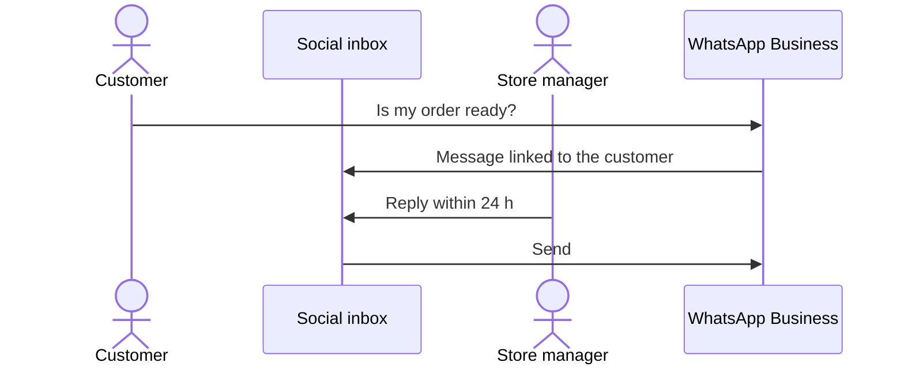

🏠 [Specs](../../../../README.md) › 🧩 [Functional capabilities](../../../README.md) ›
📣 [F5 Social media and marketing](../../README.md) › 📝 [Use cases](../README.md) ›
📝 [Use cases: FL-F5-08 Pages, forms, surveys and WhatsApp](README.md) ›
📝 UC-F5-20 Message customers on WhatsApp Business

# 📝 UC-F5-20 Message customers on WhatsApp Business

**Status:** ✅ specified

## Summary

Staff answer customers on WhatsApp Business from the social inbox, and send approved template messages (an order ready,
a booking reminder) to those who opted in.

## Personas

- [U12 Marketing and communication](../../../../01-users/personas/u12-marketing.md)
- [U23 Store manager](../../../../01-users/personas/u23-store-manager.md)
- [U09 Customer](../../../../01-users/personas/u09-customer.md)

## Goal

Reach customers where they read their messages, within WhatsApp's rules.

## Trigger

A customer writes on WhatsApp, or an event needs a message.

## Frequency

Daily in shops and restaurants.

## Preconditions

- The company's WhatsApp Business account is connected
  ([UC-F5-07](../04-connect-accounts/uc-f05-07-connect-the-company-s-accounts.md)).

## Postconditions

- **Succeeded:** the conversation is on the customer's record; templates were sent only to opted-in contacts.
- **Failed:** the message is not sent; the user sees why.

## Main flow

1. A customer writes on WhatsApp; the message arrives in the social inbox
   ([UC-F5-05](../03-inbox-and-statistics/uc-f05-05-answer-comments-and-messages.md)) and links to their record.
2. A store manager answers within 24 hours freely
   ([BR-F5-15](../../business-rules/br-f05-15-whatsapp-outside-24-hours-only-with-approved-templates.md)).
3. Marketing writes template messages on the WhatsApp screen
   ([S-F5-20](../../screens/08-pages-forms-surveys-and-whatsapp/s-f05-20-whatsapp-business.md)) and submits them for
   approval by WhatsApp.
4. Approved templates are sent by rules (order ready, booking reminder) or campaigns, to contacts with WhatsApp consent.

## Alternative flows

- 2a. After 24 hours, only an approved template can reopen the conversation.

## Error flows

- 3e. WhatsApp refuses a template: the reason is shown.
- 4e. A contact without WhatsApp consent: skipped and counted.

## Business rules

- [BR-F5-15 WhatsApp outside 24 hours only with approved templates](../../business-rules/br-f05-15-whatsapp-outside-24-hours-only-with-approved-templates.md)
- [BR-F5-05 One inbox, replies by a person](../../business-rules/br-f05-05-one-inbox-replies-by-a-person.md)
- [BR-F5-08 Marketing messages need consent](../../business-rules/br-f05-08-marketing-needs-consent.md)

## Entities

- [E-F5-14 WhatsApp template](../../data/e-f05-14-whatsapp-template.md)
- [E-F5-04 Social message](../../data/e-f05-04-social-message.md)

## Permissions

Marketing and communication; the owner reads; record rules on contacts apply. Staff answer in the inbox.

## Notifications

The assigned person: a new WhatsApp message.

## Audit events

Templates submitted and approved; messages sent.

## AI involvement

The AI assistant drafts texts and segments in the company style
([BR-F3-11](../../../f03-assistant/business-rules/br-f03-11-drafts-follow-the-company-style.md)); a person sends.

## API, MCP and A2A exposure

T5 operations of F5 with the caller's rights; the MCP tool of F5; no A2A skill.

## Screens

- [S-F5-20 WhatsApp Business](../../screens/08-pages-forms-surveys-and-whatsapp/s-f05-20-whatsapp-business.md)
- [S-F5-05 Social inbox](../../screens/03-inbox-and-statistics/s-f05-05-social-inbox.md)

## Flowchart

See [FL-F5-08 Pages, forms, surveys and WhatsApp](../../flows/fl-f05-08-pages-forms-surveys-and-whatsapp.md#flowchart).

## Sequence diagram

## Acceptance criteria

1. **Given** a customer's WhatsApp message at 10:00 **when** the store manager replies at 15:00 **then** the reply is
   sent.
2. **Given** the same conversation **when** the manager writes on the next day at 11:00 **then** only an approved
   template can be sent.
3. **Given** the template "Your order is ready" approved **when** an order is ready for an opted-in customer **then**
   the template is sent.
4. **Given** a customer without WhatsApp consent **when** a campaign runs **then** she is skipped.

## Non-functional notes

None.

## Regulatory references

[CR-FR-063](../../../../10-country-packs/france/consumer/cr-fr-063-electronic-marketing-consent.md); transfers outside
the EU ([CR-FR-049](../../../../10-country-packs/france/data-protection/cr-fr-049-processors-and-transfers.md)).

## Related use cases

- [UC-F5-05 Answer comments and messages](../03-inbox-and-statistics/uc-f05-05-answer-comments-and-messages.md)
- [UC-F5-15 Record and prove consent](../06-audiences-consent-and-journeys/uc-f05-15-record-and-prove-consent.md)

## Open questions

None.

---

⬅️ [UC-F5-19 Publish a landing page with a form](uc-f05-19-publish-a-landing-page-with-a-form.md) · ⬆️ [Up](README.md) ·
➡️ [UC-F5-21](../09-brand-tests-and-return-on-investment/uc-f05-21-keep-the-brand-kit-and-asset-library.md)
