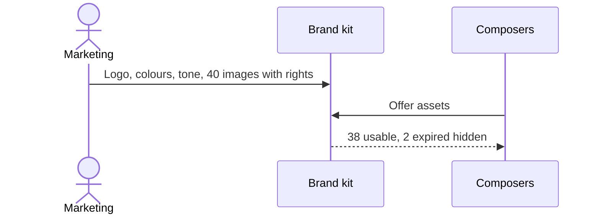

🏠 [Specs](../../../../README.md) › 🧩 [Functional capabilities](../../../README.md) ›
📣 [F5 Social media and marketing](../../README.md) › 📝 [Use cases](../README.md) ›
📝 [Use cases: FL-F5-09 Brand, tests and return on investment](README.md) ›
📝 UC-F5-21 Keep the brand kit and asset library

# 📝 UC-F5-21 Keep the brand kit and asset library

**Status:** 🔄 waiting for the owner

## Summary

Marketing keeps the company's logos, colours, fonts, tone and images with their usage rights in one library that posts,
emails, pages, documents and the AI assistant use.

## Personas

- [U12 Marketing and communication](../../../../01-users/personas/u12-marketing.md)
- [U13 Owner](../../../../01-users/personas/u13-owner.md)

## Goal

Everything published looks like the company, with images it may use.

## Trigger

Setting up, a rebrand, new images.

## Frequency

At setup; then monthly.

## Preconditions

- None.

## Postconditions

- **Succeeded:** the kit and assets are used by every channel.
- **Failed:** the previous kit stays.

## Main flow

1. Marketing opens Brand kit ([S-F5-21](../../screens/09-brand-tests-and-return-on-investment/s-f05-21-brand-kit.md))
   and sets logos, colours, fonts and the tone of voice (shared with
   [UC-F3-04](../../../f03-assistant/use-cases/04-summarise-or-draft/uc-f03-04-summarise-and-draft.md)'s style).
2. They upload images and videos with their source, rights and expiry
   ([BR-F5-16](../../business-rules/br-f05-16-assets-carry-their-rights.md)).
3. Composers of posts, emails, pages and document templates offer the kit and the assets.
4. An asset whose rights expire is hidden from composers and listed where it is used.

## Alternative flows

- 2a. AI-generated images are marked as such ([BR-F5-04](../../business-rules/br-f05-04-ai-content-is-marked.md)).

## Error flows

- 2e. An image without its rights: kept as draft, not offered.

## Business rules

- [BR-F5-16 Assets carry their rights](../../business-rules/br-f05-16-assets-carry-their-rights.md)
- [BR-F5-04 AI content is marked](../../business-rules/br-f05-04-ai-content-is-marked.md)

## Entities

- [E-F5-15 Brand asset](../../data/e-f05-15-brand-asset.md)

## Permissions

Marketing and communication; the owner reads; record rules on contacts apply.

## Notifications

Marketing: assets whose rights expire within 30 days (Proposed).

## Audit events

Kit changed; assets added, expired, removed.

## AI involvement

The AI assistant uses the tone of voice; it never uses an asset without rights.

## API, MCP and A2A exposure

T5 operations of F5 with the caller's rights; the MCP tool of F5; no A2A skill.

## Screens

- [S-F5-21 Brand kit](../../screens/09-brand-tests-and-return-on-investment/s-f05-21-brand-kit.md)

## Flowchart

See
[FL-F5-09 Brand, tests and return on investment](../../flows/fl-f05-09-brand-tests-and-return-on-investment.md#flowchart).

## Sequence diagram

## Acceptance criteria

1. **Given** an image licensed until 2026-12-31 **when** 2027-01-01 comes **then** it is hidden from composers and
   listed where used.
2. **Given** the kit's colours **when** an email is composed **then** the colours are offered.
3. **Given** an image without rights **when** it is uploaded **then** it is kept as draft and not offered.

## Non-functional notes

None.

## Regulatory references

(Proposed) to read: image rights and the French intellectual property code.

## Related use cases

- [UC-F5-01 Prepare and schedule a post](../01-publish-a-post/uc-f05-01-prepare-and-schedule-a-post.md)
- [UC-F2-05 Edit a document template](../../../f02-no-code-configuration/use-cases/02-customise-documents-and-emails/uc-f02-05-edit-a-document-template.md)

## Open questions

None.

---

⬅️ [UC-F5-20](../08-pages-forms-surveys-and-whatsapp/uc-f05-20-message-customers-on-whatsapp-business.md) ·
⬆️ [Up](README.md) · ➡️ [UC-F5-22 A/B test posts, emails and SMS](uc-f05-22-a-b-test-posts-emails-and-sms.md)
