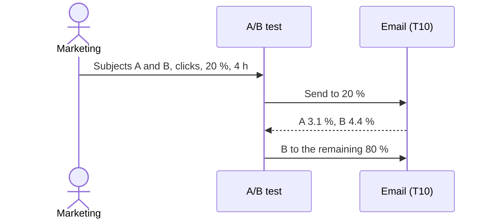

🏠 [Specs](../../../../README.md) › 🧩 [Functional capabilities](../../../README.md) ›
📣 [F5 Social media and marketing](../../README.md) › 📝 [Use cases](../README.md) ›
📝 [Use cases: FL-F5-09 Brand, tests and return on investment](README.md) › 📝 UC-F5-22 A/B test posts, emails and SMS

# 📝 UC-F5-22 A/B test posts, emails and SMS

**Status:** ✅ specified

## Summary

Marketing tests two or more variants of a post, an email or an SMS on part of the audience; the winner by the chosen
measure goes to the rest.

## Personas

- [U12 Marketing and communication](../../../../01-users/personas/u12-marketing.md)

## Goal

Choose with figures, not taste.

## Trigger

A campaign or post with variants.

## Frequency

Weekly.

## Preconditions

- A segment large enough ([BR-F5-17](../../business-rules/br-f05-17-an-a-b-winner-needs-its-sample.md)).

## Postconditions

- **Succeeded:** the winner is sent to the rest of the audience, and the test kept.
- **Failed:** with too few contacts, no test: the first variant is sent.

## Main flow

1. The marketing person adds variants to a post, email or SMS (subject, text, image, time).
2. They choose the measure (opens, clicks, conversions, engagement), the test share (20 %) and the end time.
3. Variants go to the test share; results show live on the test screen
   ([S-F5-22](../../screens/09-brand-tests-and-return-on-investment/s-f05-22-a-b-test.md)).
4. At the end time, the winner by the measure goes to the rest
   ([BR-F5-17](../../business-rules/br-f05-17-an-a-b-winner-needs-its-sample.md)).

## Alternative flows

- 4a. Marketing picks the winner by hand before the end.

## Error flows

- 4e. No significant difference: the first variant is sent and the test says so.

## Business rules

- [BR-F5-17 An A/B winner needs its sample](../../business-rules/br-f05-17-an-a-b-winner-needs-its-sample.md)

## Entities

- [E-F5-16 A/B test](../../data/e-f05-16-a-b-test.md)

## Permissions

Marketing and communication; the owner reads; record rules on contacts apply.

## Notifications

Marketing: the winner chosen.

## Audit events

Test set, winner chosen and how.

## AI involvement

The AI assistant drafts texts and segments in the company style
([BR-F3-11](../../../f03-assistant/business-rules/br-f03-11-drafts-follow-the-company-style.md)); a person sends.

## API, MCP and A2A exposure

T5 operations of F5 with the caller's rights; the MCP tool of F5; no A2A skill.

## Screens

- [S-F5-22 A/B test](../../screens/09-brand-tests-and-return-on-investment/s-f05-22-a-b-test.md)

## Flowchart

See
[FL-F5-09 Brand, tests and return on investment](../../flows/fl-f05-09-brand-tests-and-return-on-investment.md#flowchart).

## Sequence diagram

## Acceptance criteria

1. **Given** an email to 10,000 contacts with subjects A and B, 20 %, measured on clicks **when** 4 hours pass with B at
   4.4 % and A at 3.1 % **then** B goes to the remaining 8,000.
2. **Given** a post with two images **when** it is tested on Facebook **then** the image with more engagement is kept
   for the boosted post.
3. **Given** a segment of 300 contacts **when** a test is set **then** it is refused and the first variant is sent.

## Non-functional notes

None.

## Regulatory references

None.

## Related use cases

- [UC-F5-08 Run email campaigns](../05-benchmark-additions/uc-f05-08-run-email-campaigns.md)
- [UC-F5-09 Send SMS campaigns](../05-benchmark-additions/uc-f05-09-send-sms-campaigns.md)
- [UC-F5-01 Prepare and schedule a post](../01-publish-a-post/uc-f05-01-prepare-and-schedule-a-post.md)

## Open questions

None.

---

⬅️ [UC-F5-21 Keep the brand kit and asset library](uc-f05-21-keep-the-brand-kit-and-asset-library.md) ·
⬆️ [Up](README.md) · ➡️ [UC-F5-23](uc-f05-23-track-campaign-budget-cost-per-lead-and-return.md)
