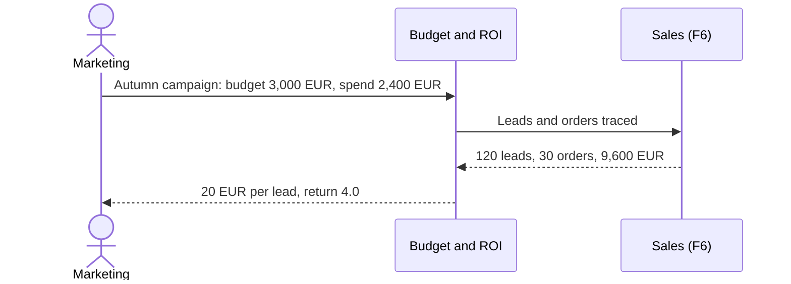

🏠 [Specs](../../../../README.md) › 🧩 [Functional capabilities](../../../README.md) ›
📣 [F5 Social media and marketing](../../README.md) › 📝 [Use cases](../README.md) ›
📝 [Use cases: FL-F5-09 Brand, tests and return on investment](README.md) ›
📝 UC-F5-23 Track campaign budget, cost per lead and return

# 📝 UC-F5-23 Track campaign budget, cost per lead and return

**Status:** ✅ specified

## Summary

Marketing records each campaign's budget and spend; simple-ERP shows the leads, orders and revenue traced to it, the
cost per lead and the return per channel.

## Personas

- [U12 Marketing and communication](../../../../01-users/personas/u12-marketing.md)
- [U13 Owner](../../../../01-users/personas/u13-owner.md)

## Goal

Spend where it brings customers.

## Trigger

A campaign is planned; then monthly.

## Frequency

Monthly.

## Preconditions

- Campaigns with tracked links ([BR-F5-06](../../business-rules/br-f05-06-leads-traced-through-tracked-links.md)).

## Postconditions

- **Succeeded:** each campaign shows budget, spend, cost per lead and return.
- **Failed:** without spend, only the counts show.

## Main flow

1. Marketing sets the campaign's budget per channel
   ([S-F5-23](../../screens/09-brand-tests-and-return-on-investment/s-f05-23-budget-and-return.md)).
2. Spend is entered or read from the ad accounts and supplier bills (F8).
3. Leads, orders and revenue traced through links and forms are counted per campaign
   ([BR-F5-18](../../business-rules/br-f05-18-return-counts-only-traced-revenue.md)).
4. The screen shows cost per lead, cost per order and return per channel; the owner reads the monthly summary.

## Alternative flows

- 2a. A supplier bill linked to the campaign is counted as spend.

## Error flows

- 3e. Revenue not traced (an order without a source): not counted, and the share untraced is shown.

## Business rules

- [BR-F5-18 Return counts only traced revenue](../../business-rules/br-f05-18-return-counts-only-traced-revenue.md)
- [BR-F5-06 Leads traced through tracked links](../../business-rules/br-f05-06-leads-traced-through-tracked-links.md)

## Entities

- [E-F5-17 Campaign budget](../../data/e-f05-17-campaign-budget.md)
- [E-F5-05 Email or SMS campaign](../../data/e-f05-05-email-or-sms-campaign.md)

## Permissions

Marketing and communication; the owner reads; record rules on contacts apply. The owner reads.

## Notifications

The owner: monthly summary.

## Audit events

Budget and spend changed.

## AI involvement

The AI assistant comments the figures; the figures come from queries
([BR-F3-03](../../../f03-assistant/business-rules/br-f03-03-figures-come-from-queries.md)).

## API, MCP and A2A exposure

T5 operations of F5 with the caller's rights; the MCP tool of F5; no A2A skill.

## Screens

- [S-F5-23 Budget and return](../../screens/09-brand-tests-and-return-on-investment/s-f05-23-budget-and-return.md)

## Flowchart

See
[FL-F5-09 Brand, tests and return on investment](../../flows/fl-f05-09-brand-tests-and-return-on-investment.md#flowchart).

## Sequence diagram

## Acceptance criteria

1. **Given** the Autumn campaign with 2,400 EUR spent, 120 leads and 9,600 EUR of traced orders **when** the screen
   opens **then** it shows 20 EUR per lead and a return of 4.0.
2. **Given** orders without a source **when** the month is computed **then** they are not counted and their share is
   shown.
3. **Given** a supplier bill of 600 EUR linked to the campaign **when** it is posted **then** the spend rises by 600
   EUR.

## Non-functional notes

None.

## Regulatory references

None.

## Related use cases

- [UC-F5-06 Read statistics](../03-inbox-and-statistics/uc-f05-06-read-statistics.md)
- [UC-F5-08 Run email campaigns](../05-benchmark-additions/uc-f05-08-run-email-campaigns.md)

## Open questions

None.

---

⬅️ [UC-F5-22 A/B test posts, emails and SMS](uc-f05-22-a-b-test-posts-emails-and-sms.md) · ⬆️ [Up](README.md) ·
➡️ [UC-F5-24 Create marketing cards](../10-referrals-push-and-listening/uc-f05-24-create-marketing-cards.md)
