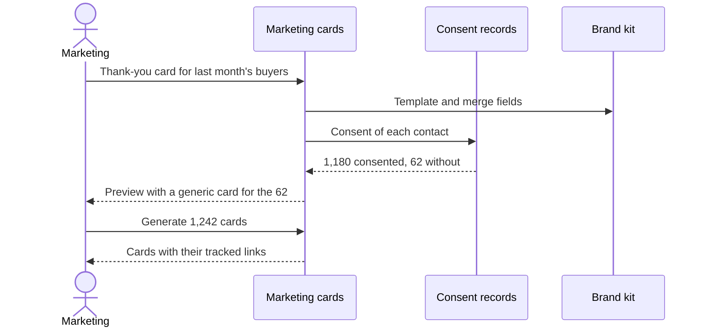

🏠 [Specs](../../../../README.md) › 🧩 [Functional capabilities](../../../README.md) ›
📣 [F5 Social media and marketing](../../README.md) › 📝 [Use cases](../README.md) › 📝 UC-F5-24 Create marketing cards

# 📝 UC-F5-24 Create marketing cards

**Status:** ✅ specified

## Summary

Marketing creates personalised cards from the brand kit: an image with a short text, a figure or a photo, made for each
contact of a segment, and shares them in emails, messages and posts. A card shows personal data (a first name, a
purchase, a loyalty tier) only for the contacts whose consent covers it; the others get the generic card.

## Personas

- [U12 Marketing and communication](../../../../01-users/personas/u12-marketing.md)

## Goal

Every contact receives a card that speaks to them, without a designer making each one and without using data the contact
did not agree to.

## Trigger

A campaign, a loyalty milestone or a launch that needs a visual per contact, started from
[UC-F5-08](../05-benchmark-additions/uc-f05-08-run-email-campaigns.md) or from the brand kit
([UC-F5-21](../09-brand-tests-and-return-on-investment/uc-f05-21-keep-the-brand-kit-and-asset-library.md)).

## Frequency

A few card campaigns a month, from tens to tens of thousands of cards each.

## Preconditions

- The brand kit holds a card template with its merge fields ([E-F5-15 Brand asset](../../data/e-f05-15-brand-asset.md)).
- The segment to reach exists
  ([UC-F5-14](../06-audiences-consent-and-journeys/uc-f05-14-build-a-segment-of-contacts.md),
  [E-F5-09 Contact segment](../../data/e-f05-09-contact-segment.md)).
- The consent of each contact is recorded
  ([UC-F5-15](../06-audiences-consent-and-journeys/uc-f05-15-record-and-prove-consent.md),
  [E-F5-10 Consent and suppression record](../../data/e-f05-10-consent-and-suppression-record.md)).

## Postconditions

- **Succeeded:** the card campaign is saved ([E-F5-21 Marketing card](../../data/e-f05-21-marketing-card.md)) with one
  generated card per contact, each with its tracked link
  ([BR-F5-06](../../business-rules/br-f05-06-leads-traced-through-tracked-links.md)); the cards are ready for the email,
  SMS or post that carries them.
- **Failed:** no card is shared; the draft and the preview stay, and the contacts left out are listed with the reason.

## Main flow

1. Marketing opens the cards screen
   ([S-F5-24](../../screens/10-referrals-push-and-listening/s-f05-24-marketing-cards.md)) and picks a card template from
   the brand kit and a segment.
2. Marketing chooses the merge fields (first name, last order, loyalty tier, a figure) and the channel the cards will go
   out on.
3. SimpleERP checks each merge field against each contact's consent
   ([BR-F5-19](../../business-rules/br-f05-19-cards-use-only-consented-personal-data.md)): a field that needs a consent
   the contact did not give is replaced by its generic text for that contact.
4. Marketing previews cards for three real contacts and for one contact without consent, then adjusts the texts.
5. Marketing generates the cards; each gets a tracked link and a short expiry date.
6. Marketing attaches the cards to an email, an SMS or a post, or exports them, and the campaign goes on in
   [UC-F5-08](../05-benchmark-additions/uc-f05-08-run-email-campaigns.md).

## Alternative flows

- 2a. Marketing asks the AI assistant: "a thank-you card with the first name for last month's buyers"; the AI assistant
  prefills the template, the fields and the segment, and marketing checks them.
- 3a. A contact withdraws consent after the cards were generated: their card is withdrawn and the link shows the generic
  card ([BR-F5-10](../../business-rules/br-f05-10-consent-is-proven-and-withdrawn-at-once.md)).
- 5a. A segment of more than 5,000 contacts is generated in the background, with its progress.
- 6a. Marketing keeps the card as a reusable template for the next campaign.

## Error flows

- 3e. A merge field has no value for a contact (no last order): that contact gets the generic text, and the count of
  such contacts is shown before generating.
- 5e. The generation fails for some contacts: the others are kept, the failed ones are listed and can be generated
  again.
- 6e. A card carries a claim marketing cannot prove: the AI assistant flags it, and sharing still needs marketing's
  approval ([BR-F5-04](../../business-rules/br-f05-04-ai-content-is-marked.md)).
- Any step: a service does not answer; the call is retried first
  ([BR-F3-32](../../../f03-assistant/business-rules/br-f03-32-retry-before-an-error.md)), then the message follows the
  error pattern ([D122](../../../../06-decisions/ux/d122-error-message-standard.md)) and what the user typed stays on
  the screen.

## Business rules

- [BR-F5-19](../../business-rules/br-f05-19-cards-use-only-consented-personal-data.md)
- [BR-F5-08](../../business-rules/br-f05-08-marketing-needs-consent.md)
- [BR-F5-10](../../business-rules/br-f05-10-consent-is-proven-and-withdrawn-at-once.md)
- [BR-F5-04 AI content is marked](../../business-rules/br-f05-04-ai-content-is-marked.md)

## Entities

- [E-F5-21 Marketing card](../../data/e-f05-21-marketing-card.md): created, changed
- [E-F5-15 Brand asset](../../data/e-f05-15-brand-asset.md): read, the template and its rights
- [E-F5-09 Contact segment](../../data/e-f05-09-contact-segment.md): read, the segment
- [E-F5-10 Consent and suppression record](../../data/e-f05-10-consent-and-suppression-record.md): read, the consent of
  each contact
- [E-F5-18 Contact](../../data/e-f05-18-contact.md): read, the merge fields

## Permissions

Marketing only. The owner reads the campaigns and their results. A card never shows data the viewer of the
link is not the person concerned by.

## Notifications

Marketing, in the app: the generation of a large segment has finished, with the count of generic cards.

## Audit events

Each generation (template, segment, merge fields, count, by whom and when); each card withdrawn and why; each contact
given the generic card and the missing consent.

## AI involvement

The AI assistant drafts the card texts and chooses the merge fields from marketing's words, and marks what it wrote
([BR-F5-04](../../business-rules/br-f05-04-ai-content-is-marked.md)); marketing checks every card text before
generation. It never reads a contact's personal data beyond the fields the consent allows
([BR-F5-19](../../business-rules/br-f05-19-cards-use-only-consented-personal-data.md)).

## API, MCP and A2A exposure

T5 operations of the capability for the personas above: create, read, update and list. The MCP tool of the
capability may read and propose, never confirm alone. No A2A skill.

## Screens

- [S-F5-24](../../screens/10-referrals-push-and-listening/s-f05-24-marketing-cards.md)

## Flowchart

See [FL-F5-10 Cards, referrals, push and listening](../../flows/fl-f05-10-referrals-push-and-listening.md#flowchart).

## Sequence diagram

## Acceptance criteria

1. **Given** a template using the first name and a segment of 1,242 contacts, 62 without consent **when** marketing
   generates the cards **then** 62 get the generic card and 1,180 the personalised one.
2. **Given** a card already generated for Julien R. **when** he withdraws his consent **then** the link shows the
   generic card from then on.
3. **Given** a merge field with no value for a contact **when** the cards are generated **then** that contact gets the
   generic text and is counted in the preview.
4. **Given** a card text written by the AI assistant **when** marketing generates without approving **then** it is
   refused until marketing approves.

## Non-functional notes

The screen answers within 2 seconds for 10,000 records; every change is audited.

## Regulatory references

Electronic marketing needs the contact's consent:
[CR-FR-063](../../../../10-country-packs/france/consumer/cr-fr-063-electronic-marketing-consent.md); use of personal
data and its purpose: [CR-FR-050](../../../../10-country-packs/france/data-protection/cr-fr-050-privacy-by-design.md).

## Related use cases

- [UC-F5-25 Run a customer referral programme](uc-f05-25-run-a-customer-referral-programme.md)
- [UC-F5-15](../06-audiences-consent-and-journeys/uc-f05-15-record-and-prove-consent.md)
- [UC-F5-14](../06-audiences-consent-and-journeys/uc-f05-14-build-a-segment-of-contacts.md)
- [UC-F5-21](../09-brand-tests-and-return-on-investment/uc-f05-21-keep-the-brand-kit-and-asset-library.md)
- [UC-F5-08 Run email campaigns](../05-benchmark-additions/uc-f05-08-run-email-campaigns.md)

## Open questions

None.

---

⬅️ [UC-F5-23](../09-brand-tests-and-return-on-investment/uc-f05-23-track-campaign-budget-cost-per-lead-and-return.md) ·
⬆️ [Up](README.md) · ➡️ [UC-F5-25 Run a customer referral programme](uc-f05-25-run-a-customer-referral-programme.md)
