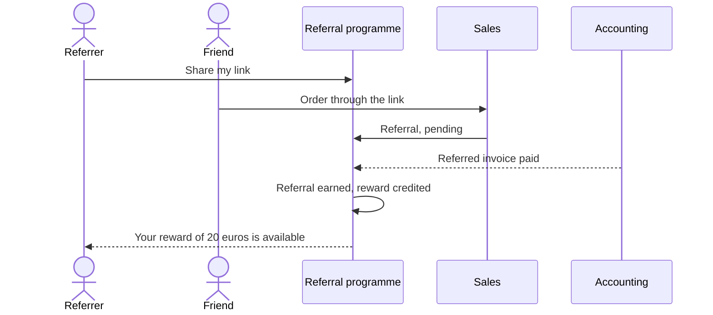

🏠 [Specs](../../../../README.md) › 🧩 [Functional capabilities](../../../README.md) ›
📣 [F5 Social media and marketing](../../README.md) › 📝 [Use cases](../README.md) ›
📝 UC-F5-25 Run a customer referral programme

# 📝 UC-F5-25 Run a customer referral programme

**Status:** ✅ specified

## Summary

Marketing runs a customer referral programme: each customer gets a personal link or code, a friend who buys through it
is recorded as referred, and the reward (a credit, a discount or a gift) is granted to the referrer only after the
referred sale is paid.

## Personas

- [U12 Marketing and communication](../../../../01-users/personas/u12-marketing.md)
- [U09 Customer](../../../../01-users/personas/u09-customer.md)

## Goal

Customers bring new customers, and the company pays rewards only for sales it has really been paid for.

## Trigger

Marketing launches a programme, or a customer shares their link from the customer portal
([UC-F6-11](../../../f06-customers-and-sales/use-cases/02-quote-to-order/uc-f06-11-use-the-customer-portal.md)).

## Frequency

One programme at a time, running for months; a referral a day to dozens a day.

## Preconditions

- The customer record exists with a consent to be contacted
  ([E-F6-01 Customer record](../../../f06-customers-and-sales/data/e-f06-01-customer-record.md),
  [E-F5-10 Consent and suppression record](../../data/e-f05-10-consent-and-suppression-record.md)).
- The programme's reward and its terms are defined by marketing and accepted by the owner.
- The reward credit or discount can be applied to a later order
  [UC-F6-12](../../../f06-customers-and-sales/use-cases/01-lead-to-quote/uc-f06-12-manage-price-lists-and-discounts.md).

## Postconditions

- **Succeeded:** each referral is recorded ([E-F5-22 Referral](../../data/e-f05-22-referral.md)) with its referrer, its
  referred customer and its state; a reward is granted once the referred sale is paid, and the referrer is told.
- **Failed:** no reward is granted; the referral stays pending or rejected with the reason.

## Main flow

1. Marketing sets up the programme on the referral screen
   ([S-F5-25](../../screens/10-referrals-push-and-listening/s-f05-25-referral-programme.md)): the reward for the
   referrer, the reward for the friend, the minimum order and the dates.
2. A customer opens the customer portal on their phone and gets their personal link and code to share.
3. A friend uses the link and places an order; SimpleERP records a referral linked to the order
   ([E-F6-04 Order](../../../f06-customers-and-sales/data/e-f06-04-order.md)).
4. SimpleERP checks that the friend is a new customer and not the referrer, and holds the referral as Pending.
5. When the referred invoice is paid
   ([E-F6-06 Customer payment](../../../f06-customers-and-sales/data/e-f06-06-customer-payment.md)), the referral
   becomes Earned and the reward is credited to the referrer
   ([BR-F5-20](../../business-rules/br-f05-20-referral-rewards-wait-until-the-referred-sale-is-paid.md)).
6. The referrer is told in the portal and by message, and marketing reads the programme's results.

## Alternative flows

- 2a. A customer shares the link by email from the portal, which sends it to the contacts they type.
- 4a. The friend is already a customer: the referral is rejected with the reason and the friend still gets the normal
  price.
- 5a. The referred order is partly paid: the reward is granted in proportion once the minimum order is paid, or waits,
  as the programme says.

## Error flows

- 4e. The referrer and the friend share an address or an account: the referral is held for marketing to check and is not
  rewarded until marketing accepts it.
- 5e. The referred order is cancelled or refunded before payment: the referral becomes Rejected and no reward is granted
  [UC-F6-09](../../../f06-customers-and-sales/use-cases/03-invoice-and-get-paid/uc-f06-09-credit-note-and-refund.md).
- 5f. The reward was granted and the order is then refunded: the reward is withdrawn from the referrer's next credit and
  the referral is marked Reversed.
- Any step: a service does not answer; the call is retried first
  ([BR-F3-32](../../../f03-assistant/business-rules/br-f03-32-retry-before-an-error.md)), then the message follows the
  error pattern ([D122](../../../../06-decisions/ux/d122-error-message-standard.md)) and what the user typed stays on
  the screen.

## Business rules

- [BR-F5-20](../../business-rules/br-f05-20-referral-rewards-wait-until-the-referred-sale-is-paid.md)
- [BR-F5-08](../../business-rules/br-f05-08-marketing-needs-consent.md)
- [BR-F6-15](../../../f06-customers-and-sales/business-rules/br-f06-15-a-pro-forma-is-not-an-invoice.md)

## Entities

- [E-F5-22 Referral](../../data/e-f05-22-referral.md): created, changed
- [E-F6-01 Customer record](../../../f06-customers-and-sales/data/e-f06-01-customer-record.md): read, the referrer and
  the friend
- [E-F6-04 Order](../../../f06-customers-and-sales/data/e-f06-04-order.md): read, the referred order
- [E-F6-05 Invoice](../../../f06-customers-and-sales/data/e-f06-05-invoice.md): read, the referred invoice
- [E-F6-06 Customer payment](../../../f06-customers-and-sales/data/e-f06-06-customer-payment.md): read, its payment

## Permissions

Marketing manages the programme and reads every referral. A customer sees only their own link, their referrals' first
names and their rewards
([BR-F6-03](../../../f06-customers-and-sales/business-rules/br-f06-03-portal-shows-only-the-customer-s-own.md)).

## Notifications

The referrer, in the portal and by message: a friend ordered, the reward earned, the reward reversed. Marketing, in the
app: a referral held for checking.

## Audit events

Each referral created, held, rewarded, rejected or reversed, with the order and the payment that caused it; each change
of the programme's terms.

## AI involvement

The AI assistant flags referrals that look abnormal (the same address, many referrals in a day) for marketing to check;
it never rejects or rewards one.

## API, MCP and A2A exposure

T5 operations of the capability for the personas above: create, read, update and list. The MCP tool of the
capability may read and propose, never confirm alone. No A2A skill.

## Screens

- [S-F5-25](../../screens/10-referrals-push-and-listening/s-f05-25-referral-programme.md)

## Flowchart

See [FL-F5-10 Cards, referrals, push and listening](../../flows/fl-f05-10-referrals-push-and-listening.md#flowchart).

## Sequence diagram

## Acceptance criteria

1. **Given** a friend who ordered through a customer's link and has not paid **when** the programme is read **then** the
   referral is Pending and no reward is granted.
2. **Given** the referred invoice paid in full **when** the payment is recorded **then** the referral is Earned and the
   reward is credited to the referrer.
3. **Given** the referred order refunded after the reward **when** the refund is recorded **then** the referral is
   Reversed and the reward is withdrawn.
4. **Given** a friend who is already a customer **when** they order through a link **then** the referral is rejected
   with the reason.

## Non-functional notes

The screen answers within 2 seconds for 10,000 records; every change is audited.

## Regulatory references

Referral rewards are marketing: the friend's address is contacted only with consent
([CR-FR-063](../../../../10-country-packs/france/consumer/cr-fr-063-electronic-marketing-consent.md)); a
reward is a price reduction shown on the invoice
([CR-FR-202](../../../../10-country-packs/france/invoicing/cr-fr-202-price-reductions-on-invoices.md)).

## Related use cases

- [UC-F5-24 Create marketing cards](uc-f05-24-create-marketing-cards.md)
- [UC-F5-26 Send push notifications](uc-f05-26-send-push-notifications.md)
- [UC-F6-11](../../../f06-customers-and-sales/use-cases/02-quote-to-order/uc-f06-11-use-the-customer-portal.md)
- [UC-F6-12](../../../f06-customers-and-sales/use-cases/01-lead-to-quote/uc-f06-12-manage-price-lists-and-discounts.md)
- [UC-F5-15](../06-audiences-consent-and-journeys/uc-f05-15-record-and-prove-consent.md)

## Open questions

None.

---

⬅️ [UC-F5-24 Create marketing cards](uc-f05-24-create-marketing-cards.md) · ⬆️ [Up](README.md) ·
➡️ [UC-F5-26 Send push notifications](uc-f05-26-send-push-notifications.md)
