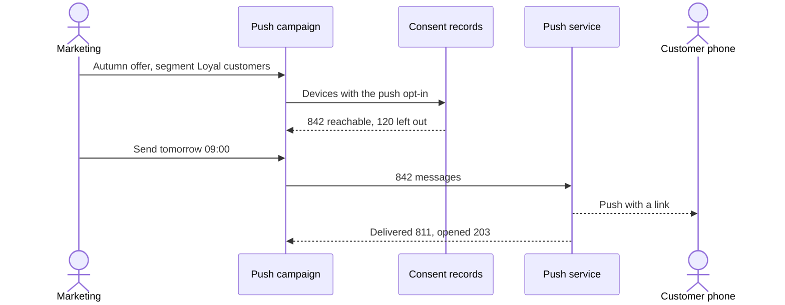

🏠 [Specs](../../../../README.md) › 🧩 [Functional capabilities](../../../README.md) ›
📣 [F5 Social media and marketing](../../README.md) › 📝 [Use cases](../README.md) › 📝 UC-F5-26 Send push notifications

# 📝 UC-F5-26 Send push notifications

**Status:** 🔄 waiting for the owner

## Summary

Marketing sends push notifications to the app and the browser of the customers who opted in on that device: a short
message with a link, to a segment, now or at a set time, with the result counted.

## Personas

- [U12 Marketing and communication](../../../../01-users/personas/u12-marketing.md)
- [U09 Customer](../../../../01-users/personas/u09-customer.md)

## Goal

Customers who want to be reached on their phone get timely messages, and nobody receives a push they did not ask for.

## Trigger

A campaign step, an offer or a reminder marketing wants on the customer's phone, started from a campaign or from the
journey ([UC-F5-10](../06-audiences-consent-and-journeys/uc-f05-10-automate-marketing-journeys.md)).

## Frequency

A few campaigns a week, to hundreds or thousands of devices each.

## Preconditions

- The customer app or the website asks for the opt-in and records it per device
  ([E-F5-10 Consent and suppression record](../../data/e-f05-10-consent-and-suppression-record.md)).
- The segment to reach exists ([E-F5-09 Contact segment](../../data/e-f05-09-contact-segment.md)).
- The push service of the company's app is connected in the integrations hub
  [UC-F24-02](../../../f24-integrations-hub/use-cases/01-find-and-connect/uc-f24-02-connect-a-tool-in-the-fewest-steps.md).

## Postconditions

- **Succeeded:** the campaign is saved ([E-F5-23 Push campaign](../../data/e-f05-23-push-campaign.md)) with the devices
  reached, the messages delivered and opened; devices that no longer accept push are removed from future sends.
- **Failed:** no push goes out; the draft stays, and devices without opt-in are listed as left out.

## Main flow

1. Marketing opens the push screen
   ([S-F5-26 Push campaign](../../screens/10-referrals-push-and-listening/s-f05-26-push-campaign.md)) and writes the
   title and the text, with a link.
2. Marketing picks a segment and a send time, or sends now.
3. simple-ERP keeps only the devices with a recorded opt-in for push
   ([BR-F5-21](../../business-rules/br-f05-21-push-needs-the-devices-opt-in.md)) and shows the count of reachable
   devices and of those left out.
4. Marketing previews the push on a phone frame and sends a test to their own device.
5. Marketing confirms; simple-ERP sends within the quiet hours of each device's time zone.
6. Deliveries, opens and clicks come back and show on the campaign; the customer sees the push on their phone and opens
   the link.

## Alternative flows

- 2a. Marketing sets a recurring push (a weekly reminder): each send checks the opt-in again.
- 3a. Marketing sends to one customer from their record, for example a delivery update: it is a service message and uses
  the customer's notification settings instead of marketing consent.
- 5a. The send is scheduled for the next morning because the quiet hours have begun.

## Error flows

- 3e. No device in the segment has the opt-in: nothing is sent and the screen says why.
- 5e. The push service refuses a token (the app was uninstalled): the device is marked unreachable and dropped from the
  next sends.
- 5f. The text is longer than the push limit: marketing is asked to shorten it before sending.
- Any step: a service does not answer; the call is retried first
  ([BR-F3-32](../../../f03-assistant/business-rules/br-f03-32-retry-before-an-error.md)), then the message follows the
  error pattern ([D122](../../../../06-decisions/ux/d122-error-message-standard.md)) and what the user typed stays on
  the screen.

## Business rules

- [BR-F5-21](../../business-rules/br-f05-21-push-needs-the-devices-opt-in.md)
- [BR-F5-08](../../business-rules/br-f05-08-marketing-needs-consent.md)
- [BR-F5-04 AI content is marked](../../business-rules/br-f05-04-ai-content-is-marked.md)

## Entities

- [E-F5-23 Push campaign](../../data/e-f05-23-push-campaign.md): created, changed
- [E-F5-09 Contact segment](../../data/e-f05-09-contact-segment.md): read, the segment
- [E-F5-10 Consent and suppression record](../../data/e-f05-10-consent-and-suppression-record.md): read, the opt-in per
  device
- [E-F5-18 Contact](../../data/e-f05-18-contact.md): read, the customer behind each device

## Permissions

Marketing only. The owner reads the results. A customer manages their own opt-in from the app settings on
their phone.

## Notifications

The customer, on their phone: the push itself. Marketing, in the app: a send finished, with its counts.

## Audit events

Each send (segment, devices reached and left out, text, by whom and when); each opt-in and opt-out per device; each
token dropped and why.

## AI involvement

The AI assistant may draft the title and text and marks them
([BR-F5-04](../../business-rules/br-f05-04-ai-content-is-marked.md)); marketing reads and approves before sending, and
the AI assistant never sends.

## API, MCP and A2A exposure

T5 operations of the capability for the personas above: create, read, update and list. The MCP tool of the
capability may read and propose, never confirm alone. No A2A skill.

## Screens

- [S-F5-26 Push campaign](../../screens/10-referrals-push-and-listening/s-f05-26-push-campaign.md)

## Flowchart

See [FL-F5-10 Cards, referrals, push and listening](../../flows/fl-f05-10-referrals-push-and-listening.md#flowchart).

## Sequence diagram

## Acceptance criteria

1. **Given** a segment of 962 devices, 842 with the opt-in **when** marketing sends **then** 842 pushes go out and 120
   devices are listed as left out.
2. **Given** a device that opted out yesterday **when** a campaign is sent to its segment **then** that device receives
   nothing.
3. **Given** a send at 23:00 in the customer's time zone **when** marketing confirms **then** the push waits until the
   quiet hours end.
4. **Given** a refused token **when** the push service answers **then** the device is marked unreachable and skipped
   next time.

## Non-functional notes

The screen answers within 2 seconds for 10,000 records; every change is audited.

## Regulatory references

A push is electronic marketing and a read or write on the customer's device:
[CR-FR-063](../../../../10-country-packs/france/consumer/cr-fr-063-electronic-marketing-consent.md),
[CR-FR-070](../../../../10-country-packs/france/data-protection/cr-fr-070-cookie-consent.md). (Proposed) Push is covered
by the same consent duty as cookies and email marketing; the France-pack rule is written later.

## Related use cases

- [UC-F5-25 Run a customer referral programme](uc-f05-25-run-a-customer-referral-programme.md)
- [UC-F5-27 Listen to brand mentions](uc-f05-27-listen-to-brand-mentions.md)
- [UC-F5-10](../06-audiences-consent-and-journeys/uc-f05-10-automate-marketing-journeys.md)
- [UC-F5-08 Run email campaigns](../05-benchmark-additions/uc-f05-08-run-email-campaigns.md)
- [UC-F5-15](../06-audiences-consent-and-journeys/uc-f05-15-record-and-prove-consent.md)

## Open questions

None.

---

⬅️ [UC-F5-25 Run a customer referral programme](uc-f05-25-run-a-customer-referral-programme.md) · ⬆️ [Up](README.md) ·
➡️ [UC-F5-27 Listen to brand mentions](uc-f05-27-listen-to-brand-mentions.md)
