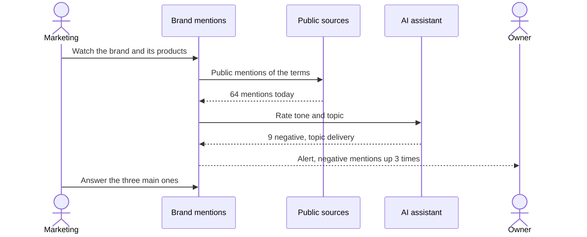

🏠 [Specs](../../../../README.md) › 🧩 [Functional capabilities](../../../README.md) ›
📣 [F5 Social media and marketing](../../README.md) › 📝 [Use cases](../README.md) › 📝 UC-F5-27 Listen to brand mentions

# 📝 UC-F5-27 Listen to brand mentions

**Status:** 🔄 waiting for the owner

## Summary

Marketing listens to what is said about the brand in public: mentions on social networks, news sites and review sites,
kept as a list with their source, tone and reach, so that the company can answer, learn and spot a crisis early.

## Personas

- [U12 Marketing and communication](../../../../01-users/personas/u12-marketing.md)
- [U13 Owner](../../../../01-users/personas/u13-owner.md)

## Goal

The company knows what the public says about it, in time to answer, and collects nothing that is not public.

## Trigger

A set of watched terms (the brand, products, people) set once; the mentions then arrive continuously.

## Frequency

Daily reading, with alerts the moment a mention spikes.

## Preconditions

- The terms to watch are defined: brand names, product names, spellings, languages.
- The sources allowed are chosen among public ones (networks' public posts, news, review sites).
- The social accounts of the company are connected for replies
  ([UC-F5-07](../04-connect-accounts/uc-f05-07-connect-the-company-s-accounts.md)).

## Postconditions

- **Succeeded:** each mention is recorded ([E-F5-24 Brand mention](../../data/e-f05-24-brand-mention.md)) with its
  source, link, tone and reach; alerts have gone out for spikes; a mention marketing wants to answer is in the inbox
  ([UC-F5-05](../03-inbox-and-statistics/uc-f05-05-answer-comments-and-messages.md)).
- **Failed:** no mention is lost silently: a source that cannot be read is shown as unavailable with the date of its
  last reading.

## Main flow

1. Marketing sets the watched terms and the sources on the mentions screen
   ([S-F5-27](../../screens/10-referrals-push-and-listening/s-f05-27-brand-mentions.md)).
2. simple-ERP collects public mentions of those terms on the allowed sources
   ([BR-F5-22](../../business-rules/br-f05-22-listening-collects-public-content-only.md)) and removes duplicates.
3. The AI assistant gives each mention a tone (positive, neutral, negative) and a topic, with its reason.
4. Marketing reads the list, filters by tone, source and reach, and opens a mention at its public address.
5. Marketing marks a mention as handled, answers it from the inbox, or turns it into a lead
   ([UC-F5-13](../05-benchmark-additions/uc-f05-13-turn-social-interactions-into-leads.md)).
6. When the count of negative mentions rises above the alert threshold, the owner and marketing are alerted.

## Alternative flows

- 1a. Marketing asks the AI assistant: "what do people say about our new range?"; it answers from the collected mentions
  and lists them, never from private posts.
- 4a. Marketing watches a competitor's name; the mentions are kept apart and not linked to any customer
  ([BR-F5-22](../../business-rules/br-f05-22-listening-collects-public-content-only.md)).
- 5a. A mention is a complaint about a delivery: marketing forwards it to the customer support queue
  [UC-F16-01](../../../f16-customer-support-agents/use-cases/01-resolve-a-request/uc-f16-01-resolve-a-customer-request-automatically.md).

## Error flows

- 2e. A source blocks reading or its terms forbid it: the source is shown as unavailable and no workaround is tried.
- 3e. The AI assistant cannot read the language of a mention: it is listed as not rated.
- 4e. A mention is deleted at its source: it stays in the list, marked as deleted at the source, without its text.
- Any step: a service does not answer; the call is retried first
  ([BR-F3-32](../../../f03-assistant/business-rules/br-f03-32-retry-before-an-error.md)), then the message follows the
  error pattern ([D122](../../../../06-decisions/ux/d122-error-message-standard.md)) and what the user typed stays on
  the screen.

## Business rules

- [BR-F5-22](../../business-rules/br-f05-22-listening-collects-public-content-only.md)
- [BR-F5-05](../../business-rules/br-f05-05-one-inbox-replies-by-a-person.md)
- [BR-F5-04 AI content is marked](../../business-rules/br-f05-04-ai-content-is-marked.md)

## Entities

- [E-F5-24 Brand mention](../../data/e-f05-24-brand-mention.md): created, changed
- [E-F5-02 Social account](../../data/e-f05-02-social-account.md): read, the accounts used for replies
- [E-F5-04 Social message](../../data/e-f05-04-social-message.md): created, when a mention is answered

## Permissions

Marketing and the owner. Other staff read the counts, never the authors' profiles.

## Notifications

Marketing and the owner, on their phone and in the app: a spike of negative mentions, with the top three.

## Audit events

Each term and source added or removed; each mention collected (source, date); each tone changed by a person; each alert.

## AI involvement

The AI assistant rates the tone and the topic of each mention with a short reason, and summarises the day; marketing can
correct a rating. It never answers a mention on its own
([BR-F5-05](../../business-rules/br-f05-05-one-inbox-replies-by-a-person.md)).

## API, MCP and A2A exposure

T5 operations of the capability for the personas above: create, read, update and list. The MCP tool of the
capability may read and propose, never confirm alone. No A2A skill.

## Screens

- [S-F5-27](../../screens/10-referrals-push-and-listening/s-f05-27-brand-mentions.md)

## Flowchart

See [FL-F5-10 Cards, referrals, push and listening](../../flows/fl-f05-10-referrals-push-and-listening.md#flowchart).

## Sequence diagram

## Acceptance criteria

1. **Given** a watched brand name **when** a public post mentions it **then** the mention appears with its source, link,
   tone and reach.
2. **Given** a private group's post **when** the sources are read **then** it is never collected.
3. **Given** negative mentions three times the usual count **when** the day's mentions are rated **then** the owner and
   marketing are alerted.
4. **Given** a mention deleted at its source **when** the list is refreshed **then** the mention stays, marked deleted,
   without its text.

## Non-functional notes

The screen answers within 2 seconds for 10,000 records; every change is audited.

## Regulatory references

Public content is still personal data when it names a person:
[CR-FR-050](../../../../10-country-packs/france/data-protection/cr-fr-050-privacy-by-design.md),
[CR-FR-052](../../../../10-country-packs/france/data-protection/cr-fr-052-storage-limitation.md). (Proposed) The
France-pack rule on collecting public posts is written later.

## Related use cases

- [UC-F5-26 Send push notifications](uc-f05-26-send-push-notifications.md)
- [UC-F5-28 Send postal mail campaigns](uc-f05-28-send-postal-mail-campaigns.md)
- [UC-F5-05](../03-inbox-and-statistics/uc-f05-05-answer-comments-and-messages.md)
- [UC-F5-13](../05-benchmark-additions/uc-f05-13-turn-social-interactions-into-leads.md)
- [UC-F5-06 Read statistics](../03-inbox-and-statistics/uc-f05-06-read-statistics.md)

## Open questions

None.

---

⬅️ [UC-F5-26 Send push notifications](uc-f05-26-send-push-notifications.md) · ⬆️ [Up](README.md) ·
➡️ [UC-F5-28 Send postal mail campaigns](uc-f05-28-send-postal-mail-campaigns.md)
