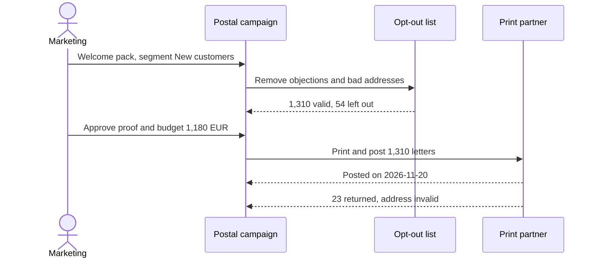

🏠 [Specs](../../../../README.md) › 🧩 [Functional capabilities](../../../README.md) ›
📣 [F5 Social media and marketing](../../README.md) › 📝 [Use cases](../README.md) ›
📝 UC-F5-28 Send postal mail campaigns

# 📝 UC-F5-28 Send postal mail campaigns

**Status:** 🔄 waiting for the owner

## Summary

Marketing sends a postal mail campaign: a letter or card printed and posted by a print partner to a segment of contacts,
with the addresses checked, the opt-outs removed and the cost counted.

## Personas

- [U12 Marketing and communication](../../../../01-users/personas/u12-marketing.md)

## Goal

Customers who prefer paper or cannot be reached online receive a letter, and nobody who objected receives one.

## Trigger

A campaign for which a paper mailing is the right channel (a welcome pack, a renewal, a catalogue), planned from the
campaign budget
[UC-F5-23](../09-brand-tests-and-return-on-investment/uc-f05-23-track-campaign-budget-cost-per-lead-and-return.md).

## Frequency

A few mailings a year, from hundreds to tens of thousands of letters.

## Preconditions

- The letter or card is designed in the brand kit with its merge fields
  ([E-F5-15 Brand asset](../../data/e-f05-15-brand-asset.md)).
- The segment to reach exists and its contacts have a postal address
  ([E-F5-09 Contact segment](../../data/e-f05-09-contact-segment.md),
  [E-F5-18 Contact](../../data/e-f05-18-contact.md)).
- A print and posting partner is connected in the integrations hub
  [UC-F24-02](../../../f24-integrations-hub/use-cases/01-find-and-connect/uc-f24-02-connect-a-tool-in-the-fewest-steps.md).

## Postconditions

- **Succeeded:** the mailing is saved ([E-F5-25 Postal campaign](../../data/e-f05-25-postal-campaign.md)) with the
  letters sent, the contacts left out and the cost; returned mail updates the contact's address status.
- **Failed:** no letter is printed; the draft stays and the contacts left out are listed with the reason.

## Main flow

1. Marketing opens the postal screen
   ([S-F5-28](../../screens/10-referrals-push-and-listening/s-f05-28-postal-campaign.md)) and chooses the letter
   template and the segment.
2. SimpleERP removes the contacts who objected to postal marketing and the addresses that fail the format check
   ([BR-F5-23](../../business-rules/br-f05-23-postal-campaigns-honour-opt-outs.md)) and shows the counts.
3. Marketing previews the letter for three contacts and the cost per letter and in total.
4. Marketing approves the proof and the budget, and chooses the posting date.
5. SimpleERP sends the file to the print partner and records the cost against the campaign budget.
6. The partner confirms the posting; returned mail is recorded with its reason as it comes back.

## Alternative flows

- 2a. A contact's opt-out arrives after the file left: marketing asks the partner to stop that letter if it is not
  printed yet; otherwise the contact is flagged for the next mailing.
- 4a. Marketing sets a test mailing to 10 internal addresses first.
- 6a. Returned mail marks the address as invalid; the contact is not mailed again until the address is corrected.

## Error flows

- 2e. The addresses of a large share of the segment fail the check: marketing is shown the share and asked to correct
  them or send anyway to the valid ones.
- 5e. The print partner refuses the file: the mailing stays Approved, with the partner's reason.
- 5f. The cost exceeds the campaign budget: the mailing waits for the owner's approval
  ([BR-F5-18](../../business-rules/br-f05-18-return-counts-only-traced-revenue.md)).
- Any step: a service does not answer; the call is retried first
  ([BR-F3-32](../../../f03-assistant/business-rules/br-f03-32-retry-before-an-error.md)), then the message follows the
  error pattern ([D122](../../../../06-decisions/ux/d122-error-message-standard.md)) and what the user typed stays on
  the screen.

## Business rules

- [BR-F5-23](../../business-rules/br-f05-23-postal-campaigns-honour-opt-outs.md)
- [BR-F5-08](../../business-rules/br-f05-08-marketing-needs-consent.md)
- [BR-F5-10](../../business-rules/br-f05-10-consent-is-proven-and-withdrawn-at-once.md)

## Entities

- [E-F5-25 Postal campaign](../../data/e-f05-25-postal-campaign.md): created, changed
- [E-F5-15 Brand asset](../../data/e-f05-15-brand-asset.md): read, the template
- [E-F5-09 Contact segment](../../data/e-f05-09-contact-segment.md): read, the segment
- [E-F5-17 Campaign budget](../../data/e-f05-17-campaign-budget.md): changed, the cost
- [E-F5-18 Contact](../../data/e-f05-18-contact.md): changed, the address status

## Permissions

Marketing prepares and approves; the owner approves a mailing above the campaign budget.

## Notifications

Marketing, in the app: the partner confirmed the posting, with the count of returned mail after 30 days.

## Audit events

Each mailing (template, segment, counts, cost, by whom and when); each opt-out honoured and the contact it removed; each
returned letter.

## AI involvement

The AI assistant may draft the letter's text and marks it
([BR-F5-04](../../business-rules/br-f05-04-ai-content-is-marked.md)); marketing approves the proof before anything is
printed.

## API, MCP and A2A exposure

T5 operations of the capability for the personas above: create, read, update and list. The MCP tool of the
capability may read and propose, never confirm alone. No A2A skill.

## Screens

- [S-F5-28](../../screens/10-referrals-push-and-listening/s-f05-28-postal-campaign.md)

## Flowchart

See [FL-F5-10 Cards, referrals, push and listening](../../flows/fl-f05-10-referrals-push-and-listening.md#flowchart).

## Sequence diagram

## Acceptance criteria

1. **Given** a segment of 1,364 contacts with 30 objections and 24 bad addresses **when** marketing prepares the mailing
   **then** 1,310 letters are planned and 54 contacts are listed as left out.
2. **Given** a contact who objected last month **when** a mailing is prepared **then** no letter is planned for them.
3. **Given** a cost above the campaign budget **when** marketing approves **then** the mailing waits for the owner.
4. **Given** a letter returned as unknown at this address **when** the partner reports it **then** the address is
   flagged and the contact is skipped next time.

## Non-functional notes

The screen answers within 2 seconds for 10,000 records; every change is audited.

## Regulatory references

The right to object to direct marketing applies to paper as well:
[CR-FR-050](../../../../10-country-packs/france/data-protection/cr-fr-050-privacy-by-design.md),
[CR-FR-051](../../../../10-country-packs/france/data-protection/cr-fr-051-access-and-erasure.md). (Proposed) The
France-pack rule on postal marketing opt-outs is written later.

## Related use cases

- [UC-F5-27 Listen to brand mentions](uc-f05-27-listen-to-brand-mentions.md)
- [UC-F5-23](../09-brand-tests-and-return-on-investment/uc-f05-23-track-campaign-budget-cost-per-lead-and-return.md)
- [UC-F5-14](../06-audiences-consent-and-journeys/uc-f05-14-build-a-segment-of-contacts.md)
- [UC-F5-15](../06-audiences-consent-and-journeys/uc-f05-15-record-and-prove-consent.md)

## Open questions

None.

---

⬅️ [UC-F5-27 Listen to brand mentions](uc-f05-27-listen-to-brand-mentions.md) · ⬆️ [Up](README.md)
