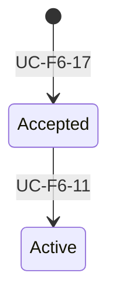

🏠 [Specs](../../../README.md) › 🧩 [Functional capabilities](../../README.md) ›
🛒 [F6 Customers and sales](../README.md) › 🗃️ [Data](README.md) › 🗃️ E-F6-01 Customer record

# 🗃️ E-F6-01 Customer record

**Status:** ✅ specified

## Purpose

A company or person who buys, with its contacts.

## Fields

| Name | Type | Required | Validation | Default | Example | Personal data | Custom fields |
|---|---|---|---|---|---|---|---|
| name | text | yes | - | - | Durand SA | maybe | yes |
| kind | company, person | yes | - | company | company | no | no |
| SIREN | text | for French companies | 9 digits, checked | - | 552 100 554 | no | no |
| contacts | people | no | - | - | J. Durand | yes | yes |
| price list | price list | no | - | default | Trade | no | no |
| reminder profile | profile | yes | - | standard | standard | no | no |

## Relations

As its use cases.

## Lifecycle

## Indexes and search

By number, customer, date.

## Retention

Invoices and accounting documents 10 years (Code de commerce L123-22); leads 3 years after the last contact (CNIL). See
[CR-FR-002 Accounting records kept 10 years](../../../10-country-packs/france/accounting/cr-fr-002-accounting-records-kept-ten-years.md),
[CR-FR-052 Personal data kept no longer than needed](../../../10-country-packs/france/data-protection/cr-fr-052-storage-limitation.md).

## Audit

Every change.

## Import and export

CSV import and export.

## Used by

- [UC-F6-01](../use-cases/01-lead-to-quote/uc-f06-01-capture-and-qualify-a-lead.md)
- [UC-F6-11](../use-cases/02-quote-to-order/uc-f06-11-use-the-customer-portal.md)
- [UC-F6-17 Organise accounts with their timeline and emails](../use-cases/06-accounts-and-credit/uc-f06-17-organise-accounts-with-their-timeline-and-emails.md)
- [UC-F10-25 Serve a customer with their profile](../../f10-point-of-sale/use-cases/10-clienteling-transfers-and-tax-free/uc-f10-25-serve-a-customer-with-their-profile.md)

## Open questions

None.

---

⬆️ [Up](README.md) · ➡️ [E-F6-02 Opportunity](e-f06-02-opportunity.md)
