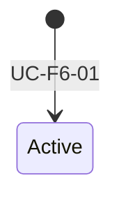

🏠 [Specs](../../../README.md) › 🧩 [Functional capabilities](../../README.md) ›
🛒 [F6 Customers and sales](../README.md) › 🗃️ [Data](README.md) › 🗃️ E-F6-02 Opportunity

# 🗃️ E-F6-02 Opportunity

**Status:** ✅ specified

## Purpose

A possible sale in the pipeline.

## Fields

| Name | Type | Required | Validation | Default | Example | Personal data | Custom fields |
|---|---|---|---|---|---|---|---|
| customer | customer | yes | - | - | Durand SA | no | no |
| amount | money | no | - | - | 48,000 EUR | no | yes |
| stage | stage | yes | per company | first | Proposal | no | no |
| next activity | date | no | - | - | 2026-11-20 | no | no |
| lost reason | text | when lost | - | - | Price | no | no |

## Relations

As its use cases.

## Lifecycle

## Indexes and search

By number, customer, date.

## Retention

Invoices and accounting documents 10 years (Code de commerce L123-22); leads 3 years after the last contact (CNIL). See
[CR-FR-002 Accounting records kept 10 years](../../../10-country-packs/france/accounting/cr-fr-002-accounting-records-kept-ten-years.md),
[CR-FR-052 Personal data kept no longer than needed](../../../10-country-packs/france/data-protection/cr-fr-052-storage-limitation.md).

## Audit

Every change.

## Import and export

CSV import and export.

## Used by

- [UC-F6-01](../use-cases/01-lead-to-quote/uc-f06-01-capture-and-qualify-a-lead.md)
- [UC-F6-02](../use-cases/01-lead-to-quote/uc-f06-02-manage-the-pipeline-and-forecast.md)

## Open questions

None.

---

⬅️ [E-F6-01 Customer record](e-f06-01-customer-record.md) · ⬆️ [Up](README.md) · ➡️ [E-F6-03 Quote](e-f06-03-quote.md)
