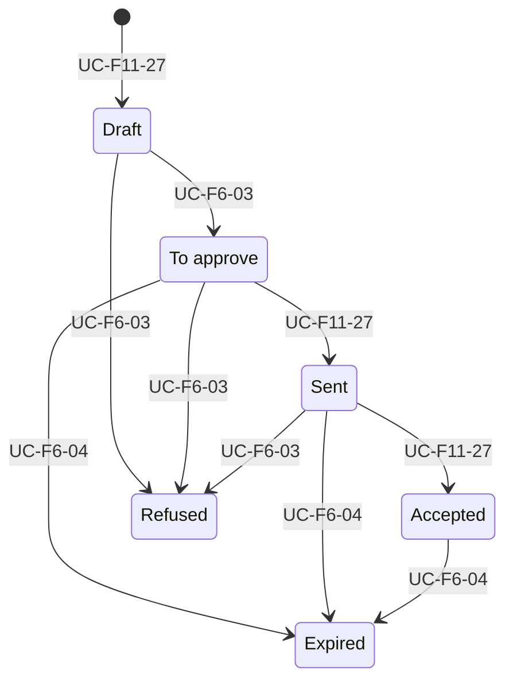

🏠 [Specs](../../../README.md) › 🧩 [Functional capabilities](../../README.md) ›
🛒 [F6 Customers and sales](../README.md) › 🗃️ [Data](README.md) › 🗃️ E-F6-03 Quote

# 🗃️ E-F6-03 Quote

**Status:** ✅ specified

## Purpose

An offer to a customer, versioned, accepted or signed.

## Fields

| Name | Type | Required | Validation | Default | Example | Personal data | Custom fields |
|---|---|---|---|---|---|---|---|
| number | text | yes | unique | sequence | Q-2026-121 | no | no |
| version | number | yes | - | 1 | 2 | no | no |
| lines | list, each with its VAT rate | yes | - | - | Labour 3 days, 20 % | no | yes |
| totals | excl. VAT, VAT per rate, incl. VAT | yes | BR-F6-08 | computed | 48,806.00 / 9,761.20 / 58,567.20 | no | no |
| valid until | date | yes | - | +30 days | 2026-12-10 | no | no |
| state | draft, to approve, sent, accepted, refused, expired | yes | - | draft | accepted | no | no |
| acceptance proof | click data or signature file | when accepted | BR-F6-01 | - | - | yes | no |

## Relations

As its use cases.

## Lifecycle

## Indexes and search

By number, customer, date.

## Retention

Invoices and accounting documents 10 years (Code de commerce L123-22); leads 3 years after the last contact
(CNIL). See
[CR-FR-002 Accounting records kept 10 years](../../../10-country-packs/france/accounting/cr-fr-002-accounting-records-kept-ten-years.md),
[CR-FR-052 Personal data kept no longer than needed](../../../10-country-packs/france/data-protection/cr-fr-052-storage-limitation.md).

## Audit

Every change.

## Import and export

CSV import and export.

## Used by

- [UC-F6-03](../use-cases/01-lead-to-quote/uc-f06-03-create-and-send-a-quote.md)
- [UC-F6-04](../use-cases/02-quote-to-order/uc-f06-04-accept-or-sign-a-quote.md)
- [UC-F6-11](../use-cases/02-quote-to-order/uc-f06-11-use-the-customer-portal.md)
- [UC-F11-27 Request a quote or punch out from a buyer's system](../../f11-online-shop/use-cases/09-pre-orders-and-b2b-buying/uc-f11-27-request-a-quote-or-punch-out-from-a-buyers-system.md)

## Open questions

None.

---

⬅️ [E-F6-02 Opportunity](e-f06-02-opportunity.md) · ⬆️ [Up](README.md) · ➡️ [E-F6-04 Order](e-f06-04-order.md)
