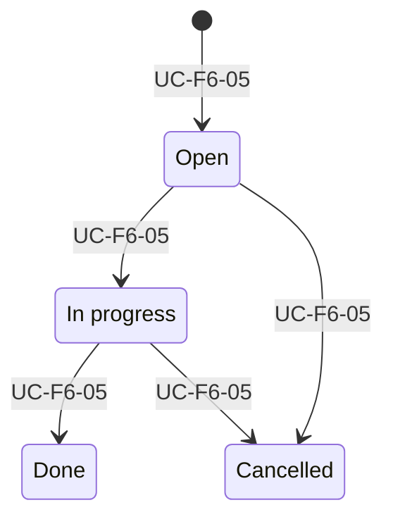

🏠 [Specs](../../../README.md) › 🧩 [Functional capabilities](../../README.md) ›
🛒 [F6 Customers and sales](../README.md) › 🗃️ [Data](README.md) › 🗃️ E-F6-04 Order

# 🗃️ E-F6-04 Order

**Status:** ✅ specified

## Purpose

An accepted quote to deliver or carry out.

## Fields

| Name | Type | Required | Validation | Default | Example | Personal data | Custom fields |
|---|---|---|---|---|---|---|---|
| number | text | yes | unique | sequence | O-2026-088 | no | no |
| quote | quote | no | - | - | Q-2026-121 v2 | no | no |
| progress | percent | yes | - | 0 | 40 % | no | no |
| state | open, in progress, done, cancelled | yes | - | open | in progress | no | no |

## Relations

As its use cases.

## Lifecycle

## Indexes and search

By number, customer, date.

## Retention

Invoices and accounting documents 10 years (Code de commerce L123-22); leads 3 years after the last contact
(CNIL). See
[CR-FR-002 Accounting records kept 10 years](../../../10-country-packs/france/accounting/cr-fr-002-accounting-records-kept-ten-years.md),
[CR-FR-052 Personal data kept no longer than needed](../../../10-country-packs/france/data-protection/cr-fr-052-storage-limitation.md).

## Audit

Every change.

## Import and export

CSV import and export.

## Used by

- [UC-F6-05](../use-cases/02-quote-to-order/uc-f06-05-turn-a-quote-into-an-order-and-follow-it.md)
- [UC-F6-18 Set a credit limit and hold orders](../use-cases/06-accounts-and-credit/uc-f06-18-set-a-credit-limit-and-hold-orders.md)
- [UC-F6-21 Take orders offline on the road](../use-cases/09-sell-on-the-road-and-steer-sales/uc-f06-21-take-orders-offline-on-the-road.md)

## Open questions

None.

---

⬅️ [E-F6-03 Quote](e-f06-03-quote.md) · ⬆️ [Up](README.md) · ➡️ [E-F6-05 Invoice](e-f06-05-invoice.md)
