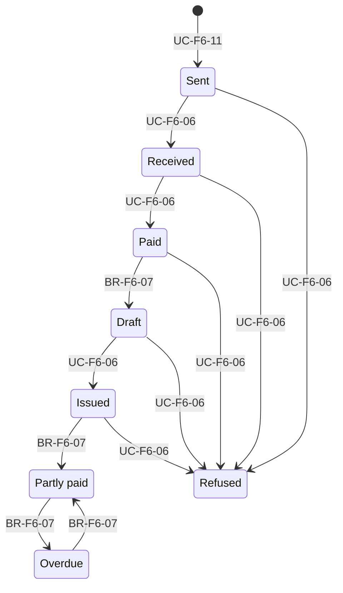

🏠 [Specs](../../../README.md) › 🧩 [Functional capabilities](../../README.md) ›
🛒 [F6 Customers and sales](../README.md) › 🗃️ [Data](README.md) › 🗃️ E-F6-05 Invoice

# 🗃️ E-F6-05 Invoice

**Status:** ✅ specified

## Purpose

An invoice or credit note, numbered without gaps.

## Fields

| Name | Type | Required | Validation | Default | Example | Personal data | Custom fields |
|---|---|---|---|---|---|---|---|
| number | text | yes | continuous, never reused (BR-F6-07) | sequence | F-2026-0412 | no | no |
| kind | deposit, progress, final, credit note, subscription | yes | - | final | progress | no | no |
| retention | money | no | 5 % when the contract says | - | 620 EUR | no | no |
| totals | excl. VAT, VAT per rate, incl. VAT | yes | BR-F6-08 | computed | 12,201.50 / 2,440.30 / 14,641.80 | no | no |
| VAT mention | text | when no VAT | BR-F6-08 | - | Autoliquidation | no | no |
| due date | date | yes | for a business customer, at most the country pack's cap (France: 60 days from the invoice, or 45 days end of month, CR-FR-018) | +30 days | 2026-12-03 | no | no |
| e-invoicing status | sent, received, refused, paid | no | - | - | received | no | no |
| state | draft, issued, partly paid, paid, overdue | yes | - | draft | overdue | no | no |

## Relations

As its use cases.

## Lifecycle

## Indexes and search

By number, customer, date.

## Retention

Invoices and accounting documents 10 years (Code de commerce L123-22); leads 3 years after the last contact (CNIL). See
[CR-FR-002 Accounting records kept 10 years](../../../10-country-packs/france/accounting/cr-fr-002-accounting-records-kept-ten-years.md),
[CR-FR-052 Personal data kept no longer than needed](../../../10-country-packs/france/data-protection/cr-fr-052-storage-limitation.md).

## Audit

Every change.

## Import and export

CSV import and export.

## Used by

- [UC-F6-06](../use-cases/03-invoice-and-get-paid/uc-f06-06-invoice-deposits-progress-and-final.md)
- [UC-F6-08](../use-cases/03-invoice-and-get-paid/uc-f06-08-remind-late-payers.md)
- [UC-F6-09](../use-cases/03-invoice-and-get-paid/uc-f06-09-credit-note-and-refund.md)
- [UC-F6-11](../use-cases/02-quote-to-order/uc-f06-11-use-the-customer-portal.md)
- [UC-F6-19 Invoice a public buyer through Chorus Pro](../use-cases/07-special-invoicing/uc-f06-19-invoice-a-public-buyer-through-chorus-pro.md)
- [UC-F6-20 Invoice several payers with funders and caps](../use-cases/07-special-invoicing/uc-f06-20-invoice-several-payers-with-funders-and-caps.md)
- [UC-F6-22 Issue a pro-forma invoice and a statement of account](../use-cases/07-special-invoicing/uc-f06-22-issue-a-pro-forma-invoice-and-a-statement-of-account.md)
- [UC-F6-23 Agree an instalment plan](../use-cases/08-collect-and-settle/uc-f06-23-agree-an-instalment-plan.md)
- [UC-F6-24 Handle a disputed invoice](../use-cases/08-collect-and-settle/uc-f06-24-handle-a-disputed-invoice.md)
- [UC-F6-26 Read sales and margin reports](../use-cases/09-sell-on-the-road-and-steer-sales/uc-f06-26-read-sales-and-margin-reports.md)

## Open questions

None.

---

⬅️ [E-F6-04 Order](e-f06-04-order.md) · ⬆️ [Up](README.md) ·
➡️ [E-F6-06 Customer payment](e-f06-06-customer-payment.md)
