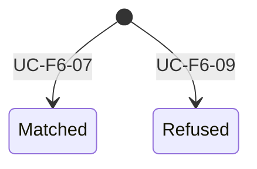

🏠 [Specs](../../../README.md) › 🧩 [Functional capabilities](../../README.md) ›
🛒 [F6 Customers and sales](../README.md) › 🗃️ [Data](README.md) › 🗃️ E-F6-06 Customer payment

# 🗃️ E-F6-06 Customer payment

**Status:** ✅ specified

## Purpose

Money received or refunded.

## Fields

| Name | Type | Required | Validation | Default | Example | Personal data | Custom fields |
|---|---|---|---|---|---|---|---|
| amount | money | yes | - | - | 4,150 EUR | no | no |
| method | card, wallet, SEPA debit, transfer, cheque, cash | yes | - | - | card | no | no |
| provider reference | text | no | never a card number (BR-F6-02) | - | pi_3Q... | no | no |
| invoices | invoices | no | matched | - | F-2026-0412 | no | no |

## Relations

As its use cases.

## Lifecycle

## Indexes and search

By number, customer, date.

## Retention

Invoices and accounting documents 10 years (Code de commerce L123-22); leads 3 years after the last contact (CNIL). See
[CR-FR-002 Accounting records kept 10 years](../../../10-country-packs/france/accounting/cr-fr-002-accounting-records-kept-ten-years.md),
[CR-FR-052 Personal data kept no longer than needed](../../../10-country-packs/france/data-protection/cr-fr-052-storage-limitation.md).

## Audit

Every change.

## Import and export

CSV import and export.

## Used by

- [UC-F6-07](../use-cases/03-invoice-and-get-paid/uc-f06-07-get-paid-online-and-reconcile.md)
- [UC-F6-09](../use-cases/03-invoice-and-get-paid/uc-f06-09-credit-note-and-refund.md)

## Open questions

None.

---

⬅️ [E-F6-05 Invoice](e-f06-05-invoice.md) · ⬆️ [Up](README.md) ·
➡️ [E-F6-07 Subscription contract](e-f06-07-subscription-contract.md)
