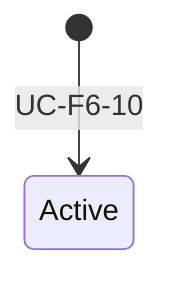

🏠 [Specs](../../../README.md) › 🧩 [Functional capabilities](../../README.md) ›
🛒 [F6 Customers and sales](../README.md) › 🗃️ [Data](README.md) › 🗃️ E-F6-07 Subscription contract

# 🗃️ E-F6-07 Subscription contract

**Status:** ✅ specified

## Purpose

A recurring contract.

## Fields

| Name | Type | Required | Validation | Default | Example | Personal data | Custom fields |
|---|---|---|---|---|---|---|---|
| customer | customer | yes | - | - | Durand SA | no | no |
| lines | list | yes | - | - | Boiler maintenance | no | yes |
| period | month, quarter, year | yes | - | year | year | no | no |
| renewal | automatic, with notice | yes | - | automatic | automatic | no | no |
| index | text | no | - | - | Syntec | no | no |

## Relations

As its use cases.

## Lifecycle

## Indexes and search

By number, customer, date.

## Retention

Invoices and accounting documents 10 years (Code de commerce L123-22); leads 3 years after the last contact (CNIL). See
[CR-FR-002 Accounting records kept 10 years](../../../10-country-packs/france/accounting/cr-fr-002-accounting-records-kept-ten-years.md),
[CR-FR-052 Personal data kept no longer than needed](../../../10-country-packs/france/data-protection/cr-fr-052-storage-limitation.md).

## Audit

Every change.

## Import and export

CSV import and export.

## Used by

- [UC-F6-10](../use-cases/04-subscriptions/uc-f06-10-manage-subscriptions.md)
- [UC-F6-11](../use-cases/02-quote-to-order/uc-f06-11-use-the-customer-portal.md)

## Open questions

None.

---

⬅️ [E-F6-06 Customer payment](e-f06-06-customer-payment.md) · ⬆️ [Up](README.md) ·
➡️ [E-F6-08 Sales price list](e-f06-08-sales-price-list.md)
