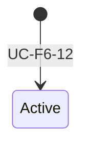

🏠 [Specs](../../../README.md) › 🧩 [Functional capabilities](../../README.md) ›
🛒 [F6 Customers and sales](../README.md) › 🗃️ [Data](README.md) › 🗃️ E-F6-08 Sales price list

# 🗃️ E-F6-08 Sales price list

**Status:** ✅ specified

## Purpose

Prices and discount rules for a group, currency or period.

## Fields

| Name | Type | Required | Validation | Default | Example | Personal data | Custom fields |
|---|---|---|---|---|---|---|---|
| name | text | yes | unique | - | Trade | no | no |
| currency | currency | yes | - | EUR | EUR | no | no |
| valid | dates | no | - | - | 2026 | no | no |
| rules | list | no | - | - | -10 % over 100 units | no | no |
| discount thresholds | per role | no | BR-F6-04 | 15 % | Sales 15 %, Manager 30 % | no | no |

## Relations

As its use cases.

## Lifecycle

## Indexes and search

By number, customer, date.

## Retention

Invoices and accounting documents 10 years (Code de commerce L123-22); leads 3 years after the last contact (CNIL). See
[CR-FR-002 Accounting records kept 10 years](../../../10-country-packs/france/accounting/cr-fr-002-accounting-records-kept-ten-years.md),
[CR-FR-052 Personal data kept no longer than needed](../../../10-country-packs/france/data-protection/cr-fr-052-storage-limitation.md).

## Audit

Every change.

## Import and export

CSV import and export.

## Used by

- [UC-F6-03](../use-cases/01-lead-to-quote/uc-f06-03-create-and-send-a-quote.md)
- [UC-F6-12](../use-cases/01-lead-to-quote/uc-f06-12-manage-price-lists-and-discounts.md)

## Open questions

None.

---

⬅️ [E-F6-07 Subscription contract](e-f06-07-subscription-contract.md) · ⬆️ [Up](README.md) ·
➡️ [E-F6-09 Rental](e-f06-09-rental.md)
