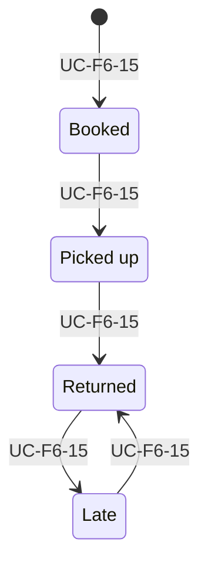

🏠 [Specs](../../../README.md) › 🧩 [Functional capabilities](../../README.md) ›
🛒 [F6 Customers and sales](../README.md) › 🗃️ [Data](README.md) › 🗃️ E-F6-09 Rental

# 🗃️ E-F6-09 Rental

**Status:** ✅ specified

## Purpose

A rental of an item for a period.

## Fields

| Name | Type | Required | Validation | Default | Example | Personal data | Custom fields |
|---|---|---|---|---|---|---|---|
| item | product with serial | yes | BR-F6-09 | - | Scaffold S-12 | no | no |
| period | dates | yes | - | - | 1 to 5 Dec | no | no |
| state | booked, picked up, returned, late | yes | - | booked | returned | no | no |

## Relations

As its use cases.

## Lifecycle

## Indexes and search

By name, date, owner.

## Retention

Kept for the period of its kind of record in the country pack (D293), or else its kind's default in the
[retention schedule](../../../05-non-functional/data-retention.md). See
[CR-FR-002 Accounting records kept 10 years](../../../10-country-packs/france/accounting/cr-fr-002-accounting-records-kept-ten-years.md),
[CR-FR-052 Personal data kept no longer than needed](../../../10-country-packs/france/data-protection/cr-fr-052-storage-limitation.md).

## Audit

Every change.

## Import and export

CSV.

## Used by

- [UC-F6-15](../use-cases/05-benchmark-additions/uc-f06-15-rent-out-equipment.md)

## Open questions

None.

---

⬅️ [E-F6-08 Sales price list](e-f06-08-sales-price-list.md) · ⬆️ [Up](README.md) ·
➡️ [E-F6-10 Rate plan and meter](e-f06-10-rate-plan-and-meter.md)
