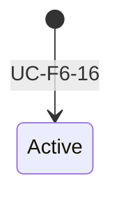

🏠 [Specs](../../../README.md) › 🧩 [Functional capabilities](../../README.md) ›
🛒 [F6 Customers and sales](../README.md) › 🗃️ [Data](README.md) › 🗃️ E-F6-10 Rate plan and meter

# 🗃️ E-F6-10 Rate plan and meter

**Status:** ✅ specified

## Purpose

How usage is priced and measured.

## Fields

| Name | Type | Required | Validation | Default | Example | Personal data | Custom fields |
|---|---|---|---|---|---|---|---|
| plan | tiers, commitment, overage | yes | - | - | 10 000 units then 0.02 | no | no |
| readings | quantity, date, source | yes | BR-F6-10 | - | 12 400 | no | no |
| credits | prepaid balance | no | - | 0 | 500.00 | no | no |

## Relations

As its use cases.

## Lifecycle

## Indexes and search

By name, date, owner.

## Retention

Kept for the period of its kind of record in the country pack (D293), or else its kind's default in the
[retention schedule](../../../05-non-functional/data-retention.md). See
[CR-FR-002 Accounting records kept 10 years](../../../10-country-packs/france/accounting/cr-fr-002-accounting-records-kept-ten-years.md),
[CR-FR-052 Personal data kept no longer than needed](../../../10-country-packs/france/data-protection/cr-fr-052-storage-limitation.md).

## Audit

Every change.

## Import and export

CSV.

## Used by

- [UC-F6-16](../use-cases/05-benchmark-additions/uc-f06-16-bill-usage-commitments-and-milestones.md)

## Open questions

None.

---

⬅️ [E-F6-09 Rental](e-f06-09-rental.md) · ⬆️ [Up](README.md) · ➡️ [E-F6-11 Timeline entry](e-f06-11-timeline-entry.md)
