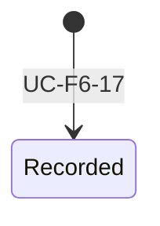

🏠 [Specs](../../../README.md) › 🧩 [Functional capabilities](../../README.md) ›
🛒 [F6 Customers and sales](../README.md) › 🗃️ [Data](README.md) › 🗃️ E-F6-11 Timeline entry

# 🗃️ E-F6-11 Timeline entry

**Status:** ✅ specified

## Purpose

One event of an account's timeline: an email, call, meeting, document, order, invoice, payment or request.

## Fields

| Name | Type | Required | Validation | Default | Example | Personal data | Custom fields |
|---|---|---|---|---|---|---|---|
| account | customer | yes | - | - | Brasserie du Parc | no | - |
| kind | email, call, meeting, quote, order, invoice, payment, request | yes | - | - | email | no | - |
| date | date and time | yes | - | - | 2026-11-12 09:14 | no | - |
| summary | text | yes | - | - | Order for December | yes | - |
| link | record | yes | - | - | Email 4412 | no | - |

## Relations

Points to the record it shows; a Customer has many.

## Lifecycle

Created when its record is.

## Indexes and search

By account, kind and date.

## Retention

As the record it shows.

## Audit

None: a view of records.

## Import and export

None.

## Used by

- [UC-F6-17 Organise accounts with their timeline and emails](../use-cases/06-accounts-and-credit/uc-f06-17-organise-accounts-with-their-timeline-and-emails.md)

## Open questions

None.

---

⬅️ [E-F6-10 Rate plan and meter](e-f06-10-rate-plan-and-meter.md) · ⬆️ [Up](README.md) ·
➡️ [E-F6-12 Credit limit](e-f06-12-credit-limit.md)
