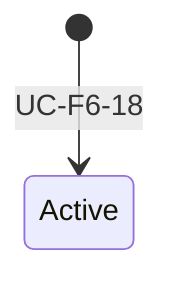

🏠 [Specs](../../../README.md) › 🧩 [Functional capabilities](../../README.md) ›
🛒 [F6 Customers and sales](../README.md) › 🗃️ [Data](README.md) › 🗃️ E-F6-12 Credit limit

# 🗃️ E-F6-12 Credit limit

**Status:** 🔄 waiting for the owner

## Purpose

The credit a customer or group may use, and its holds.

## Fields

| Name | Type | Required | Validation | Default | Example | Personal data | Custom fields |
|---|---|---|---|---|---|---|---|
| customer or group | customer | yes | - | - | Brasserie du Parc group | no | - |
| limit | amount | yes | 0 or more | - | 20,000 EUR | no | - |
| overdue days | number | no | - | 30 (Proposed) | 30 | no | - |
| review date | date | no | - | - | 2027-06-30 | no | - |
| holds | orders with reason and release | no | - | - | Order 3381 held | no | - |

### Sector extension: SC15 Wholesale and distribution

From [E-SC15-12 Credit limit](../../../08-sectors/sc15-wholesale-and-distribution/data/e-sc15-12-credit-limit.md),
merged here ([D516](../../../06-decisions/foundations/d516-naming-rules-and-the-seven-classes-of-names.md), shared name
"Credit limit"). A customer's credit limit.

| Name | Type | Required | Validation | Default | Example | Personal data | Custom fields |
|---|---|---|---|---|---|---|---|
| customer, limit, used | records | yes | BR-SC15-08 | - | Bistro Group, 50 000, 46 000 | no | no |

## Relations

One per Customer or parent; holds point to Orders.

## Lifecycle

Set, reviewed, changed.

## Indexes and search

Credit control list.

## Retention

10 years with the accounts (Proposed).

## Audit

Limit changed, holds and releases with reason.

## Import and export

None.

## Used by

- [UC-F6-18 Set a credit limit and hold orders](../use-cases/06-accounts-and-credit/uc-f06-18-set-a-credit-limit-and-hold-orders.md)
- [UC-SC15-16 Manage customer credit limits](../../../08-sectors/sc15-wholesale-and-distribution/use-cases/05-sales-force-and-performance/uc-sc15-16-manage-customer-credit-limits.md)

## Open questions

None.

---

⬅️ [E-F6-11 Timeline entry](e-f06-11-timeline-entry.md) · ⬆️ [Up](README.md) ·
➡️ [E-F6-13 Public buyer setting](e-f06-13-public-buyer-setting.md)
