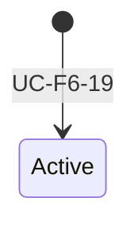

🏠 [Specs](../../../README.md) › 🧩 [Functional capabilities](../../README.md) ›
🛒 [F6 Customers and sales](../README.md) › 🗃️ [Data](README.md) › 🗃️ E-F6-13 Public buyer setting

# 🗃️ E-F6-13 Public buyer setting

**Status:** ✅ specified

## Purpose

A public customer's Chorus Pro references.

## Fields

| Name | Type | Required | Validation | Default | Example | Personal data | Custom fields |
|---|---|---|---|---|---|---|---|
| customer | customer | yes | public buyer | - | Town hall of Villeurbanne | no | - |
| SIRET | SIRET | yes | valid | - | 21690266800013 | no | - |
| service code | text | no | as the buyer's | - | SERV-TECH | no | - |
| engagement number required | yes, no | yes | - | no | yes | no | - |

## Relations

One per public Customer; Invoices carry the engagement number.

## Lifecycle

Set, changed.

## Indexes and search

By SIRET.

## Retention

While the customer exists.

## Audit

Changed.

## Import and export

None.

## Used by

- [UC-F6-19 Invoice a public buyer through Chorus Pro](../use-cases/07-special-invoicing/uc-f06-19-invoice-a-public-buyer-through-chorus-pro.md)

## Open questions

None.

---

⬅️ [E-F6-12 Credit limit](e-f06-12-credit-limit.md) · ⬆️ [Up](README.md) ·
➡️ [E-F6-14 Funder agreement](e-f06-14-funder-agreement.md)
