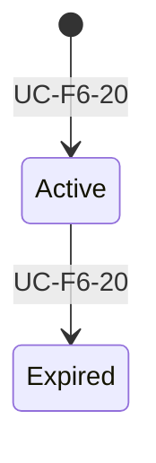

🏠 [Specs](../../../README.md) › 🧩 [Functional capabilities](../../README.md) ›
🛒 [F6 Customers and sales](../README.md) › 🗃️ [Data](README.md) › 🗃️ E-F6-14 Funder agreement

# 🗃️ E-F6-14 Funder agreement

**Status:** 🔄 waiting for the owner

## Purpose

A third party paying part of a beneficiary's services: share, cap and period.

## Fields

| Name | Type | Required | Validation | Default | Example | Personal data | Custom fields |
|---|---|---|---|---|---|---|---|
| beneficiary | customer or record | yes | - | - | Mme Roche | yes | - |
| funder | customer | yes | - | - | Département du Rhône | no | - |
| share | percent or amount | yes | - | - | 70 % | no | - |
| cap | hours or amount per period | no | - | - | 40 h a month | no | - |
| period | dates | yes | - | - | 2026-01-01 to 2026-12-31 | no | - |
| format | Chorus Pro, funder file, invoice | yes | - | invoice | Chorus Pro | no | - |

## Relations

Several per beneficiary, in order; used when invoicing.

## Lifecycle

Active, expired.

## Indexes and search

By beneficiary and funder.

## Retention

10 years with the invoices (Proposed).

## Audit

Created, changed, ended.

## Import and export

None.

## Used by

- [UC-F6-20 Invoice several payers with funders and caps](../use-cases/07-special-invoicing/uc-f06-20-invoice-several-payers-with-funders-and-caps.md)

## Open questions

None.

---

⬅️ [E-F6-13 Public buyer setting](e-f06-13-public-buyer-setting.md) · ⬆️ [Up](README.md) ·
➡️ [E-F6-15 Pro-forma invoice](e-f06-15-pro-forma-invoice.md)
