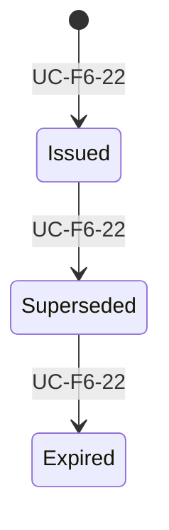

🏠 [Specs](../../../README.md) › 🧩 [Functional capabilities](../../README.md) ›
🛒 [F6 Customers and sales](../README.md) › 🗃️ [Data](README.md) › 🗃️ E-F6-15 Pro-forma invoice

# 🗃️ E-F6-15 Pro-forma invoice

**Status:** ✅ specified

## Purpose

A priced document before an invoice, with its own numbering.

## Fields

| Name | Type | Required | Validation | Default | Example | Personal data | Custom fields |
|---|---|---|---|---|---|---|---|
| number | PF range | yes | own range | - | PF-2026-031 | no | - |
| source | quote or order | yes | - | - | Q-218 | no | - |
| lines and totals | as the source | yes | - | - | 8,400 EUR excl. VAT | no | - |
| valid until | date | no | - | - | 2026-12-31 | no | - |

## Relations

From a Quote or Order; never an accounting entry.

## Lifecycle

Issued, superseded, expired.

## Indexes and search

By number and customer.

## Retention

As commercial documents.

## Audit

Issued.

## Import and export

None.

## Used by

- [UC-F6-22 Issue a pro-forma invoice and a statement of account](../use-cases/07-special-invoicing/uc-f06-22-issue-a-pro-forma-invoice-and-a-statement-of-account.md)

## Open questions

None.

---

⬅️ [E-F6-14 Funder agreement](e-f06-14-funder-agreement.md) · ⬆️ [Up](README.md) ·
➡️ [E-F6-16 Instalment plan](e-f06-16-instalment-plan.md)
