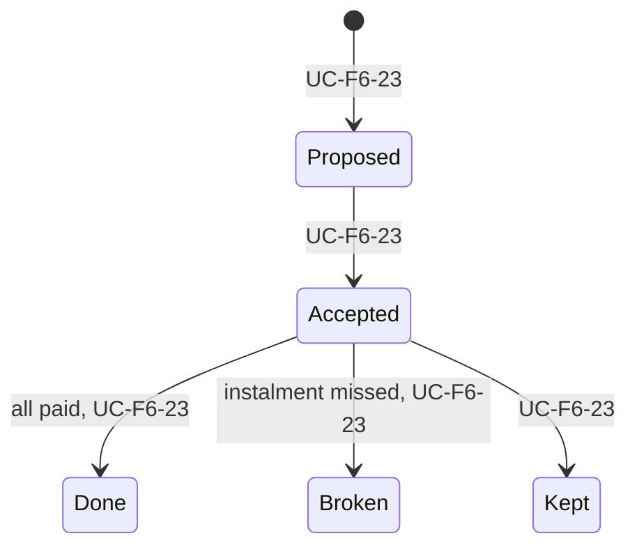

🏠 [Specs](../../../README.md) › 🧩 [Functional capabilities](../../README.md) ›
🛒 [F6 Customers and sales](../README.md) › 🗃️ [Data](README.md) › 🗃️ E-F6-16 Instalment plan

# 🗃️ E-F6-16 Instalment plan

**Status:** 🔄 waiting for the owner

## Purpose

An agreed schedule to pay a balance.

## Fields

| Name | Type | Required | Validation | Default | Example | Personal data | Custom fields |
|---|---|---|---|---|---|---|---|
| customer | customer | yes | - | - | Brasserie du Parc | no | - |
| invoices | list | yes | open | - | 3 invoices | no | - |
| instalments | date and amount | yes | sum to the balance | - | 3 x 1,400 EUR | no | - |
| status | proposed, accepted, kept, broken, done | yes | - | proposed | accepted | no | - |

## Relations

Covers Invoices; payments are matched to instalments.

## Lifecycle

## Indexes and search

By customer and status.

## Retention

10 years with the invoices (Proposed).

## Audit

As UC-F6-23's audit events.

## Import and export

None.

## Used by

- [UC-F6-23 Agree an instalment plan](../use-cases/08-collect-and-settle/uc-f06-23-agree-an-instalment-plan.md)

## Open questions

None.

---

⬅️ [E-F6-15 Pro-forma invoice](e-f06-15-pro-forma-invoice.md) · ⬆️ [Up](README.md) ·
➡️ [E-F6-17 Invoice dispute](e-f06-17-invoice-dispute.md)
