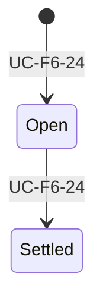

🏠 [Specs](../../../README.md) › 🧩 [Functional capabilities](../../README.md) ›
🛒 [F6 Customers and sales](../README.md) › 🗃️ [Data](README.md) › 🗃️ E-F6-17 Invoice dispute

# 🗃️ E-F6-17 Invoice dispute

**Status:** 🔄 waiting for the owner

## Purpose

A customer's dispute on an invoice or some lines.

## Fields

| Name | Type | Required | Validation | Default | Example | Personal data | Custom fields |
|---|---|---|---|---|---|---|---|
| invoice | invoice | yes | sent | - | INV-2026-1184 | no | - |
| lines and amount | list, amount | yes | within the invoice | - | line 3, 86 EUR | no | - |
| reason | text | yes | - | - | 2 crates missing | no | - |
| outcome | credit note, rejected, mixed | no | - | - | credit note | no | - |

## Relations

On one Invoice; may lead to a Credit note.

## Lifecycle

## Indexes and search

By customer and status.

## Retention

10 years with the invoice (Proposed).

## Audit

As UC-F6-24's audit events.

## Import and export

None.

## Used by

- [UC-F6-24 Handle a disputed invoice](../use-cases/08-collect-and-settle/uc-f06-24-handle-a-disputed-invoice.md)

## Open questions

None.

---

⬅️ [E-F6-16 Instalment plan](e-f06-16-instalment-plan.md) · ⬆️ [Up](README.md) ·
➡️ [E-F6-18 Commission plan and target](e-f06-18-commission-plan-and-target.md)
