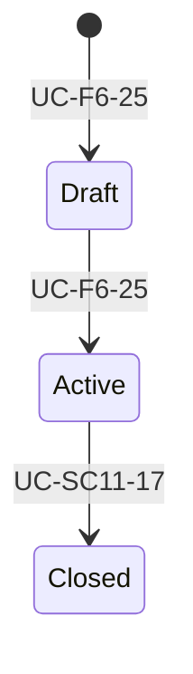

🏠 [Specs](../../../README.md) › 🧩 [Functional capabilities](../../README.md) ›
🛒 [F6 Customers and sales](../README.md) › 🗃️ [Data](README.md) › 🗃️ E-F6-18 Commission plan and target

# 🗃️ E-F6-18 Commission plan and target

**Status:** 🔄 waiting for the owner

## Purpose

Targets per rep, team or territory and the commission rules for a period.

## Fields

| Name | Type | Required | Validation | Default | Example | Personal data | Custom fields |
|---|---|---|---|---|---|---|---|
| period | dates | yes | - | - | 2027-Q1 | no | - |
| targets | per rep, team, territory | yes | - | - | Lea 180,000 EUR | no | - |
| rates and tiers | list | yes | - | - | 3 %, 5 % above target | no | - |
| base | paid, invoiced | yes | - | paid (Proposed) | paid | no | - |

## Relations

Commission lines are computed from it.

## Lifecycle

Draft, active, closed.

## Indexes and search

By period.

## Retention

5 years with pay records (Proposed).

## Audit

Changed.

## Import and export

None.

## Used by

- [UC-F6-25 Set sales targets and pay commissions](../use-cases/09-sell-on-the-road-and-steer-sales/uc-f06-25-set-sales-targets-and-pay-commissions.md)
- [UC-F6-26 Read sales and margin reports](../use-cases/09-sell-on-the-road-and-steer-sales/uc-f06-26-read-sales-and-margin-reports.md)

## Open questions

None.

---

⬅️ [E-F6-17 Invoice dispute](e-f06-17-invoice-dispute.md) · ⬆️ [Up](README.md) ·
➡️ [E-F6-19 Commission line](e-f06-19-commission-line.md)
