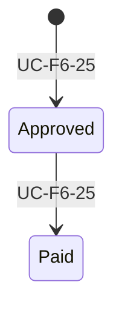

🏠 [Specs](../../../README.md) › 🧩 [Functional capabilities](../../README.md) ›
🛒 [F6 Customers and sales](../README.md) › 🗃️ [Data](README.md) › 🗃️ E-F6-19 Commission line

# 🗃️ E-F6-19 Commission line

**Status:** 🔄 waiting for the owner

## Purpose

A commission earned or reversed on an invoice for a rep.

## Fields

| Name | Type | Required | Validation | Default | Example | Personal data | Custom fields |
|---|---|---|---|---|---|---|---|
| rep | user | yes | - | - | Lea Roux | yes | - |
| invoice | invoice | yes | - | - | INV-2027-0042 | no | - |
| amount | amount | yes | - | - | 300 EUR | yes | - |
| statement | month, status | yes | - | - | January, approved | no | - |

## Relations

From a Commission plan; approved statements become pay inputs (F13).

## Lifecycle

Computed, approved, paid.

## Indexes and search

By rep and month.

## Retention

5 years (Proposed).

## Audit

Computed, reversed, approved.

## Import and export

None.

## Used by

- [UC-F6-25 Set sales targets and pay commissions](../use-cases/09-sell-on-the-road-and-steer-sales/uc-f06-25-set-sales-targets-and-pay-commissions.md)

## Open questions

None.

---

⬅️ [E-F6-18 Commission plan and target](e-f06-18-commission-plan-and-target.md) · ⬆️ [Up](README.md) ·
➡️ [E-F6-20 Lead](e-f06-20-lead.md)
