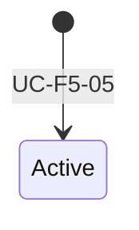

🏠 [Specs](../../../README.md) › 🧩 [Functional capabilities](../../README.md) ›
🛒 [F6 Customers and sales](../README.md) › 🗃️ [Data](README.md) › 🗃️ E-F6-20 Lead

# 🗃️ E-F6-20 Lead

**Status:** 🔄 waiting for the owner

## Purpose

(Proposed) The lead the flow charts name with the words "Lead", "leads"
([FL-F5-03](../../f05-social-media/flows/fl-f05-03-inbox-and-statistics.md),
[FL-F5-05](../../f05-social-media/flows/fl-f05-05-benchmark-additions.md),
[FL-F5-08](../../f05-social-media/flows/fl-f05-08-pages-forms-surveys-and-whatsapp.md),
[FL-F6-01](../flows/fl-f06-01-lead-to-quote.md), [FL-F6-05](../flows/fl-f06-05-benchmark-additions.md)). The owner
decided to create it ([D516](../../../06-decisions/foundations/d516-naming-rules-and-the-seven-classes-of-names.md));
what it holds waits for the owner's confirmation.

## Fields

(Proposed) To define with the owner: the flow charts name the record, not its fields.

## Relations

(Proposed) To define with the owner, from the use cases below.

## Lifecycle

## Indexes and search

(Proposed) To define with the owner.

## Retention

(Proposed) As the other records of its capability, to confirm with the owner.

## Audit

(Proposed) Every change, as the other records of its capability.

## Import and export

(Proposed) To define with the owner.

## Used by

- [UC-F5-05 Answer comments and messages](../../f05-social-media/use-cases/03-inbox-and-statistics/uc-f05-05-answer-comments-and-messages.md)
- [UC-F5-13 Turn social interactions into leads](../../f05-social-media/use-cases/05-benchmark-additions/uc-f05-13-turn-social-interactions-into-leads.md)
- [UC-F5-19 Publish a landing page with a form](../../f05-social-media/use-cases/08-pages-forms-surveys-and-whatsapp/uc-f05-19-publish-a-landing-page-with-a-form.md)
- [UC-F6-01 Capture and qualify a lead](../use-cases/01-lead-to-quote/uc-f06-01-capture-and-qualify-a-lead.md)
- [UC-F6-13 Score, assign and enrich leads](../use-cases/05-benchmark-additions/uc-f06-13-score-assign-and-enrich-leads.md)

## Open questions

(Proposed) Its fields, relations and states wait for the owner (waiting list, step 36e).

---

⬅️ [E-F6-19 Commission line](e-f06-19-commission-line.md) · ⬆️ [Up](README.md) ·
➡️ [E-F6-21 Payment reminder](e-f06-21-payment-reminder.md)
