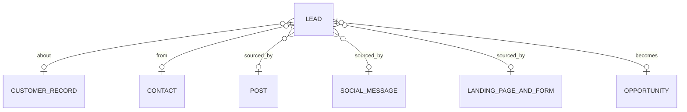
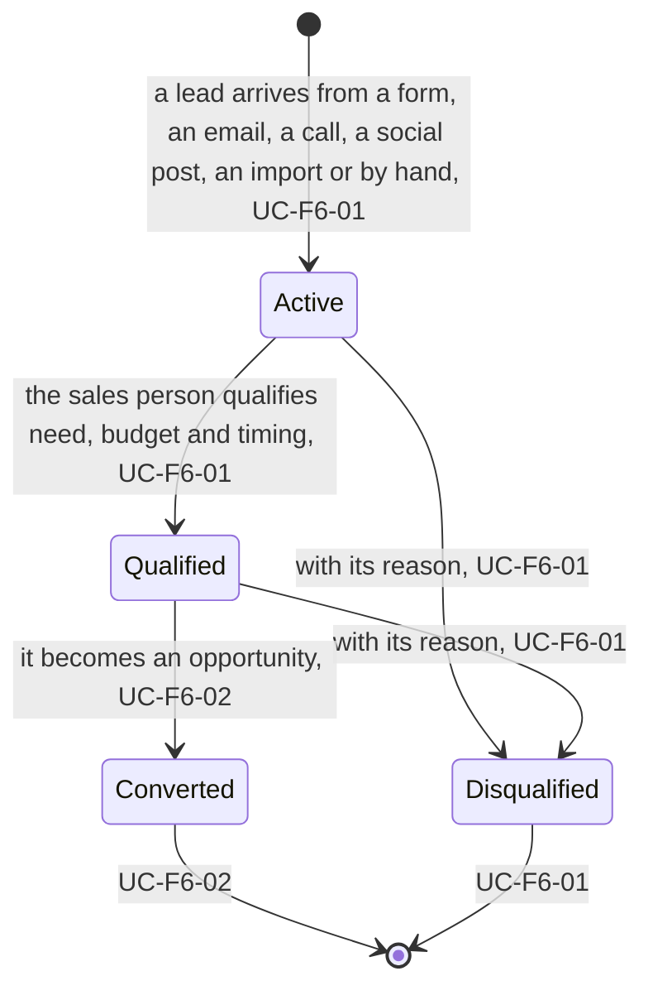

🏠 [Specs](../../../README.md) › 🧩 [Functional capabilities](../../README.md) ›
🛒 [F6 Customers and sales](../README.md) › 🗃️ [Data](README.md) › 🗃️ E-F6-20 Lead

# 🗃️ E-F6-20 Lead

**Status:** ✅ specified

## Purpose

The lead the flow charts name with the words "Lead", "leads"
([FL-F5-03](../../f05-social-media/flows/fl-f05-03-inbox-and-statistics.md),
[FL-F5-05](../../f05-social-media/flows/fl-f05-05-benchmark-additions.md),
[FL-F5-08](../../f05-social-media/flows/fl-f05-08-pages-forms-surveys-and-whatsapp.md),
[FL-F6-01](../flows/fl-f06-01-lead-to-quote.md), [FL-F6-05](../flows/fl-f06-05-benchmark-additions.md)). The owner
decided to create it ([D516](../../../06-decisions/foundations/d516-naming-rules-and-the-seven-classes-of-names.md));
its fields are derived from the specifications and confirmed by the owner (D572).

## Fields

| Name | Type | Required | Validation | Default | Example | Personal data | Custom fields |
|---|---|---|---|---|---|---|---|
| company | customer (E-F6-01) or company name | no | matched against existing companies | - | Durand SA (existing customer) | no | no |
| contact | contact (E-F5-18) | no | matched against existing contacts, never duplicated | - | J. Durand, buyer | yes | no |
| source | web form, email, call, social post, import, by hand | yes | one of the six | - | web form | no | no |
| source record | post (E-F5-01), social message (E-F5-04) or landing page and form (E-F5-13) | no | the record the lead came from | - | form "kitchen showroom" | no | no |
| need | text | no | - | - | Kitchen for 40 flats | no | no |
| budget | amount with currency | no | 0 or more | - | about 50,000 EUR | no | no |
| timing | text | no | - | - | spring 2027 | no | no |
| score | number | no | computed from past won leads (S-F6-11) | - | 82 | no | no |
| enrichment | public company data | no | from SIRENE: identifier, size, activity | - | SIREN, 12 staff, Lyon | no | no |
| assigned to | user | no | a sales person of the company | - | Léa M. | yes | no |
| disqualification reason | text | when disqualified | - | - | no budget this year | no | no |
| opportunity | opportunity (E-F6-02) | no | set when the lead is turned into one | - | Durand kitchen 40 flats | no | no |
| state | Active, Qualified, Disqualified, Converted | yes | the lifecycle below | Active | Qualified | no | no |

The title shown in the list is the company, or the contact for a person, followed by the need: "Durand Rénovation,
kitchen" ([S-F6-L20](../screens/00-lists/s-f06-l20-leads.md)). The fields come from the capture and qualification of
[UC-F6-01](../use-cases/01-lead-to-quote/uc-f06-01-capture-and-qualify-a-lead.md) (source, matching, need, budget,
timing, assignment, disqualification with its reason, the opportunity), the scoring, enrichment and assignment of
[UC-F6-13](../use-cases/05-benchmark-additions/uc-f06-13-score-assign-and-enrich-leads.md) and its mock-up of
[S-F6-11](../screens/05-benchmark-additions/s-f06-11-lead-scoring.md), the source post of
[UC-F5-13](../../f05-social-media/use-cases/05-benchmark-additions/uc-f05-13-turn-social-interactions-into-leads.md) and
[BR-F5-06](../../f05-social-media/business-rules/br-f05-06-leads-traced-through-tracked-links.md), and the form of
[UC-F5-19](../../f05-social-media/use-cases/08-pages-forms-surveys-and-whatsapp/uc-f05-19-publish-a-landing-page-with-a-form.md).
The consent a form collected is kept in
[E-F5-10](../../f05-social-media/data/e-f05-10-consent-and-suppression-record.md), never on the lead.

## Relations

- [E-F6-01 Customer record](e-f06-01-customer-record.md)
- [E-F5-18 Contact](../../f05-social-media/data/e-f05-18-contact.md)
- [E-F5-01 Post](../../f05-social-media/data/e-f05-01-post.md)
- [E-F5-04 Social message](../../f05-social-media/data/e-f05-04-social-message.md)
- [E-F5-13 Landing page and form](../../f05-social-media/data/e-f05-13-landing-page-and-form.md)
- [E-F6-02 Opportunity](e-f06-02-opportunity.md)
- [E-F5-10 Consent and suppression record](../../f05-social-media/data/e-f05-10-consent-and-suppression-record.md)

## Lifecycle

Scoring, enrichment and assignment ([UC-F6-13](../use-cases/05-benchmark-additions/uc-f06-13-score-assign-and-enrich-leads.md))
do not change the state.

## Indexes and search

Searched by the title, company and contact; filtered by state, source, score and the person assigned
([S-F6-L20](../screens/00-lists/s-f06-l20-leads.md), [S-F6-11](../screens/05-benchmark-additions/s-f06-11-lead-scoring.md)).
A new lead is matched against existing contacts and companies, and a duplicate is proposed for merge, never merged
automatically ([UC-F6-01](../use-cases/01-lead-to-quote/uc-f06-01-capture-and-qualify-a-lead.md)).

## Retention

As the other records of its capability.

## Audit

Every change, as the other records of its capability.

## Import and export

CSV import and export of the fields the user may see. A bad import file is refused with the lines in error
([UC-F6-01](../use-cases/01-lead-to-quote/uc-f06-01-capture-and-qualify-a-lead.md)); an imported line brings consent
only with its source and date
([UC-F5-15](../../f05-social-media/use-cases/06-audiences-consent-and-journeys/uc-f05-15-record-and-prove-consent.md)).

## Used by

- [UC-F5-05 Answer comments and messages](../../f05-social-media/use-cases/03-inbox-and-statistics/uc-f05-05-answer-comments-and-messages.md)
- [UC-F5-13 Turn social interactions into leads](../../f05-social-media/use-cases/05-benchmark-additions/uc-f05-13-turn-social-interactions-into-leads.md)
- [UC-F5-19 Publish a landing page with a form](../../f05-social-media/use-cases/08-pages-forms-surveys-and-whatsapp/uc-f05-19-publish-a-landing-page-with-a-form.md)
- [UC-F6-01 Capture and qualify a lead](../use-cases/01-lead-to-quote/uc-f06-01-capture-and-qualify-a-lead.md)
- [UC-F6-13 Score, assign and enrich leads](../use-cases/05-benchmark-additions/uc-f06-13-score-assign-and-enrich-leads.md)

## Open questions

None.

---

⬅️ [E-F6-19 Commission line](e-f06-19-commission-line.md) · ⬆️ [Up](README.md) ·
➡️ [E-F6-21 Payment reminder](e-f06-21-payment-reminder.md)
