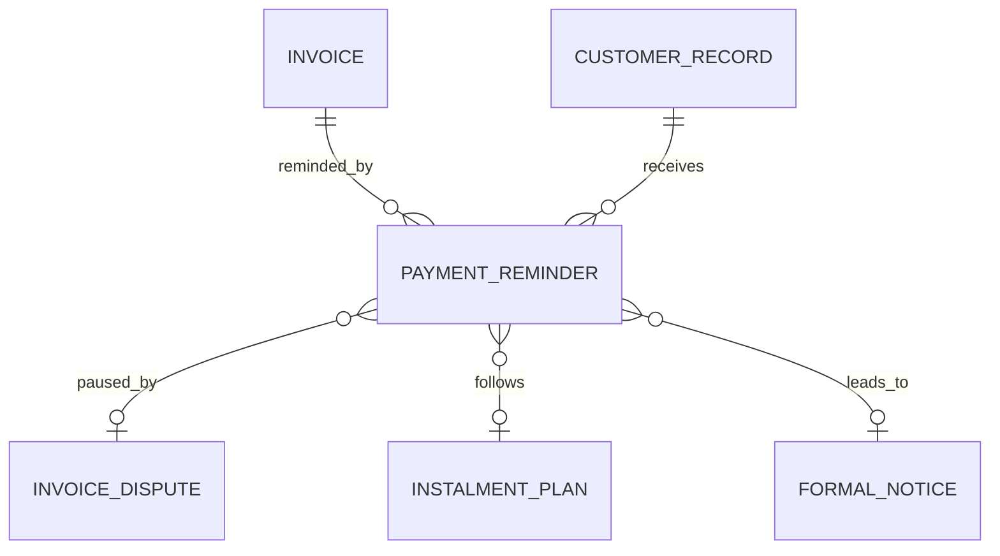
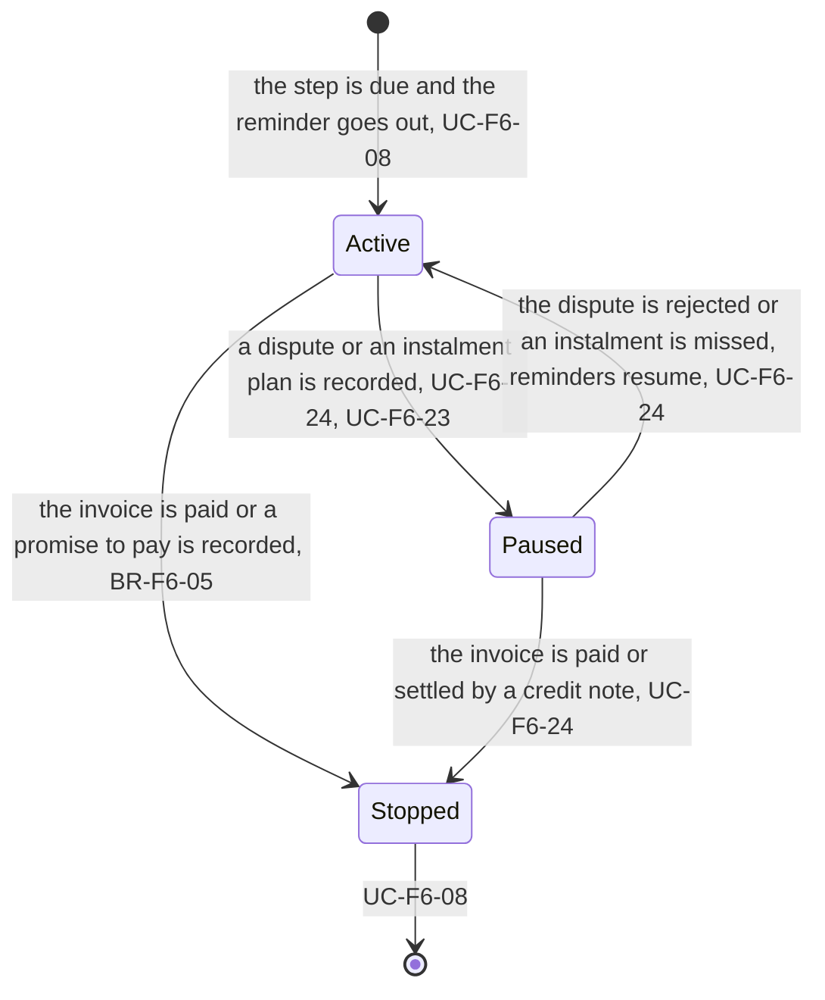

🏠 [Specs](../../../README.md) › 🧩 [Functional capabilities](../../README.md) ›
🛒 [F6 Customers and sales](../README.md) › 🗃️ [Data](README.md) › 🗃️ E-F6-21 Payment reminder

# 🗃️ E-F6-21 Payment reminder

**Status:** ✅ specified

## Purpose

The payment reminder the flow charts name with the words "Reminders", "reminders"
([FL-F6-03](../flows/fl-f06-03-invoice-and-get-paid.md), [FL-F6-08](../flows/fl-f06-08-collect-and-settle.md)). The
owner decided to create it
([D516](../../../06-decisions/foundations/d516-naming-rules-and-the-seven-classes-of-names.md)); its fields are derived
from the specifications and confirmed by the owner (D572).

## Fields

| Name | Type | Required | Validation | Default | Example | Personal data | Custom fields |
|---|---|---|---|---|---|---|---|
| invoice | invoice (E-F6-05) | yes | an issued invoice not fully paid | - | F-2026-0371 | no | no |
| customer | customer (E-F6-01) | yes | the invoice's customer | the invoice's customer | Martin SARL | no | no |
| step | number | yes | a step of the customer's reminder profile | - | 2nd | no | no |
| days late | number | yes | computed from the invoice's due date | computed | 16 | no | no |
| amount reminded | amount with currency | yes | what is due less any disputed amount (BR-F6-17) | computed | 1,154 EUR | no | no |
| late penalties and fixed fee | amount with currency | no | as the country pack sets them, the fixed fee for business customers only (CR-FR-019) | computed | late penalties and fixed recovery fee | no | no |
| channel | email, post | no | post when the email bounced | - | email | no | no |
| sent at | date and time | no | not in the future | - | 2026-11-19 08:00 | no | no |
| next step | text | no | the next step of the sequence, or none | - | Day 30: formal notice | no | no |
| state | Active, Paused, Stopped | yes | the lifecycle below | Active | Active | no | no |

The title shown in the list is the invoice and the step: "Reminder F-2026-0388, 1st"
([S-F6-L21](../screens/00-lists/s-f06-l21-payment-reminders.md)). The fields come from the sequence of
[UC-F6-08](../use-cases/03-invoice-and-get-paid/uc-f06-08-remind-late-payers.md) and
[BR-F6-05](../business-rules/br-f06-05-reminders-run-on-their-own.md) (a step before the due date, then after 7, 15 and
30 days, the penalties and the fixed fee, the post after a bounce), the pause on the disputed amount of
[UC-F6-24](../use-cases/08-collect-and-settle/uc-f06-24-handle-a-disputed-invoice.md) and
[BR-F6-17](../business-rules/br-f06-17-a-dispute-pauses-reminders-on-what-is-disputed.md), and the columns of the
automatic reminders mock-up of [S-F6-08](../screens/03-invoice-and-get-paid/s-f06-08-reminders.md) (invoice, customer,
days late, last step, next). The sequence itself is the reminder profile of the
[customer record](e-f06-01-customer-record.md); its last step is the [formal notice](e-f06-22-formal-notice.md).

## Relations

- [E-F6-05 Invoice](e-f06-05-invoice.md)
- [E-F6-01 Customer record](e-f06-01-customer-record.md): its reminder profile sets the steps.
- [E-F6-17 Invoice dispute](e-f06-17-invoice-dispute.md)
- [E-F6-16 Instalment plan](e-f06-16-instalment-plan.md)
- [E-F6-22 Formal notice](e-f06-22-formal-notice.md)

## Lifecycle

## Indexes and search

Searched by the title, invoice and customer; filtered by state, step and days late
([S-F6-L21](../screens/00-lists/s-f06-l21-payment-reminders.md),
[S-F6-08](../screens/03-invoice-and-get-paid/s-f06-08-reminders.md)).

## Retention

As the other records of its capability.

## Audit

Every change, as the other records of its capability.

## Import and export

No import: reminders are generated by the sequence. CSV or XLSX export of the fields the user may see (T3).

## Used by

- [UC-F6-08 Remind late payers](../use-cases/03-invoice-and-get-paid/uc-f06-08-remind-late-payers.md)
- [UC-F6-24 Handle a disputed invoice](../use-cases/08-collect-and-settle/uc-f06-24-handle-a-disputed-invoice.md)

## Open questions

None.

---

⬅️ [E-F6-20 Lead](e-f06-20-lead.md) · ⬆️ [Up](README.md) · ➡️ [E-F6-22 Formal notice](e-f06-22-formal-notice.md)
