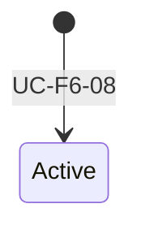

🏠 [Specs](../../../README.md) › 🧩 [Functional capabilities](../../README.md) ›
🛒 [F6 Customers and sales](../README.md) › 🗃️ [Data](README.md) › 🗃️ E-F6-21 Payment reminder

# 🗃️ E-F6-21 Payment reminder

**Status:** 🔄 waiting for the owner

## Purpose

(Proposed) The payment reminder the flow charts name with the words "Reminders", "reminders"
([FL-F6-03](../flows/fl-f06-03-invoice-and-get-paid.md), [FL-F6-08](../flows/fl-f06-08-collect-and-settle.md)). The
owner decided to create it
([D516](../../../06-decisions/foundations/d516-naming-rules-and-the-seven-classes-of-names.md)); what it holds waits for
the owner's confirmation.

## Fields

(Proposed) To define with the owner: the flow charts name the record, not its fields.

## Relations

(Proposed) To define with the owner, from the use cases below.

## Lifecycle

## Indexes and search

(Proposed) To define with the owner.

## Retention

(Proposed) As the other records of its capability, to confirm with the owner.

## Audit

(Proposed) Every change, as the other records of its capability.

## Import and export

(Proposed) To define with the owner.

## Used by

- [UC-F6-08 Remind late payers](../use-cases/03-invoice-and-get-paid/uc-f06-08-remind-late-payers.md)
- [UC-F6-24 Handle a disputed invoice](../use-cases/08-collect-and-settle/uc-f06-24-handle-a-disputed-invoice.md)

## Open questions

(Proposed) Its fields, relations and states wait for the owner (waiting list, step 36e).

---

⬅️ [E-F6-20 Lead](e-f06-20-lead.md) · ⬆️ [Up](README.md) · ➡️ [E-F6-22 Formal notice](e-f06-22-formal-notice.md)
