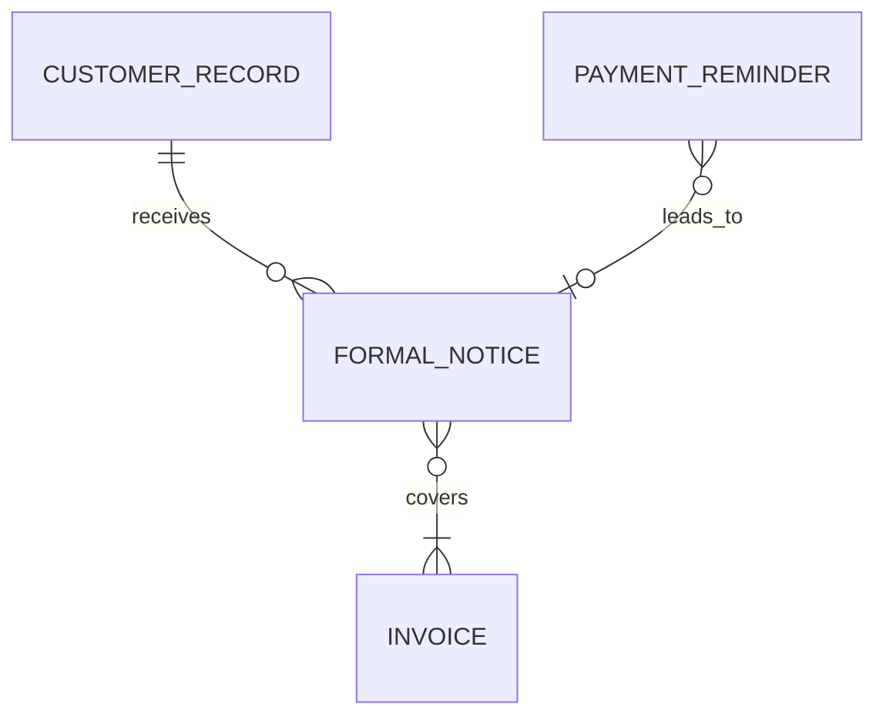
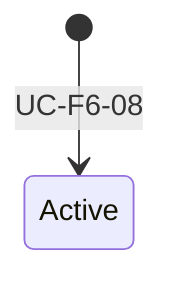

🏠 [Specs](../../../README.md) › 🧩 [Functional capabilities](../../README.md) ›
🛒 [F6 Customers and sales](../README.md) › 🗃️ [Data](README.md) › 🗃️ E-F6-22 Formal notice

# 🗃️ E-F6-22 Formal notice

**Status:** ✅ specified

## Purpose

The formal notice the flow charts name with the words "formal notice"
([FL-F6-03](../flows/fl-f06-03-invoice-and-get-paid.md)). The owner decided to create it
([D516](../../../06-decisions/foundations/d516-naming-rules-and-the-seven-classes-of-names.md)); its fields are derived
from the specifications and confirmed by the owner (D572).

## Fields

| Name | Type | Required | Validation | Default | Example | Personal data | Custom fields |
|---|---|---|---|---|---|---|---|
| customer | customer (E-F6-01) | yes | the customer of the overdue invoices | - | Durand SA | no | no |
| invoices | list of invoices (E-F6-05) | yes | issued invoices of the customer not fully paid | - | F-2026-0310 | no | no |
| amount due | amount with currency | yes | what is due less any disputed amount (BR-F6-17) | computed | 3,480 EUR | no | no |
| late penalties and fixed fee | amount with currency | no | as the country pack sets them, the fixed fee for business customers only (CR-FR-019) | computed | late penalties and fixed recovery fee | no | no |
| channel | email, post | no | post when the email bounced | - | post | no | no |
| sent at | date and time | no | not in the future | - | 2026-11-20 08:00 | no | no |
| handed over to | collection agency, court procedure | no | a person's decision, never automatic | - | collection agency | no | no |
| state | Active | yes | the lifecycle below | Active | Active | no | no |

The title shown in the list is the customer and the invoice: "Notice Durand SA, F-2026-0310"
([S-F6-L22](../screens/00-lists/s-f06-l22-formal-notices.md)). The formal notice is the last step of the reminder
sequence, sent automatically 30 days after the due date in the example of
[BR-F6-05](../business-rules/br-f06-05-reminders-run-on-their-own.md), with the legal penalties of the country pack
([UC-F6-08](../use-cases/03-invoice-and-get-paid/uc-f06-08-remind-late-payers.md), steps 2 and 3); the hand-over to a
collection agency or a court procedure is the alternative flow 3a, and the post after a bounce the error flow 2e. The
automatic reminders mock-up of [S-F6-08](../screens/03-invoice-and-get-paid/s-f06-08-reminders.md) shows it as the
last step ("Formal notice sent").

## Relations

- [E-F6-01 Customer record](e-f06-01-customer-record.md): its reminder profile sets when the notice goes out.
- [E-F6-05 Invoice](e-f06-05-invoice.md)
- [E-F6-21 Payment reminder](e-f06-21-payment-reminder.md)

## Lifecycle

## Indexes and search

Searched by the title, customer and invoice; filtered by state and date sent
([S-F6-L22](../screens/00-lists/s-f06-l22-formal-notices.md)).

## Retention

As the other records of its capability.

## Audit

Every change, as the other records of its capability.

## Import and export

No import: notices are generated by the sequence. CSV or XLSX export of the fields the user may see (T3).

## Used by

- [UC-F6-08 Remind late payers](../use-cases/03-invoice-and-get-paid/uc-f06-08-remind-late-payers.md)

## Open questions

None.

---

⬅️ [E-F6-21 Payment reminder](e-f06-21-payment-reminder.md) · ⬆️ [Up](README.md) ·
➡️ [E-F6-23 Partner](e-f06-23-partner.md)
