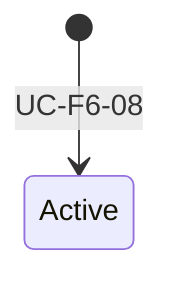

🏠 [Specs](../../../README.md) › 🧩 [Functional capabilities](../../README.md) ›
🛒 [F6 Customers and sales](../README.md) › 🗃️ [Data](README.md) › 🗃️ E-F6-22 Formal notice

# 🗃️ E-F6-22 Formal notice

**Status:** 🔄 waiting for the owner

## Purpose

(Proposed) The formal notice the flow charts name with the words "formal notice"
([FL-F6-03](../flows/fl-f06-03-invoice-and-get-paid.md)). The owner decided to create it
([D516](../../../06-decisions/foundations/d516-naming-rules-and-the-seven-classes-of-names.md)); what it holds waits for
the owner's confirmation.

## Fields

(Proposed) To define with the owner: the flow charts name the record, not its fields.

## Relations

(Proposed) To define with the owner, from the use cases below.

## Lifecycle

## Indexes and search

(Proposed) To define with the owner.

## Retention

(Proposed) As the other records of its capability, to confirm with the owner.

## Audit

(Proposed) Every change, as the other records of its capability.

## Import and export

(Proposed) To define with the owner.

## Used by

- [UC-F6-08 Remind late payers](../use-cases/03-invoice-and-get-paid/uc-f06-08-remind-late-payers.md)

## Open questions

(Proposed) Its fields, relations and states wait for the owner (waiting list, step 36e).

---

⬅️ [E-F6-21 Payment reminder](e-f06-21-payment-reminder.md) · ⬆️ [Up](README.md) ·
➡️ [E-F6-23 Partner](e-f06-23-partner.md)
