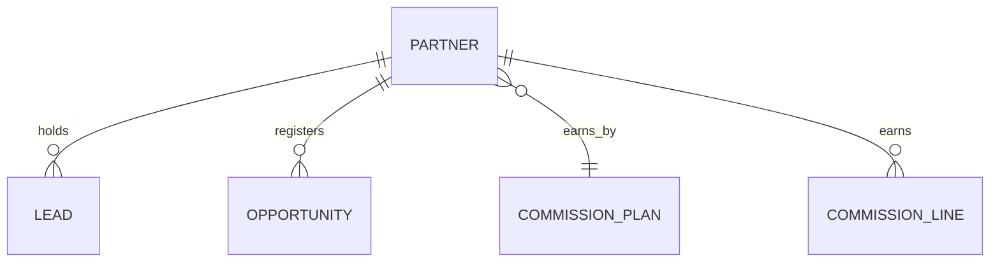
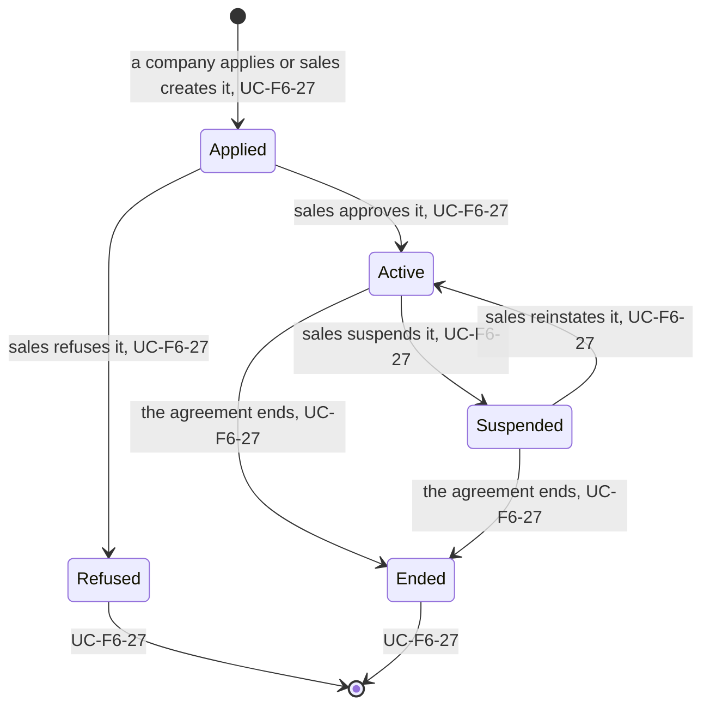

🏠 [Specs](../../../README.md) › 🧩 [Functional capabilities](../../README.md) ›
🛒 [F6 Customers and sales](../README.md) › 🗃️ [Data](README.md) › 🗃️ E-F6-23 Partner

# 🗃️ E-F6-23 Partner

**Status:** ✅ specified

## Purpose

A partner company of the programme: its tier, territory, plan, portal user and the leads and deals it holds
([D525](../../../06-decisions/f06-customers-and-sales/d525-benchmark-gaps-f06-customers-and-sales.md)).

## Fields

| Name | Type | Required | Validation | Default | Example | Personal data | Custom fields |
|---|---|---|---|---|---|---|---|
| name | text | yes | unique per company | - | Nord Distribution | no | no |
| legal identifiers | list of company identifiers (E-F6-24) | yes | at least one valid identifier | - | SIREN 552 081 317 | no | no |
| tier | registered, silver, gold | yes | one of the three | registered | gold | no | no |
| territory | list of text | no | regions or countries | none | Hauts-de-France | no | no |
| commission plan | commission plan (E-F6-18) | yes | a plan of the company | the tier's plan | Gold 5 percent | no | no |
| protection period | days | no | 1 to 365 | 90 | 90 | no | no |
| portal user | user | no | an external user of the partner | - | Anne B. | yes | no |
| state | Applied, Active, Refused, Suspended, Ended | yes | the lifecycle below | Applied | Active | no | no |
| owner | user | yes | a user of the company | the creator | Claire P. | yes | no |

## Relations

- [E-F6-20 Lead](e-f06-20-lead.md)
- [E-F6-02 Opportunity](e-f06-02-opportunity.md)
- [E-F6-18 Commission plan and target](e-f06-18-commission-plan-and-target.md)
- [E-F6-19 Commission line](e-f06-19-commission-line.md)

## Lifecycle

## Indexes and search

By name, tier, territory, state and revenue.

## Retention

Kept 10 years after the end of the agreement, as accounting records
([CR-FR-002](../../../10-country-packs/france/accounting/cr-fr-002-accounting-records-kept-ten-years.md)); the portal
user is erased at the end.

## Audit

Every change of tier, plan, state and territory, with who, when, the old and the new value.

## Import and export

Import partners from a CSV; export the partners and their commissions as a CSV.

## Used by

- [UC-F6-27](../use-cases/10-partners-contracts-and-warranties/uc-f06-27-run-a-partner-programme.md)

## Open questions

None.

---

⬅️ [E-F6-22 Formal notice](e-f06-22-formal-notice.md) · ⬆️ [Up](README.md) ·
➡️ [E-F6-24 Company identifier](e-f06-24-company-identifier.md)
