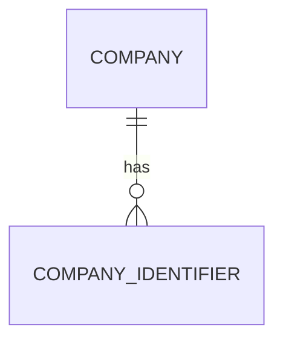
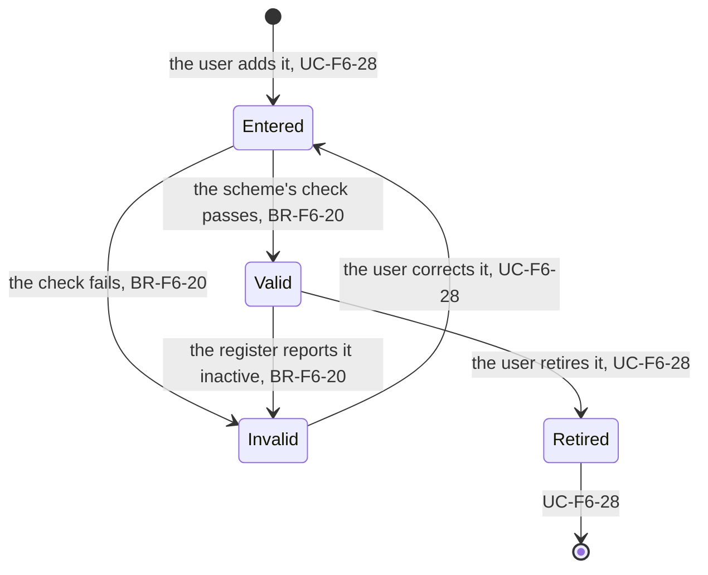

🏠 [Specs](../../../README.md) › 🧩 [Functional capabilities](../../README.md) ›
🛒 [F6 Customers and sales](../README.md) › 🗃️ [Data](README.md) › 🗃️ E-F6-24 Company identifier

# 🗃️ E-F6-24 Company identifier

**Status:** ✅ specified

## Purpose

One identifier of a company, with its scheme, its check and its uses
([D525](../../../06-decisions/f06-customers-and-sales/d525-benchmark-gaps-f06-customers-and-sales.md)).

## Fields

| Name | Type | Required | Validation | Default | Example | Personal data | Custom fields |
|---|---|---|---|---|---|---|---|
| company | customer, supplier or partner | yes | an existing company | - | Bois et Fils | no | no |
| scheme | list | yes | a scheme of the country pack | - | VAT number | no | no |
| value | text | yes | valid for the scheme | - | FR12552081317 | no | no |
| checked on | date | no | not in the future | - | 2026-11-14 | no | no |
| check detail | text | no | - | - | active in the VAT register | no | no |
| default for | list of uses | no | invoice, e-invoice, customs, filing | none | invoice | no | no |
| valid from, to | two dates | no | from before to | - | 2019-01-01, - | no | no |
| state | Entered, Valid, Invalid, Retired | yes | the lifecycle below | Entered | Valid | no | no |
| owner | user | yes | a user of the company | the creator | Claire P. | yes | no |

## Relations

- [E-F6-01 Customer record](e-f06-01-customer-record.md)
- [E-F6-23 Partner](e-f06-23-partner.md)

## Lifecycle

## Indexes and search

By company, scheme, value, state and date of the last check.

## Retention

Kept as long as the company exists and 10 years after its last invoice
([CR-FR-002](../../../10-country-packs/france/accounting/cr-fr-002-accounting-records-kept-ten-years.md)).

## Audit

Every identifier added, changed, checked and retired, with who or what, when and the result.

## Import and export

Import identifiers from a CSV with company, scheme and value; export them with their check.

## Used by

- [UC-F6-28](../use-cases/10-partners-contracts-and-warranties/uc-f06-28-keep-several-identifiers-per-company.md)

## Open questions

None.

---

⬅️ [E-F6-23 Partner](e-f06-23-partner.md) · ⬆️ [Up](README.md) ·
➡️ [E-F6-25 Frame contract](e-f06-25-frame-contract.md)
