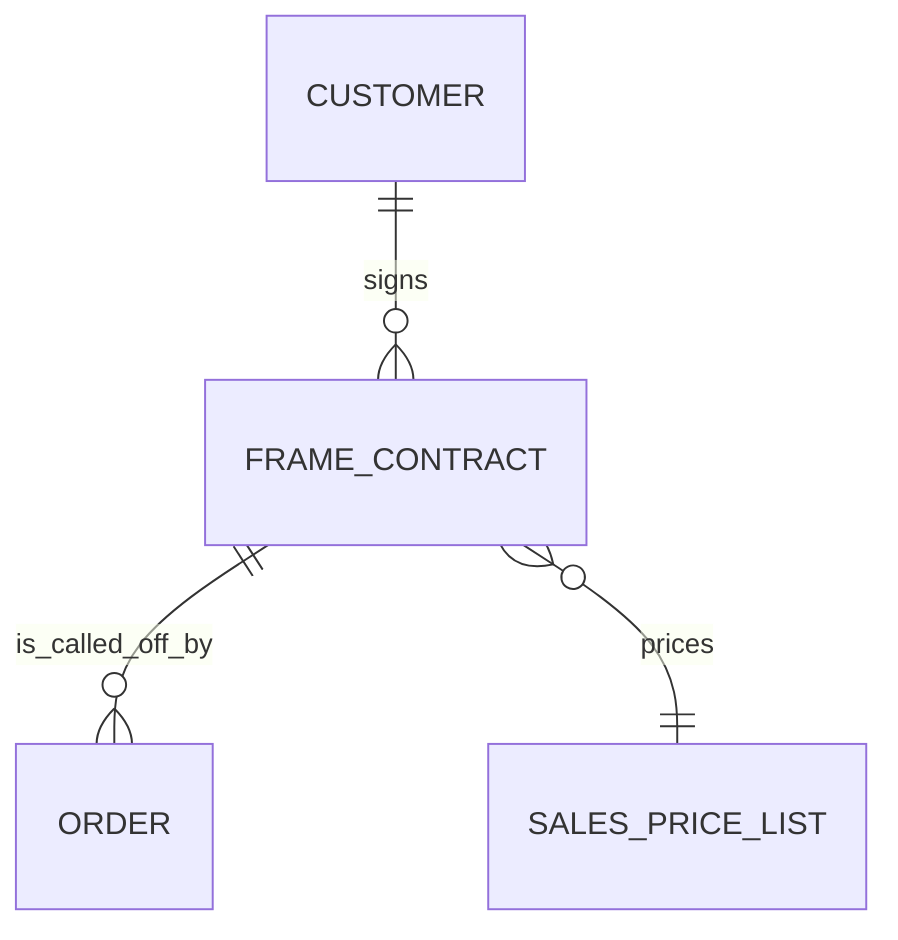
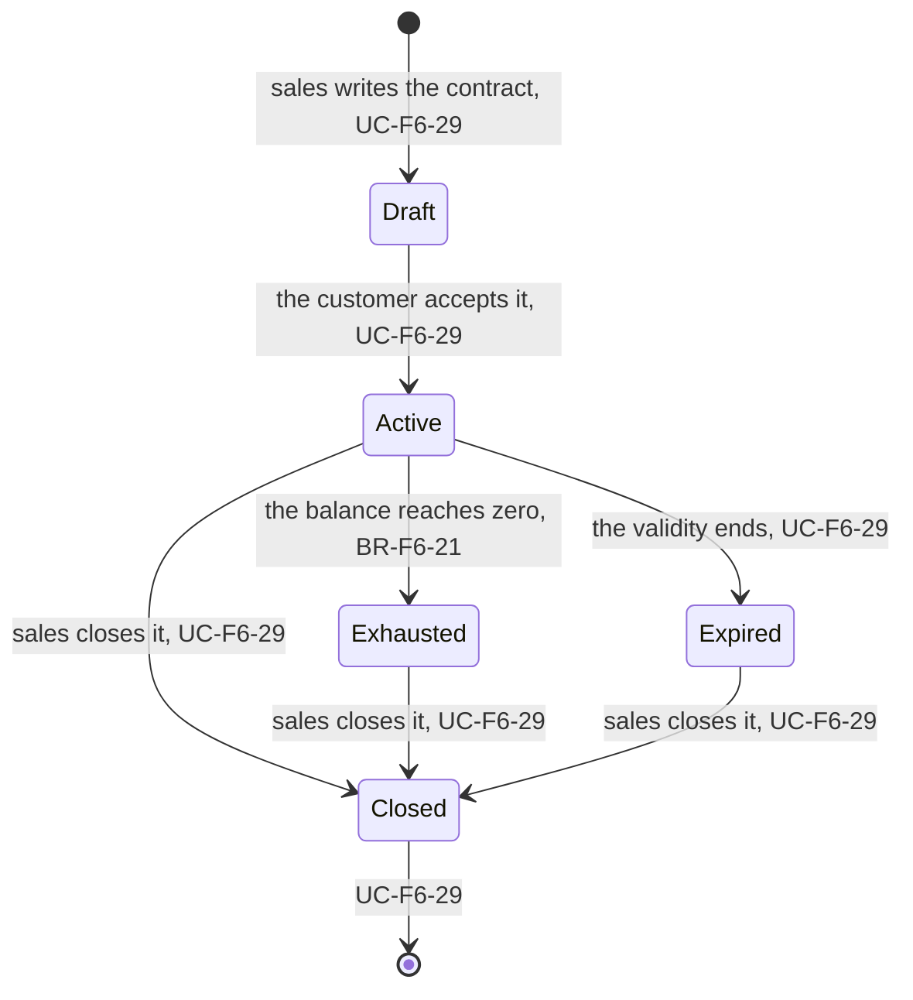

🏠 [Specs](../../../README.md) › 🧩 [Functional capabilities](../../README.md) ›
🛒 [F6 Customers and sales](../README.md) › 🗃️ [Data](README.md) › 🗃️ E-F6-25 Frame contract

# 🗃️ E-F6-25 Frame contract

**Status:** ✅ specified

## Purpose

A frame contract: the agreed prices, the commitment over a period and the balance left
([D525](../../../06-decisions/f06-customers-and-sales/d525-benchmark-gaps-f06-customers-and-sales.md)).

## Fields

| Name | Type | Required | Validation | Default | Example | Personal data | Custom fields |
|---|---|---|---|---|---|---|---|
| number | text | yes | unique | generated | FC-2027-04 | no | no |
| customer | customer (E-F6-01) | yes | an active customer | - | Bois et Fils | no | no |
| valid from, to | two dates | yes | from before to | - | 2027-01-01, 2027-12-31 | no | no |
| lines | list of item, agreed price, committed quantity | yes | at least one line | - | oak plank, 12.00 EUR, 1,000 | no | no |
| committed amount | amount with currency | no | computed from the lines | computed | 12,000 EUR | no | no |
| called off | number | no | 0 up to the commitment unless approved | 0 | 200 | no | no |
| balance | number | no | committed minus called off | committed | 800 | no | no |
| price above balance | agreed or list | no | one of the two | list | list | no | no |
| state | Draft, Active, Exhausted, Expired, Closed | yes | the lifecycle below | Draft | Active | no | no |
| owner | user | yes | a user of the company | the creator | Claire P. | yes | no |

## Relations

- [E-F6-01 Customer record](e-f06-01-customer-record.md)
- [E-F6-04 Order](e-f06-04-order.md)
- [E-F6-08 Sales price list](e-f06-08-sales-price-list.md)

## Lifecycle

## Indexes and search

By number, customer, validity, state and balance.

## Retention

Kept 10 years after it closes, with the orders it produced
([CR-FR-002](../../../10-country-packs/france/accounting/cr-fr-002-accounting-records-kept-ten-years.md)).

## Audit

Every contract change, acceptance, call-off, approval above the balance and closing, with who and when.

## Import and export

Export the contract with its call-offs as a CSV or a PDF; no import.

## Used by

- [UC-F6-29](../use-cases/10-partners-contracts-and-warranties/uc-f06-29-agree-a-frame-contract-and-call-off-orders.md)

## Open questions

None.

---

⬅️ [E-F6-24 Company identifier](e-f06-24-company-identifier.md) · ⬆️ [Up](README.md) ·
➡️ [E-F6-26 Solvency report](e-f06-26-solvency-report.md)
