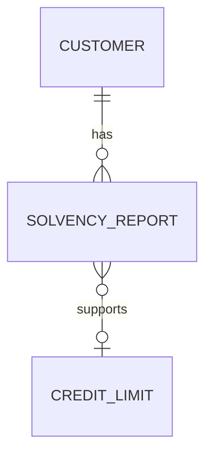
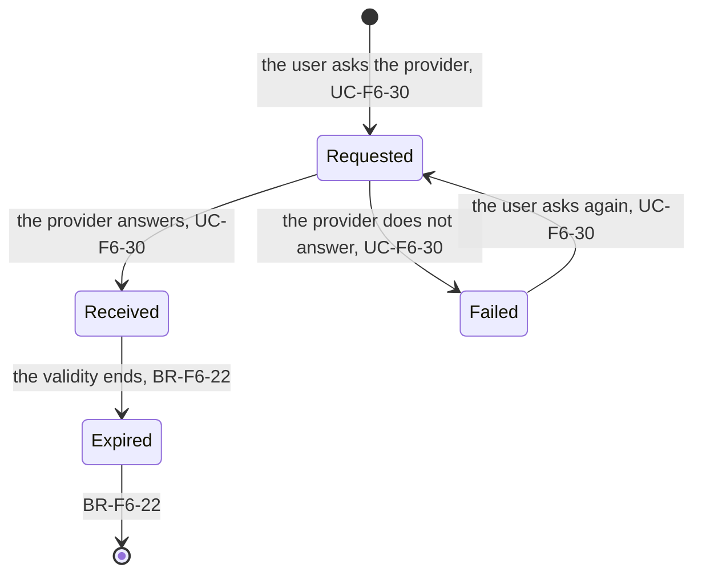

🏠 [Specs](../../../README.md) › 🧩 [Functional capabilities](../../README.md) ›
🛒 [F6 Customers and sales](../README.md) › 🗃️ [Data](README.md) › 🗃️ E-F6-26 Solvency report

# 🗃️ E-F6-26 Solvency report

**Status:** ✅ specified

## Purpose

A solvency report on a customer: provider, score, recommended limit and validity
([D525](../../../06-decisions/f06-customers-and-sales/d525-benchmark-gaps-f06-customers-and-sales.md)).

## Fields

| Name | Type | Required | Validation | Default | Example | Personal data | Custom fields |
|---|---|---|---|---|---|---|---|
| customer | customer (E-F6-01) | yes | an active customer | - | Bois et Fils | no | no |
| provider | text | yes | a connected provider | - | CreditInfo | no | no |
| identifier used | company identifier (E-F6-24) | yes | a valid identifier | - | SIREN 552081317 | no | no |
| score | number | no | 0 to 10 | - | 7 | no | no |
| recommended limit | amount with currency | no | 0 or more | - | 15,000 EUR | no | no |
| reasons | text | no | - | - | paid on time 11 of 12 invoices | yes | no |
| received on | date | no | not in the future | - | 2026-11-14 | no | no |
| valid until | date | no | after received on | 90 days later | 2027-02-12 | no | no |
| state | Requested, Received, Failed, Expired | yes | the lifecycle below | Requested | Received | no | no |
| owner | user | yes | a user of the company | the creator | Claire P. | yes | no |

## Relations

- [E-F6-01 Customer record](e-f06-01-customer-record.md)
- [E-F6-12 Credit limit](e-f06-12-credit-limit.md)

## Lifecycle

## Indexes and search

By customer, provider, state, score and validity.

## Retention

Kept 3 years after the last use; the reasons of a report on a sole trader are erased when the report expires.

## Audit

Every request, answer and use of a report, with who, when and the limit it supported.

## Import and export

No import. The report is exported as the provider's PDF with the customer record.

## Used by

- [UC-F6-30](../use-cases/10-partners-contracts-and-warranties/uc-f06-30-check-a-customers-solvency.md)

## Open questions

None.

---

⬅️ [E-F6-25 Frame contract](e-f06-25-frame-contract.md) · ⬆️ [Up](README.md) ·
➡️ [E-F6-27 Warranty](e-f06-27-warranty.md)
