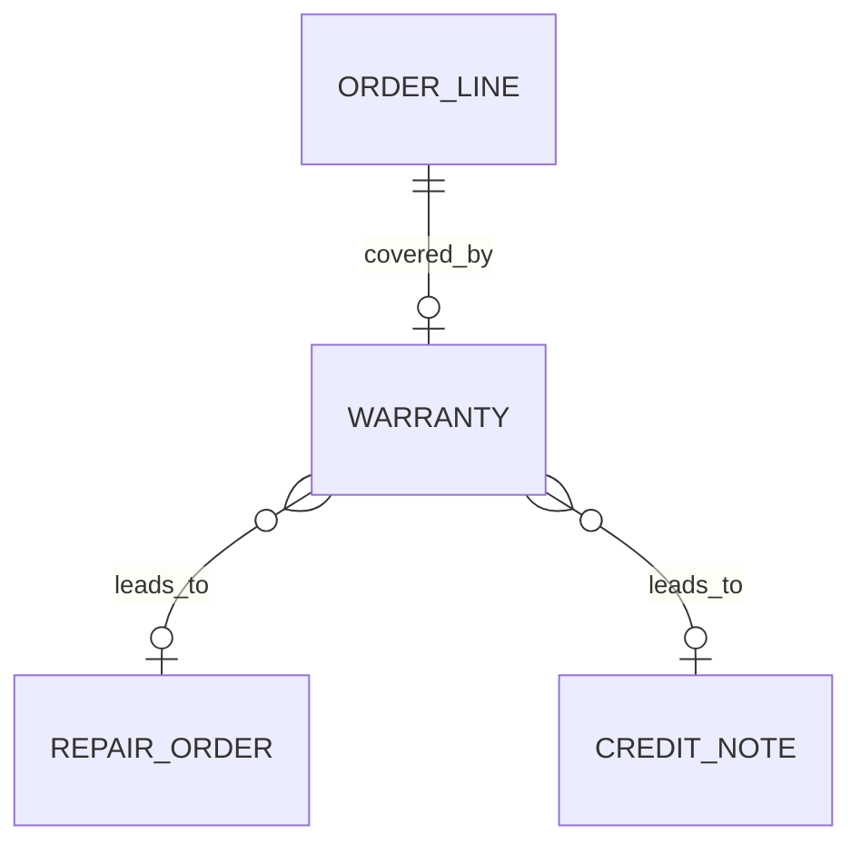
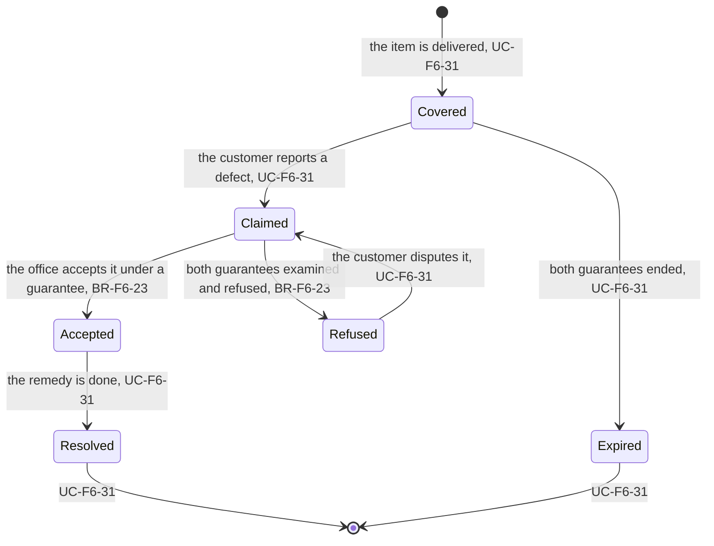

🏠 [Specs](../../../README.md) › 🧩 [Functional capabilities](../../README.md) ›
🛒 [F6 Customers and sales](../README.md) › 🗃️ [Data](README.md) › 🗃️ E-F6-27 Warranty

# 🗃️ E-F6-27 Warranty

**Status:** ✅ specified

## Purpose

The warranty of a delivered item and the claims made on it: the two guarantees, the decision and the remedy
([D525](../../../06-decisions/f06-customers-and-sales/d525-benchmark-gaps-f06-customers-and-sales.md)).

## Fields

| Name | Type | Required | Validation | Default | Example | Personal data | Custom fields |
|---|---|---|---|---|---|---|---|
| order line | order (E-F6-04) line | yes | a delivered line | - | SO-2290 line 1 | no | no |
| item and serial | item and text | yes | an item of the order | - | Oak table, T-44 | no | no |
| customer | customer (E-F6-01) | yes | the order's customer | - | Karim D. | yes | no |
| delivered on | date | yes | from the delivery note | - | 2026-09-12 | no | no |
| legal guarantee ends | date | yes | from the delivery date and the country pack | computed | 2028-09-12 | no | no |
| commercial warranty ends | date | no | after delivered on | from the price list | 2027-09-12 | no | no |
| claim | text and images | no | - | - | scratched top, 3 photos | yes | no |
| guarantee applied | legal, commercial or none | no | one of the three | - | legal | no | no |
| remedy | repair, replace, price reduction, refund | no | one of the four | - | replace | no | no |
| state | Covered, Claimed, Accepted, Refused, Resolved, Expired | yes | the lifecycle below | Covered | Claimed | no | no |
| owner | user | yes | a user of the company | the creator | Claire P. | yes | no |

## Relations

- [E-F6-04 Order](e-f06-04-order.md)
- [E-F7-14 Repair order](../../f07-purchasing-and-stock/data/e-f07-14-repair-order.md)
- [E-F6-05 Invoice](e-f06-05-invoice.md)

## Lifecycle

## Indexes and search

By customer, item, serial, state and the end of each guarantee.

## Retention

Kept 5 years after the end of the legal guarantee, with the claim and its photos.

## Audit

Every claim, decision, remedy and refusal with the guarantees examined, who and when.

## Import and export

No import. A claim is exported as a PDF for the customer.

## Used by

- [UC-F6-31](../use-cases/10-partners-contracts-and-warranties/uc-f06-31-handle-a-warranty-claim.md)

## Open questions

None.

---

⬅️ [E-F6-26 Solvency report](e-f06-26-solvency-report.md) · ⬆️ [Up](README.md)
