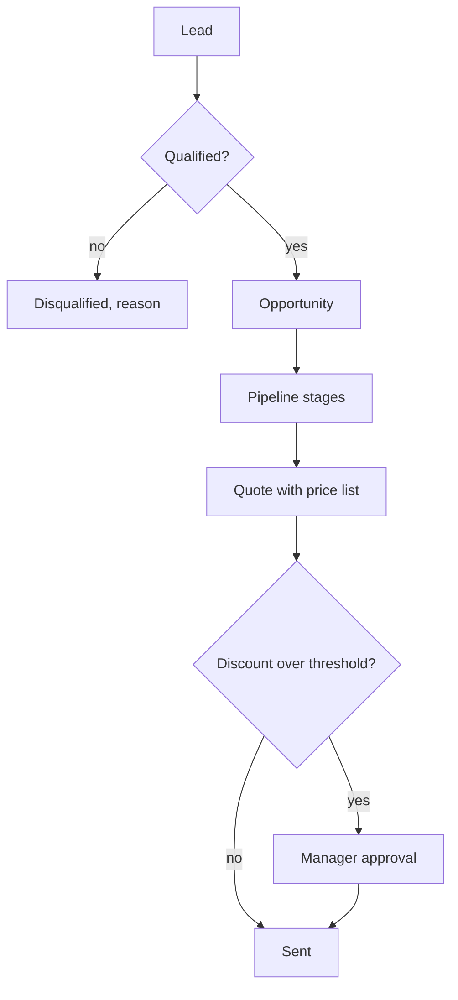

🏠 [Specs](../../../README.md) › 🧩 [Functional capabilities](../../README.md) ›
🛒 [F6 Customers and sales](../README.md) › 🔀 [Flows](README.md) › 🔀 FL-F6-01 Lead to quote

# 🔀 FL-F6-01 Lead to quote

**Status:** ✅ specified

## Summary

Covers UC-F6-01, UC-F6-02, UC-F6-03, UC-F6-12.

## Personas

See each use case.

## Flowchart

## Sequence diagram

See each use case.

## Steps

| Step | Persona | Screen | Use case | What happens |
|---|---|---|---|---|
| 1 | See [UC-F6-01](../use-cases/01-lead-to-quote/uc-f06-01-capture-and-qualify-a-lead.md) | [S-F6-02](../screens/01-lead-to-quote/s-f06-02-lead.md) | [UC-F6-01](../use-cases/01-lead-to-quote/uc-f06-01-capture-and-qualify-a-lead.md) | Capture and qualify a lead |
| 2 | See [UC-F6-02](../use-cases/01-lead-to-quote/uc-f06-02-manage-the-pipeline-and-forecast.md) | [S-F6-01](../screens/01-lead-to-quote/s-f06-01-pipeline.md) | [UC-F6-02](../use-cases/01-lead-to-quote/uc-f06-02-manage-the-pipeline-and-forecast.md) | Manage the pipeline and forecast |
| 3 | See [UC-F6-03](../use-cases/01-lead-to-quote/uc-f06-03-create-and-send-a-quote.md) | [S-F6-03](../screens/01-lead-to-quote/s-f06-03-quote-editor.md) | [UC-F6-03](../use-cases/01-lead-to-quote/uc-f06-03-create-and-send-a-quote.md) | Create and send a quote |
| 4 | See [UC-F6-12](../use-cases/01-lead-to-quote/uc-f06-12-manage-price-lists-and-discounts.md) | [S-F6-10](../screens/01-lead-to-quote/s-f06-10-price-lists.md) | [UC-F6-12](../use-cases/01-lead-to-quote/uc-f06-12-manage-price-lists-and-discounts.md) | Manage price lists and discounts |

### Entities and screens

| Entity | States in this flow | Shown at step and screen | Aggregated view |
|---|---|---|---|
| [E-F6-20 Lead](../data/e-f06-20-lead.md) | Active | 1 [S-F6-02](../screens/01-lead-to-quote/s-f06-02-lead.md) | Leads |
| [E-F6-02 Opportunity](../data/e-f06-02-opportunity.md) | Active | 1 [S-F6-02](../screens/01-lead-to-quote/s-f06-02-lead.md); 2 [S-F6-01](../screens/01-lead-to-quote/s-f06-01-pipeline.md) | Opportunities |
| [E-F6-03 Quote](../data/e-f06-03-quote.md) | Draft, To approve, Sent | 3 [S-F6-03](../screens/01-lead-to-quote/s-f06-03-quote-editor.md) | Quotes |
| [E-F6-08 Sales price list](../data/e-f06-08-sales-price-list.md) | Active | 3 [S-F6-03](../screens/01-lead-to-quote/s-f06-03-quote-editor.md); 4 [S-F6-10](../screens/01-lead-to-quote/s-f06-10-price-lists.md) | Sales price lists |

## Errors

As each use case.

## Images

Every step and error, for each persona taking part, in light and dark mode (D120). Steps are numbered as in the Steps
table; E rows are the error cases.

| Step | Persona | Device | Light | Dark |
|---|---|---|---|---|
| 1 | U03 | desktop | [light](../images/01-lead-to-quote/u03-sales/1-capture-and-qualify-desktop-light.png) | [dark](../images/01-lead-to-quote/u03-sales/1-capture-and-qualify-desktop-dark.png) |
| 2 | U03 | desktop | [light](../images/01-lead-to-quote/u03-sales/2-pipeline-desktop-light.png) | [dark](../images/01-lead-to-quote/u03-sales/2-pipeline-desktop-dark.png) |
| 3 | U03 | desktop | [light](../images/01-lead-to-quote/u03-sales/3-quote-desktop-light.png) | [dark](../images/01-lead-to-quote/u03-sales/3-quote-desktop-dark.png) |
| 3 | U03 | phone | [light](../images/01-lead-to-quote/u03-sales/3-quote-phone-light.png) | [dark](../images/01-lead-to-quote/u03-sales/3-quote-phone-dark.png) |
| 4 | U02 | desktop | [light](../images/01-lead-to-quote/u02-manager/4-price-lists-desktop-light.png) | [dark](../images/01-lead-to-quote/u02-manager/4-price-lists-desktop-dark.png) |
| E1 | U03 | desktop | [light](../images/01-lead-to-quote/u03-sales/e1-discount-needs-approval-desktop-light.png) | [dark](../images/01-lead-to-quote/u03-sales/e1-discount-needs-approval-desktop-dark.png) |
| E1 | U03 | phone | [light](../images/01-lead-to-quote/u03-sales/e1-discount-needs-approval-phone-light.png) | [dark](../images/01-lead-to-quote/u03-sales/e1-discount-needs-approval-phone-dark.png) |
| E1 | U03 | tablet | [light](../images/01-lead-to-quote/u03-sales/e1-discount-needs-approval-tablet-light.png) | [dark](../images/01-lead-to-quote/u03-sales/e1-discount-needs-approval-tablet-dark.png) |

## Open questions

None.

---

⬆️ [Up](README.md) · ➡️ [FL-F6-02 Quote to order](fl-f06-02-quote-to-order.md)
