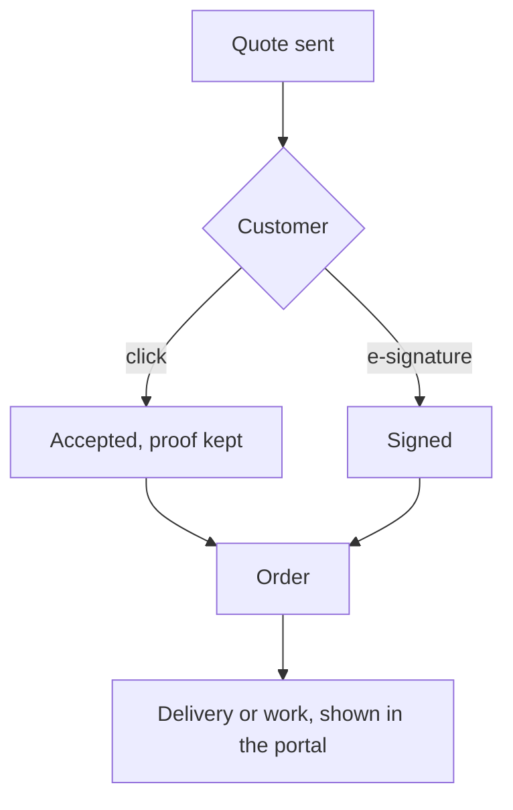

🏠 [Specs](../../../README.md) › 🧩 [Functional capabilities](../../README.md) ›
🛒 [F6 Customers and sales](../README.md) › 🔀 [Flows](README.md) › 🔀 FL-F6-02 Quote to order

# 🔀 FL-F6-02 Quote to order

**Status:** ✅ specified

## Summary

Covers UC-F6-04, UC-F6-05, UC-F6-11.

## Personas

See each use case.

## Flowchart

## Sequence diagram

See each use case.

## Steps

| Step | Persona | Screen | Use case | What happens |
|---|---|---|---|---|
| 1 | See [UC-F6-04](../use-cases/02-quote-to-order/uc-f06-04-accept-or-sign-a-quote.md) | [S-F6-04](../screens/02-quote-to-order/s-f06-04-customer-portal.md) | [UC-F6-04](../use-cases/02-quote-to-order/uc-f06-04-accept-or-sign-a-quote.md) | Accept or sign a quote |
| 2 | See [UC-F6-05](../use-cases/02-quote-to-order/uc-f06-05-turn-a-quote-into-an-order-and-follow-it.md) | [S-F6-05](../screens/02-quote-to-order/s-f06-05-order.md) | [UC-F6-05](../use-cases/02-quote-to-order/uc-f06-05-turn-a-quote-into-an-order-and-follow-it.md) | Turn a quote into an order and follow it |
| 3 | See [UC-F6-11](../use-cases/02-quote-to-order/uc-f06-11-use-the-customer-portal.md) | [S-F6-04](../screens/02-quote-to-order/s-f06-04-customer-portal.md) | [UC-F6-11](../use-cases/02-quote-to-order/uc-f06-11-use-the-customer-portal.md) | Use the customer portal |

### Entities and screens

| Entity | States in this flow | Shown at step and screen | Aggregated view |
|---|---|---|---|
| [E-F6-03 Quote](../data/e-f06-03-quote.md) | Draft, To approve, Sent, Accepted | 1, 3 [S-F6-04](../screens/02-quote-to-order/s-f06-04-customer-portal.md) | Quotes |
| [E-F6-04 Order](../data/e-f06-04-order.md) | Open, In progress, Cancelled, Done | 2 [S-F6-05](../screens/02-quote-to-order/s-f06-05-order.md) | Orders |
| [E-F7-04 Transfer](../../f07-purchasing-and-stock/data/e-f07-04-transfer.md) | Sent | Shown elsewhere: [S-F10-25 Store stock and transfers](../../f10-point-of-sale/screens/10-clienteling-transfers-and-tax-free/s-f10-25-store-stock-and-transfers.md) | Transfers |
| [E-F9-18 Project and task](../../f09-hr-and-projects/data/e-f09-18-project-and-task.md) | New, Planned, Active, Delivered, Done | Shown elsewhere: [S-F9-17 Projects](../../f09-hr-and-projects/screens/06-plan-and-deliver-work/s-f09-17-projects.md) | Project and tasks |
| [E-F1-17 Portal account](../../f01-administration/data/e-f01-17-portal-account.md) | Invited, Active, Blocked, Deactivated | Shown elsewhere: [S-F1-19 Portal accounts](../../f01-administration/screens/12-portal-accounts-and-integrations/s-f01-19-portal-accounts.md) | Portal accounts |

## Errors

As each use case.

## Images

Every step and error, for each persona taking part, in light and dark mode (D120). Steps are numbered as in the Steps
table; E rows are the error cases.

| Step | Persona | Device | Light | Dark |
|---|---|---|---|---|
| 1 | U09 | phone | [light](../images/02-quote-to-order/u09-customer/1-accept-in-portal-phone-light.png) | [dark](../images/02-quote-to-order/u09-customer/1-accept-in-portal-phone-dark.png) |
| 2 | U03 | desktop | [light](../images/02-quote-to-order/u03-sales/2-order-desktop-light.png) | [dark](../images/02-quote-to-order/u03-sales/2-order-desktop-dark.png) |
| 3 | U09 | phone | [light](../images/02-quote-to-order/u09-customer/3-portal-phone-light.png) | [dark](../images/02-quote-to-order/u09-customer/3-portal-phone-dark.png) |
| E1 | U09 | phone | [light](../images/02-quote-to-order/u09-customer/e1-quote-expired-phone-light.png) | [dark](../images/02-quote-to-order/u09-customer/e1-quote-expired-phone-dark.png) |

## Open questions

None.

---

⬅️ [FL-F6-01 Lead to quote](fl-f06-01-lead-to-quote.md) · ⬆️ [Up](README.md) ·
➡️ [FL-F6-03 Invoice and get paid](fl-f06-03-invoice-and-get-paid.md)
