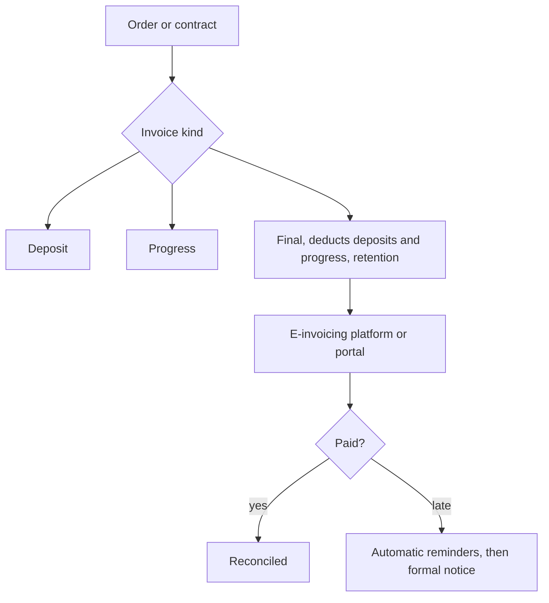

🏠 [Specs](../../../README.md) › 🧩 [Functional capabilities](../../README.md) ›
🛒 [F6 Customers and sales](../README.md) › 🔀 [Flows](README.md) › 🔀 FL-F6-03 Invoice and get paid

# 🔀 FL-F6-03 Invoice and get paid

**Status:** ✅ specified

## Summary

Covers UC-F6-06, UC-F6-07, UC-F6-08, UC-F6-09.

## Personas

See each use case.

## Flowchart

## Sequence diagram

See each use case.

## Steps

| Step | Persona | Screen | Use case | What happens |
|---|---|---|---|---|
| 1 | See [UC-F6-06](../use-cases/03-invoice-and-get-paid/uc-f06-06-invoice-deposits-progress-and-final.md) | [S-F6-06](../screens/03-invoice-and-get-paid/s-f06-06-invoice.md) | [UC-F6-06](../use-cases/03-invoice-and-get-paid/uc-f06-06-invoice-deposits-progress-and-final.md) | Invoice: deposits, progress and final |
| 2 | See [UC-F6-07](../use-cases/03-invoice-and-get-paid/uc-f06-07-get-paid-online-and-reconcile.md) | [S-F6-07](../screens/03-invoice-and-get-paid/s-f06-07-payments-and-reconciliation.md) | [UC-F6-07](../use-cases/03-invoice-and-get-paid/uc-f06-07-get-paid-online-and-reconcile.md) | Get paid online and reconcile |
| 3 | See [UC-F6-08](../use-cases/03-invoice-and-get-paid/uc-f06-08-remind-late-payers.md) | [S-F6-08](../screens/03-invoice-and-get-paid/s-f06-08-reminders.md) | [UC-F6-08](../use-cases/03-invoice-and-get-paid/uc-f06-08-remind-late-payers.md) | Remind late payers |
| 4 | See [UC-F6-09](../use-cases/03-invoice-and-get-paid/uc-f06-09-credit-note-and-refund.md) | [S-F6-06](../screens/03-invoice-and-get-paid/s-f06-06-invoice.md) | [UC-F6-09](../use-cases/03-invoice-and-get-paid/uc-f06-09-credit-note-and-refund.md) | Credit note and refund |

### Entities and screens

| Entity | States in this flow | Shown at step and screen | Aggregated view |
|---|---|---|---|
| [E-F6-04 Order](../data/e-f06-04-order.md) | Open, In progress, Cancelled, Done | Shown elsewhere: [S-F6-05 Order](../screens/02-quote-to-order/s-f06-05-order.md) | Orders |
| [E-F6-07 Subscription contract](../data/e-f06-07-subscription-contract.md) | Active | Shown elsewhere: [S-F6-09 Subscriptions](../screens/04-subscriptions/s-f06-09-subscriptions.md) | Subscription contracts |
| [E-F6-05 Invoice](../data/e-f06-05-invoice.md) | Sent, Received, Paid | 1, 4 [S-F6-06](../screens/03-invoice-and-get-paid/s-f06-06-invoice.md); 3 [S-F6-08](../screens/03-invoice-and-get-paid/s-f06-08-reminders.md) | Invoices |
| [E-F6-21 Payment reminder](../data/e-f06-21-payment-reminder.md) | Active | 3 [S-F6-08](../screens/03-invoice-and-get-paid/s-f06-08-reminders.md) | Payment reminders |
| [E-F6-22 Formal notice](../data/e-f06-22-formal-notice.md) | Active | 3 [S-F6-08](../screens/03-invoice-and-get-paid/s-f06-08-reminders.md) | Formal notices |

## Errors

As each use case.

## Images

Every step and error, for each persona taking part, in light and dark mode (D120). Steps are numbered as in the Steps
table; E rows are the error cases.

| Step | Persona | Device | Light | Dark |
|---|---|---|---|---|
| 1 | U05 | desktop | [light](../images/03-invoice-and-get-paid/u05-accounting/1-final-invoice-desktop-light.png) | [dark](../images/03-invoice-and-get-paid/u05-accounting/1-final-invoice-desktop-dark.png) |
| 2 | U05 | desktop | [light](../images/03-invoice-and-get-paid/u05-accounting/2-payments-desktop-light.png) | [dark](../images/03-invoice-and-get-paid/u05-accounting/2-payments-desktop-dark.png) |
| 3 | U05 | desktop | [light](../images/03-invoice-and-get-paid/u05-accounting/3-automatic-reminders-desktop-light.png) | [dark](../images/03-invoice-and-get-paid/u05-accounting/3-automatic-reminders-desktop-dark.png) |
| 4 | U05 | desktop | [light](../images/03-invoice-and-get-paid/u05-accounting/4-credit-note-desktop-light.png) | [dark](../images/03-invoice-and-get-paid/u05-accounting/4-credit-note-desktop-dark.png) |
| E1 | U05 | desktop | [light](../images/03-invoice-and-get-paid/u05-accounting/e1-platform-refused-desktop-light.png) | [dark](../images/03-invoice-and-get-paid/u05-accounting/e1-platform-refused-desktop-dark.png) |

## Open questions

None.

---

⬅️ [FL-F6-02 Quote to order](fl-f06-02-quote-to-order.md) · ⬆️ [Up](README.md) ·
➡️ [FL-F6-04 Subscriptions](fl-f06-04-subscriptions.md)
